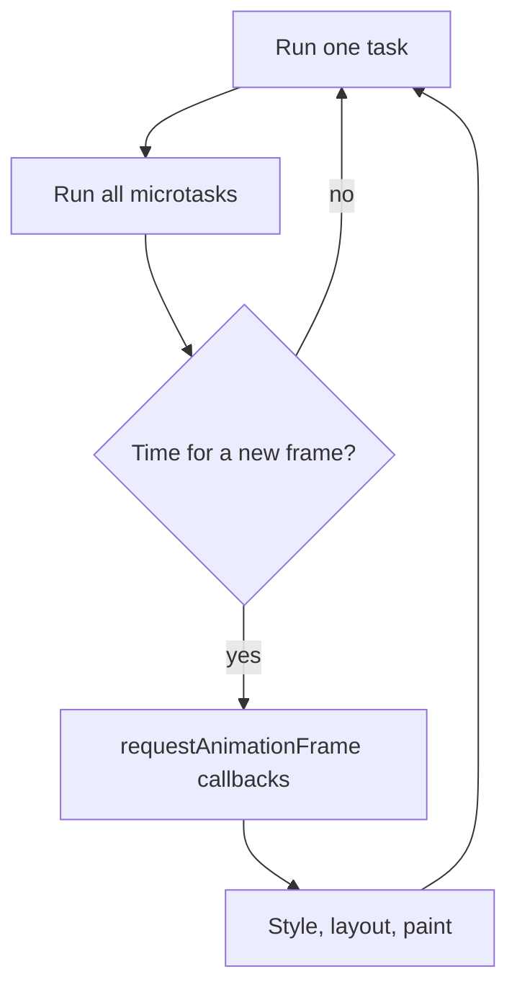

## In one line
The browser's event loop runs one task at a time on a single thread, empties the whole microtask queue after each task, and only then gets a chance to update the screen.

## The problem it solves
JavaScript in a web page runs on one **thread**: a single line of work that can do only one thing at a time. That same thread also handles clicks and, between your code, draws the page.

So the browser needs a strict rule for "what runs next". Without knowing that rule, you get bugs like these on a shop admin page:

- You show an "Importing products..." spinner, then process 20,000 rows. The spinner never appears. The page freezes, then jumps straight to "Done".
- A promise callback runs before a `setTimeout(fn, 0)` you scheduled earlier, and your code reads data that is not ready yet.

The **event loop** is that rule. It is also behind one of the most common interview puzzles: "In what order do these `console.log` lines print?"

## Everyday analogy
A single cashier at a shop counter. Customers wait in the main line: those are **tasks**. While serving one customer, the cashier may promise small follow-ups, like "I'll staple your receipt". Those go on a sticky-note list: **microtasks**.

The rule: serve one customer, then finish **every** sticky note, including notes added while doing notes. Only then does the cashier glance up and tidy the display window (repaint the screen), and call the next customer.

Where it breaks down: a real cashier might pause a slow customer to help someone else. The event loop never interrupts a running task, so one slow task makes everyone wait.

## How it works
Some terms first:

- The **call stack** is the list of functions currently running. When it is empty, the current piece of JavaScript has finished.
- A **task** (often called a **macrotask**) is a unit of work the browser queues: running a script, a click handler, a `setTimeout` callback, a `postMessage` message.
- A **microtask** is a smaller follow-up that must run as soon as the current JavaScript finishes: a promise `.then` callback, the code after an `await`, `queueMicrotask(fn)`, and `MutationObserver` callbacks.
- **Rendering** here means turning the page's current state into pixels: recalculating styles, working out positions (**layout**), and drawing (**paint**). See [How the browser renders a page](#/topic/critical-rendering-path).

One turn of the loop:

1. **Pick one task** from a task queue (the browser may prioritize, for example user input) and run it until the call stack is empty.
2. **Drain the microtask queue.** Run every microtask. If a microtask queues another microtask, that runs too, before anything else.
3. **Maybe render.** If it is time for a new frame, run `requestAnimationFrame` callbacks, then style, layout, and paint. On a 60 Hz screen that is roughly every 16.7 ms. The browser can skip rendering if nothing changed or the tab is hidden.
4. **Go back to step 1.**


*Notice: the screen can only update between tasks, and never while microtasks remain.*

Three consequences follow directly:

- **Microtasks always beat the next task.** A promise callback runs before a `setTimeout(fn, 0)`, even if the timeout was scheduled first.
- **`setTimeout(fn, 0)` means "not before 0 ms", not "now".** It queues a task, which waits behind everything else. Browsers also clamp nested timers to at least 4 ms after 5 levels, and throttle timers in background tabs.
- **Long JavaScript freezes the page.** While a task runs, no clicks are handled and nothing is painted. Any task over 50 ms counts as a **long task** and is a common cause of a slow-feeling page.

## Real example

**1. The ordering puzzle.** Predict the output before reading it. Works the same in a browser console or in Node.js 18 or later (`node order.mjs`).

```js
console.log('A: script starts');

setTimeout(() => console.log('B: setTimeout callback'), 0);

Promise.resolve().then(() => console.log('C: promise.then'));

(async () => {
  console.log('D: async function, before await');
  await null;                    // everything after this line becomes a microtask
  console.log('E: async function, after await');
})();

queueMicrotask(() => console.log('F: queueMicrotask'));

console.log('G: script ends');
```

```text
A: script starts
D: async function, before await
G: script ends
C: promise.then
E: async function, after await
F: queueMicrotask
B: setTimeout callback
```

Why: the whole script is one task, so the synchronous lines `A`, `D`, `G` run first (an `async` function runs synchronously until its first `await`). Then the microtasks run in the order they were queued: `C`, `E`, `F`. Only then does the loop pick the next task, the timer: `B`.

**2. Fixing the frozen import.** An admin uploads a CSV with thousands of products, and the page validates them in the browser. Doing it in one loop is one long task, so the progress bar never moves. Splitting the work into batches and yielding between them gives the browser a chance to paint and handle clicks.

```js
// Give control back to the event loop, so it can paint and handle input.
function yieldToBrowser() {
  if (globalThis.scheduler?.yield) return scheduler.yield(); // where supported
  return new Promise((resolve) => setTimeout(resolve, 0));   // a new task, anywhere
}

async function importProducts(rows) {
  const progress = document.querySelector('#import-progress'); // a <progress> element
  const BATCH_SIZE = 200;

  for (let start = 0; start < rows.length; start += BATCH_SIZE) {
    const batch = rows.slice(start, start + BATCH_SIZE);
    batch.forEach(validateAndNormalize);            // your per-row CPU work

    progress.value = Math.min(start + BATCH_SIZE, rows.length);
    await yieldToBrowser();                          // end this task here
  }
}
```

Note that `await Promise.resolve()` would **not** help. That only queues a microtask, and the browser cannot render until the microtask queue is empty. You need a new **task**, which is what `setTimeout` or `scheduler.yield()` gives you. `scheduler.yield()` is not available in every browser yet, hence the fallback.

## How to say it in an interview

> [!INTERVIEW]
> **30 seconds:** "JavaScript in the browser runs on one thread, and the event loop decides what runs next. It takes one task, like a click handler or a timer callback, runs it to completion, then runs every microtask, like promise callbacks and code after `await`. Only after that can the browser render a frame. So promise callbacks always run before a `setTimeout` of zero, and a long synchronous task freezes the page."

> [!INTERVIEW]
> **2 minutes:** Start with the 30-second answer, then add:
>
> "This matters for real performance. While a task runs, the browser can't respond to clicks or paint. Anything over 50 milliseconds is a long task, and that's what hurts Interaction to Next Paint, Google's responsiveness metric.
>
> For example, if an admin page validates 20,000 rows in one loop, the progress bar never updates. I'd split it into batches and yield between them with `setTimeout` or `scheduler.yield()`, which creates a new task so the browser can paint in between. A promise wouldn't help, because microtasks run before rendering.
>
> The tradeoff with yielding is that the total job takes slightly longer, because other work runs in between. If the work is really heavy, I'd move it to a Web Worker, which runs on a separate thread. And on the server, Node.js has a similar loop but with its own phases, plus `process.nextTick` and `setImmediate`, so the details differ."

## Follow-up questions interviewers ask

<details>
<summary>Can microtasks block rendering?</summary>

Yes. The browser drains the microtask queue completely before it can render, including microtasks added during the drain. A promise chain that keeps scheduling more promise callbacks forever will freeze the page just like an infinite `while` loop. Timers cannot do this, because each timer is a separate task with a chance to render between them.

</details>

<details>
<summary>Where does requestAnimationFrame fit?</summary>

`requestAnimationFrame(fn)` runs `fn` right before the browser's next paint, as part of the rendering step. It is the right place for visual updates such as animations, because your change lands exactly once per frame. A `setTimeout` loop is not aligned with frames and can run too often or too late.

</details>

<details>
<summary>How is the browser event loop different from Node.js?</summary>

The core idea is the same: one JavaScript thread, tasks, and microtasks drained between them. The differences:

- Node has no rendering step.
- Node's loop has named **phases**, such as timers, poll (waiting for I/O), and check (`setImmediate` callbacks).
- Node adds `process.nextTick`, a queue that runs even before promise microtasks.

See [The Node.js event loop](#/topic/event-loop).

</details>

<details>
<summary>If JavaScript is single-threaded, how does fetch run in the background?</summary>

Your JavaScript is single-threaded. The browser is not. When you call `fetch`, the browser's networking code does the download on other threads. When the response arrives, the browser queues work on the event loop to settle the promise, and your `.then` or `await` code continues as a microtask. Your code only runs on the one thread, but the waiting happens elsewhere.

</details>

<details>
<summary>How do you keep heavy work from freezing the UI?</summary>

Three options, from simplest to strongest:

1. **Break it into chunks** and yield between them with `setTimeout` or `scheduler.yield()`.
2. **Do less work**: paginate, virtualize long lists (only render visible rows), or move the work to the server.
3. **Use a Web Worker**: a separate JavaScript thread with no access to the page's elements. It sends results back with messages. Good for parsing large files or heavy calculations.

</details>

## Common mistakes and misconceptions

> [!MISTAKE]
> "`setTimeout(fn, 0)` runs immediately." No. It queues a task, which runs after the current script, all microtasks, and possibly a render. It is a minimum delay, not a promise of timing.

> [!MISTAKE]
> "Promises run in parallel, on another thread." No. A promise callback runs on the same main thread, just later. Only the waiting (network, timers) happens elsewhere.

> [!MISTAKE]
> "`await` pauses the whole page." No. It pauses only that `async` function. The rest of its code is queued as a microtask, and the event loop keeps running other work.

> [!MISTAKE]
> "Show a spinner, then do heavy work, and the spinner will appear." Not if both happen in the same task. The DOM changes, but nothing is painted until the task and its microtasks finish. Yield to a new task first.

## Tradeoffs: when NOT to use it
"It" here is leaning on event loop tricks like `setTimeout(fn, 0)` and microtask ordering:

- **Don't use `setTimeout(fn, 0)` to "fix" ordering bugs.** If code needs data, `await` the promise that provides it.
- **Don't rely on exact ordering between different task sources.** Browsers may prioritize input over timers, and the order between, say, a network callback and a timer is not something to build on. Only the microtask-before-next-task rule is solid.
- **Don't chunk work that belongs in a Web Worker.** Yielding keeps the page responsive but still uses the main thread. A long CPU job, such as parsing a 50 MB file, belongs on a worker.
- **Don't chunk work that should not be in the browser at all.** Validating 20,000 product rows is often better done on the server, in a background job, with the browser just uploading the file. See [Why background jobs exist](#/topic/background-jobs).

## Check yourself

<details>
<summary>1. `setTimeout(a, 0); Promise.resolve().then(b);` Which runs first, and why?</summary>

`b`. Promise callbacks are microtasks, and the microtask queue is emptied as soon as the current script finishes. The timer callback `a` is a task, so it waits for the next turn of the loop.

</details>

<details>
<summary>2. You set a "Loading..." message, then run a 2-second loop. Why does the message never show?</summary>

Both happen in the same task. The browser can only paint between tasks, and by then the loop has finished and the message has probably been replaced. Yield to a new task (for example `await new Promise((r) => setTimeout(r, 0))`) after setting the message, or move the work off the main thread.

</details>

<details>
<summary>3. Name two sources of microtasks and two sources of tasks.</summary>

Microtasks: promise `.then`/`.catch`/`.finally` callbacks, code after `await`, `queueMicrotask`, `MutationObserver`. Tasks: `setTimeout`/`setInterval` callbacks, user events like clicks and key presses, `postMessage` messages, and running a `<script>`.

</details>

## Go deeper
- [MDN: In depth: microtasks and the JavaScript runtime environment](https://developer.mozilla.org/en-US/docs/Web/API/HTML_DOM_API/Microtask_guide/In_depth)
- [web.dev: Optimize long tasks](https://web.dev/articles/optimize-long-tasks)
- [HTML Standard: event loops](https://html.spec.whatwg.org/multipage/webappapis.html#event-loops)
