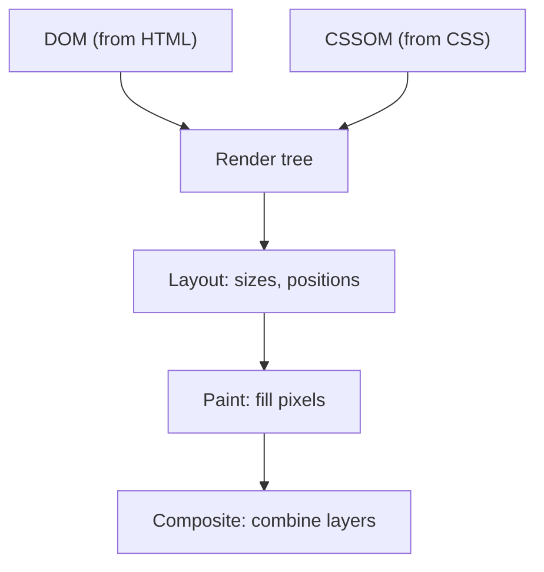

## In one line
The critical rendering path is the sequence of steps a browser takes to turn HTML, CSS, and JavaScript into pixels on the screen: build the DOM and CSSOM, combine them, work out the layout, then paint.

## The problem it solves
Your product page at `shop.example.com/products/42` has a fast server: the HTML arrives in 100 ms. Yet users stare at a white screen for two seconds. The server is not the problem. The browser is waiting.

To fix that, you need to know what the browser does between receiving bytes and showing pixels, and which files make it **wait**. That sequence is the **critical rendering path**: "critical" because the first paint cannot happen until it completes.

It also explains why some UI updates are smooth and others make the page stutter. Interviewers ask it as the second half of "what happens when you type a URL" (see [What happens when you type a URL](#/topic/url-to-page)).

## Everyday analogy
Building a house from plans. The HTML is the list of rooms and what is in them. The CSS is the interior designer's style guide. Before anyone can decorate, you need both: you cannot paint a wall until you know which wall exists and what colour it should be. Then you measure every room (layout) and finally paint (paint).

Where it breaks down: a house is built once. A web page can be re-measured and repainted many times a second, every time JavaScript changes something.

## How it works
Some terms first:

- **HTML** describes the content and structure of a page. **CSS** describes how it looks. **JavaScript** adds behaviour.
- **Parsing** means reading text and turning it into a structure a program can work with.
- A **pixel** is one dot of colour on the screen.

The steps:

1. **Build the DOM.** The browser parses the HTML into the **DOM** (Document Object Model): a tree of objects, one per element, such as `<body>` containing `<h1>` and ``. JavaScript reads and changes the page through the DOM. Parsing is incremental: the browser builds the tree as bytes arrive.
2. **Build the CSSOM.** Every stylesheet is parsed into the **CSSOM** (CSS Object Model), a tree of style rules. CSS is **render-blocking**: the browser will not show the page until the CSS in the `<head>` is downloaded and parsed. Otherwise you would see unstyled content flash and then jump.
3. **Run scripts.** A plain `<script src>` is **parser-blocking**: the HTML parser stops, downloads the script, and runs it, because the script might change the DOM. If a stylesheet is still loading, the script also waits for it, because the script might read styles.
4. **Build the render tree.** The browser combines the DOM and CSSOM into the **render tree**: only the elements that will be visible, each with its final computed styles. An element with `display: none` is left out.
5. **Layout** (also called **reflow**). The browser calculates the exact size and position of every box on the screen, based on the **viewport** (the visible area of the browser window). Change the width of one element and its neighbours may move, so layout can be expensive.
6. **Paint.** The browser fills in the pixels: text, colours, borders, images, shadows. It often paints into several separate **layers**.
7. **Composite.** The layers are combined, in the right order, into the final image on screen, often using the **GPU** (the graphics chip). Animating `transform` or `opacity` can be done here alone, skipping layout and paint.


*Notice: nothing can be painted until both trees exist, which is why slow CSS delays the whole page.*

**After the first paint**, the same pipeline runs again on every change. What you change decides how much of it runs:

| You change | Steps that run again |
|---|---|
| `width`, `top`, font size, adding elements | Layout, paint, composite |
| `color`, `background` | Paint, composite |
| `transform`, `opacity` | Composite only (often) |

That table is why smooth animations use `transform` instead of `left` or `top`.

## Real example
**1. Loading the product page without blocking.**

```html
<head>
  <!-- CSS in the head: render-blocking, so keep it small -->
  <link rel="stylesheet" href="/css/main.css">

  <!-- defer: download in parallel, run after the HTML is parsed, in order -->
  <script src="/js/app.js" defer></script>

  <!-- async: download in parallel, run as soon as it arrives, in any order -->
  <script src="https://analytics.example.com/tag.js" async></script>
</head>
<body>
  <!-- The main image: fetch it first, and reserve its space so nothing jumps -->
  
</body>
```

The three ways to load a script:

| Attribute | Downloading blocks parsing? | When it runs |
|---|---|---|
| none | Yes | Immediately, pausing the parser |
| `defer` | No | After parsing finishes, in document order |
| `async` | No | As soon as it downloads, in any order |

Use `defer` for your app code, which usually depends on the page and on other scripts. Use `async` for independent scripts like analytics. Scripts with `type="module"` are deferred by default.

**2. Avoiding layout thrashing in JavaScript.** Reading a layout value like `offsetHeight` forces the browser to calculate layout right now, if any styles changed since the last layout. Mixing reads and writes in a loop forces a layout on every iteration. This is called **layout thrashing**.

```js
const cards = [...document.querySelectorAll('.product-card')];

// Bad: write, then read, in every iteration -> a forced layout each time
const heightsSlow = cards.map((card) => {
  card.style.width = '300px';   // write: invalidates layout
  return card.offsetHeight;     // read: forces layout right now
});

// Better: all the writes, then all the reads -> one layout in total
cards.forEach((card) => { card.style.width = '300px'; });
const heights = cards.map((card) => card.offsetHeight);
```

To see this in a real page, open Chrome DevTools, go to the **Performance** panel, and record a page load. Purple "Layout" blocks and long "Evaluate Script" blocks show you where the time goes.

## How to say it in an interview

> [!INTERVIEW]
> **30 seconds:** "The browser parses HTML into the DOM and CSS into the CSSOM, combines them into a render tree of visible elements, then runs layout to compute sizes and positions, paints the pixels, and composites the layers onto the screen. CSS blocks rendering, and normal scripts block HTML parsing, so to get a fast first paint I keep critical CSS small and load scripts with `defer` or `async`."

> [!INTERVIEW]
> **2 minutes:** Start with the 30-second answer, then add:
>
> "The same pipeline runs again after the page loads, whenever something changes. Changing geometry, like width or position, triggers layout and paint. Changing colour skips layout. Changing `transform` or `opacity` can often be done by the compositor alone, which is why smooth animations use them.
>
> For example, if a product page has a fast backend but users still see a blank screen, I'd check for a large CSS file and synchronous scripts in the head. The fixes are inlining the small CSS needed for the top of the page, deferring scripts, and giving the main product image high fetch priority.
>
> The tradeoff is that inlining CSS makes every HTML response bigger and that CSS can't be cached separately, so I only inline the small critical part. And deferring too much can cause a flash of content before it becomes interactive."

## Follow-up questions interviewers ask

<details>
<summary>What is the difference between reflow and repaint?</summary>

**Reflow** (layout) recalculates sizes and positions. It happens when geometry changes: width, height, font size, adding or removing elements. **Repaint** redraws pixels without changing geometry, for example a new background colour. Reflow is usually more expensive, because moving one element can move many others, and it is always followed by a repaint.

</details>

<details>
<summary>Why is CSS render-blocking but images are not?</summary>

Without CSS, the browser would show unstyled content and then restyle it, causing a jarring flash. So it waits. An image only fills a box. The browser can lay out and paint the page and show the image when it arrives (ideally with a set width and height so nothing jumps).

</details>

<details>
<summary>What is the preload scanner?</summary>

While the main parser is blocked by a script, browsers run a lightweight **preload scanner** that looks ahead in the raw HTML for `<link>`, `<script>`, and `` tags and starts downloading them early. That is why resources declared in the HTML load faster than ones injected later by JavaScript, which the scanner cannot see.

</details>

<details>
<summary>What does "critical CSS" mean?</summary>

The small set of CSS rules needed to style what is visible without scrolling ("above the fold"). Inlining it in a `<style>` tag in the HTML lets the first paint happen without waiting for a separate CSS download. The rest of the CSS is loaded afterwards. It helps most on slow mobile networks.

</details>

<details>
<summary>How does this relate to React?</summary>

React updates the DOM, and then the browser runs the same layout, paint, and composite steps. A client-rendered React app has an extra cost before any of that: the browser must download and run the JavaScript bundle before there is anything in the DOM to render. That is one reason server rendering exists. See [SSR, SSG, CSR, and Server Components](#/topic/rendering-strategies).

</details>

## Common mistakes and misconceptions

> [!MISTAKE]
> "`async` and `defer` are the same." Both download without blocking parsing. `defer` runs after parsing, in order. `async` runs as soon as it arrives, in any order, which can break scripts that depend on each other.

> [!MISTAKE]
> "`display: none` and `visibility: hidden` are the same." An element with `display: none` is not in the render tree and takes no space. `visibility: hidden` is still laid out and takes up space; it just isn't painted.

> [!MISTAKE]
> "Putting scripts at the bottom of the body is the modern best practice." It works, but the download only starts when the parser reaches it. `defer` in the `<head>` starts the download early and still runs after parsing.

> [!MISTAKE]
> "The DOM is the same as the HTML source." The DOM is the live tree built from it. The browser fixes broken HTML while parsing, and JavaScript can change the DOM at any time, so the two often differ.

## Tradeoffs: when NOT to use it
"It" here means optimizing the rendering path by hand:

- **Don't inline all your CSS.** Inlined CSS is downloaded again with every page and cannot be cached separately. Inline only the small critical part.
- **Don't preload or prioritize everything.** `<link rel="preload">` and `fetchpriority="high"` tell the browser "this matters most". Use them for one or two late-discovered or key files (a web font, the main image), or you slow down the ones that really matter.
- **Don't promote everything to its own layer** (for example with `will-change: transform` on every element). Each layer uses GPU memory. Use it for elements you actually animate.
- **Don't optimize before measuring.** A page that is slow because the API takes 3 seconds will not be fixed by reordering scripts. Check the Performance panel or the [Core Web Vitals](#/topic/web-performance) first.

## Check yourself

<details>
<summary>1. Name the main steps from HTML to pixels, in order.</summary>

Parse HTML into the DOM, parse CSS into the CSSOM, combine them into the render tree, layout (sizes and positions), paint (pixels), composite (combine layers).

</details>

<details>
<summary>2. A page shows nothing for 2 seconds although the HTML arrives in 100 ms. Name two likely causes.</summary>

A large or slow stylesheet in the `<head>` (CSS is render-blocking), or a synchronous `<script>` in the head that blocks the parser while it downloads and runs. Fix with small critical CSS and `defer` or `async`.

</details>

<details>
<summary>3. Why animate `transform: translateX()` instead of `left`?</summary>

Changing `left` changes geometry, so every frame triggers layout and paint. `transform` can usually be handled by the compositor alone, skipping layout and paint, so the animation stays smooth.

</details>

## Go deeper
- [web.dev: Understand the critical path](https://web.dev/learn/performance/understanding-the-critical-path)
- [MDN: Critical rendering path](https://developer.mozilla.org/en-US/docs/Web/Performance/Guides/Critical_rendering_path)
- [MDN: How browsers work](https://developer.mozilla.org/en-US/docs/Web/Performance/Guides/How_browsers_work)
