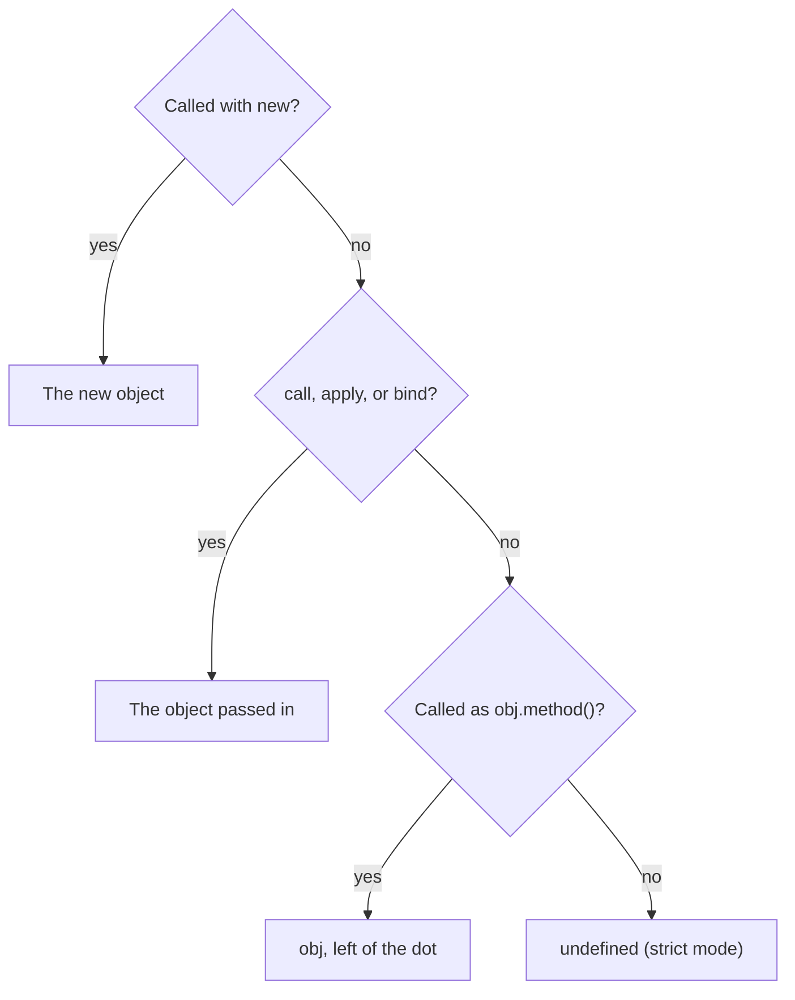

## In one line
Scope decides where a variable can be seen, a closure lets a function keep using the variables around it after that code has finished, hoisting is how declarations exist before their line runs, and `this` is decided by how a function is called.

## The problem it solves
These four ideas explain most "JavaScript is weird" bugs. Interviewers ask them to see whether you can predict what code does.

A few plain definitions first:

- A **variable** is a named box that holds a value, like `let price = 1299`.
- A **function** is a reusable block of code you can call, like `formatPrice(1299)`.
- **Scope** is the region of code where a variable can be used. Outside its scope, the name does not exist.

Three real bugs from a shop app show why this matters:

- A loop schedules three "item added" messages. All three print `3` instead of `0`, `1`, `2`.
- `['mug', 'lamp'].forEach(cart.add)` crashes with "Cannot read properties of undefined".
- A React component keeps showing an old search term inside a timer, even after the user typed a new one.

The first is scope, the second is `this`, the third is a closure.

## Everyday analogy
Think of nested rooms in an office building, with one-way glass. The building is the whole program. Each function is a room inside it, and rooms can contain smaller rooms.

- From inside a room you can see out into every room that contains yours, all the way to the lobby. You cannot see into a room nested inside yours. That is **scope**.
- If someone leaves a room but takes a key to it, they can still use what is inside, even after the meeting ended. That is a **closure**.

Where it breaks down: the rooms explain scope and closures, but not `this`. `this` is not about where code is written. It is more like the word "me", which means whoever is speaking right now.

## How it works

**1. Scope is decided by where you write the code.**
JavaScript has three main kinds of scope:

- **Global scope**: declared outside any function. Visible everywhere.
- **Function scope**: declared inside a function. Visible only inside it.
- **Block scope**: declared with `let` or `const` inside `{ }`, such as an `if` or a `for`. Visible only inside those braces. `var` ignores blocks and is scoped to the whole function.

This is called **lexical scope**: "lexical" means it is based on the text of the code, not on when it runs. When code uses a name, JavaScript looks in the current scope, then the one outside it, and so on up to global. That lookup path is the **scope chain**. If the name is never found, you get a `ReferenceError`.

**2. A closure is a function plus the variables it can reach.**
When you create a function inside another function, the inner function keeps a live link to the outer function's variables. It keeps that link even after the outer function has returned.

```js
function makeCartCounter() {
  let count = 0;                 // lives in makeCartCounter's scope
  return function addItem() {
    count += 1;                  // still reachable after makeCartCounter returned
    return count;
  };
}

const addToCart = makeCartCounter();
console.log(addToCart()); // 1
console.log(addToCart()); // 2

const otherCart = makeCartCounter(); // a new call gets a new, separate count
console.log(otherCart()); // 1
```

Nothing outside can touch `count` directly. The link is to the **variable**, not a copy of its value. That detail explains the loop bug.

**3. The classic loop: `var` vs `let`.**
`setTimeout(fn, 0)` runs `fn` later, after the current code finishes. A function passed to be called later is a **callback**.

```js
for (var i = 0; i < 3; i++) {
  setTimeout(() => console.log('var:', i), 0); // var: 3, var: 3, var: 3
}
for (let j = 0; j < 3; j++) {
  setTimeout(() => console.log('let:', j), 0); // let: 0, let: 1, let: 2
}
```

With `var`, there is one `i` for the whole function. All three callbacks close over that same variable, and by the time they run, the loop has finished and `i` is `3`. With `let`, each loop iteration gets a fresh `j`, so each callback closes over its own copy.

**4. Hoisting: declarations are set up before code runs.**
Before running a scope, the JavaScript engine scans it and registers every declaration. This is **hoisting**: declarations behave as if they were moved to the top. They are not all set up the same way:

| Declaration | Before its line runs |
|---|---|
| `function formatPrice() {}` | Fully usable |
| `var price` | Exists, value is `undefined` |
| `let`, `const`, `class` | Exists, but touching it throws `ReferenceError` |

The gap between the start of the scope and the `let`/`const` line is the **temporal dead zone** (TDZ). The variable is known, but not yet initialized.

```js
console.log(price);             // undefined: var is hoisted and set to undefined
var price = 1299;

console.log(formatPrice(1299)); // $12.99: function declarations are fully hoisted
function formatPrice(cents) {
  return `$${(cents / 100).toFixed(2)}`;
}

console.log(discount);          // ReferenceError: Cannot access 'discount' before initialization
let discount = 0.1;
```

**5. `this` is decided at call time.**
`this` is a special word inside a function that refers to an object. A function stored on an object is called a **method**. Unlike scope, `this` does not depend on where the function is written. It depends on **how it is called**. Check these rules in order:

1. **`new`**: `new Cart()` creates a new object, and `this` is that object.
2. **Explicit**: `fn.call(obj)`, `fn.apply(obj)`, or `fn.bind(obj)` set `this` to `obj`. `bind` returns a new function with `this` locked.
3. **Implicit**: `obj.method()`. `this` is the object left of the dot.
4. **Default**: a plain call, `fn()`. `this` is `undefined` in **strict mode**, a stricter set of JavaScript rules that classes and ES modules always use. In old non-strict scripts it is the global object instead.

**Arrow functions** (`() => {}`) skip all four rules. They have no `this` of their own and use the `this` of the code around them, like any other outer variable.


*Notice: the answer depends only on the call site; arrow functions skip this tree and use the outer `this`.*

## Real example
**Setup:** Node.js 18 or later. Save as `cart.mjs` and run `node cart.mjs`. The `.mjs` extension makes it an ES module, so strict mode is on.

```js
class Cart {
  constructor(owner) {
    this.owner = owner;          // rule 1, new: `this` is the brand-new object
    this.items = [];
  }
  add(product) {
    this.items.push(product);    // `this` depends on how add() is called
    return this.items.length;
  }
  addLater(product) {
    // Arrow function: no `this` of its own, so it uses addLater's `this`
    setTimeout(() => console.log(this.owner, 'added', this.add(product)), 0);
  }
}

const cart = new Cart('user 981');
console.log(cart.add('mug'));             // rule 3, implicit: this = cart -> 1

const add = cart.add;                     // copy the function, lose the object
try {
  add('lamp');                            // rule 4, default: this = undefined
} catch (err) {
  console.log(err.message);
}

const boundAdd = cart.add.bind(cart);     // rule 2, explicit: this is locked to cart
console.log(boundAdd('lamp'));            // 2
cart.addLater('poster');                  // user 981 added 3
```

Output:

```text
1
Cannot read properties of undefined (reading 'items')
2
user 981 added 3
```

This is the `forEach(cart.add)` bug from the start: passing `cart.add` hands over the function without the object. Fix it with `forEach((p) => cart.add(p))` or `forEach(cart.add.bind(cart))`.

## How to say it in an interview

> [!INTERVIEW]
> **30 seconds:** "Scope is where a variable is visible, and in JavaScript it's lexical, so it's decided by where the code is written. A closure is a function that keeps access to the variables of the scope it was created in, even after that scope has finished. Hoisting means declarations are registered before code runs: `var` starts as `undefined`, and `let` and `const` are in a temporal dead zone until their line. And `this` is decided by how a function is called, except in arrow functions, which take it from the surrounding code."

> [!INTERVIEW]
> **2 minutes:** Start with the 30-second answer, then add:
>
> "The classic example is a `for` loop with `var` and a `setTimeout`: it prints the final value three times, because all callbacks close over one shared variable. With `let`, each iteration gets its own variable, so it prints 0, 1, 2.
>
> Closures give you private state and factories, and React hooks rely on them. The tradeoff is that a closure keeps its variables alive: a long-lived listener can hold a large object in memory, or hold an outdated value, which is the 'stale closure' bug in React effects.
>
> For `this`, I check four rules in order: `new`, then explicit `call`/`apply`/`bind`, then `obj.method()`, then the default, which is `undefined` in strict mode. The common real bug is passing `cart.add` as a callback and losing `this`. I fix it with an arrow function wrapper or `bind`."

## Follow-up questions interviewers ask

<details>
<summary>What is the difference between var, let, and const?</summary>

- `var` is function-scoped, hoisted with the value `undefined`, and can be redeclared.
- `let` is block-scoped, in the temporal dead zone until its line, and can be reassigned.
- `const` is like `let`, but cannot be reassigned.

`const` does not freeze the value: `const cart = []` still allows `cart.push('mug')`. It only stops `cart = somethingElse`. Default to `const`, use `let` to reassign, and avoid `var`.

</details>

<details>
<summary>Give a practical use of closures.</summary>

A **debounce** function waits until the user stops typing before running a search. It keeps a timer ID in a closure:

```js
function debounce(fn, ms) {
  let timerId;                         // private, remembered between calls
  return (...args) => {
    clearTimeout(timerId);
    timerId = setTimeout(() => fn(...args), ms);
  };
}
const searchProducts = debounce((q) => console.log('searching', q), 300);
```

Other uses: private state (the cart counter above), factories like `makeDiscount(0.1)`, and caching results.

</details>

<details>
<summary>What is a stale closure, and where does it show up?</summary>

A closure captures the variables from the moment it was created. If those variables are later replaced, an old closure still sees the old ones.

In React, every render creates new functions that capture that render's state. A `setInterval` set up once in a `useEffect` with an empty dependency list keeps the closure from the first render, so it keeps reading the first value. Fixes: list the value in the dependency array, or use the updater form `setCount((c) => c + 1)`. See [React hooks](#/topic/react-hooks).

</details>

<details>
<summary>What does `this` mean inside an arrow function, and when is that a problem?</summary>

An arrow function has no `this` of its own. It uses the `this` of the code where it was written. That is great for callbacks inside methods, as in `addLater` above.

It is a problem when you use an arrow function as an object method: `{ owner: 'user 981', describe: () => this.owner }`. Here `this` comes from the outer code (for example the module, where it is `undefined`), not from the object. Use normal method syntax for methods.

</details>

<details>
<summary>Can closures cause memory leaks?</summary>

They can keep memory alive longer than intended. The **garbage collector** frees values that nothing can reach any more, and a closure keeps its outer variables reachable. An event listener that closes over a large product list and is never removed keeps that list in memory. Remove listeners and clear timers when done, for example in a React effect's cleanup function.

</details>

## Common mistakes and misconceptions

> [!MISTAKE]
> "Hoisting physically moves code to the top." No. Nothing moves. The engine registers declarations before running the scope. It is a mental model for that setup step.

> [!MISTAKE]
> "`let` and `const` are not hoisted." They are hoisted, but not initialized. That is why you get "Cannot access before initialization" (the temporal dead zone) rather than "is not defined".

> [!MISTAKE]
> "A closure copies the variable's value." No. It keeps a link to the variable itself. If the variable changes later, the closure sees the new value. That is the whole reason the `var` loop prints `3` three times.

> [!MISTAKE]
> "`this` is the object where the function was defined." No. For normal functions, `this` is set by how the function is called. Only arrow functions take it from where they are written.

## Tradeoffs: when NOT to use it
- **Don't use `var` in new code.** Function scope and `undefined` hoisting cause bugs that `let` and `const` turn into clear errors.
- **Don't build big structures out of closures when a class or module is clearer.** Ten nested closures that share private state are hard to read and to debug. A small class with clear methods is often easier.
- **Don't rely on `this` when you don't need it.** In callbacks and React function components, plain variables and arrow functions avoid a whole class of bugs.
- **Don't memorize quirky edge cases.** Being able to explain the loop bug and the lost-`this` bug clearly matters far more than trivia.

## Check yourself

<details>
<summary>1. What does this print, and why? <code>console.log(total); let total = 5;</code></summary>

`ReferenceError: Cannot access 'total' before initialization`. `total` is hoisted but sits in the temporal dead zone until its `let` line runs. With `var`, it would print `undefined` instead.

</details>

<details>
<summary>2. `const fn = user.getName; fn();` returns undefined or throws. Why?</summary>

`fn()` is a plain call with no object on the left of the dot, so the default rule applies and `this` is `undefined` in strict mode (or the global object in old non-strict code). Fix it with `user.getName.bind(user)` or call `user.getName()` directly.

</details>

<details>
<summary>3. After `const a = makeCartCounter(); a(); a();`, what does a fresh `makeCartCounter()()` return?</summary>

`1`. Each call to `makeCartCounter` creates a new scope with its own `count`. The closure in `a` and the new closure do not share anything.

</details>

## Go deeper
- [MDN: Closures](https://developer.mozilla.org/en-US/docs/Web/JavaScript/Guide/Closures)
- [MDN: this](https://developer.mozilla.org/en-US/docs/Web/JavaScript/Reference/Operators/this)
- [MDN: Hoisting (glossary)](https://developer.mozilla.org/en-US/docs/Glossary/Hoisting)
