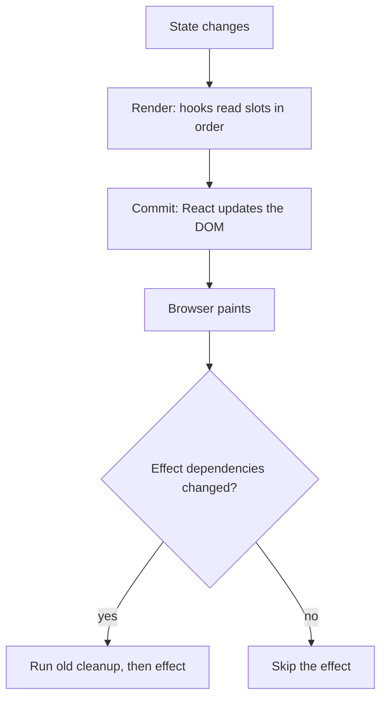

## In one line
Hooks are functions like `useState` and `useEffect` that let a React function component remember data, sync with the outside world, and skip unnecessary work, as long as you call them in the same order on every render.

## The problem it solves
A React component is just a function, and a function forgets everything when it returns. Yet a product search box must remember what the user typed, fetch results when the text changes, and cancel the old request when the user keeps typing.

**Hooks** give a function component those abilities. A hook is a special function whose name starts with `use`. The four that interviewers ask about most:

- `useState`: remember a value between renders.
- `useEffect`: keep the component in sync with something outside React, like a network request, a timer, or a WebSocket.
- `useMemo`: remember the result of a calculation between renders.
- `useCallback`: remember a function between renders.

They are also where most React bugs live: infinite loops, stale values, double requests, and memoization that does nothing. This topic builds on [React rendering](#/topic/react-rendering): a **render** is React calling your component function, and the **commit** is React updating the page.

## Everyday analogy
A hotel with numbered lockers at the front desk. Every time a guest (your component) comes back, they are handed lockers 1, 2, 3 in order: the first `useState` gets locker 1, the second gets locker 2. The desk does not know what is inside, only the order.

Where it breaks down: a real guest could ask for "the locker with my passport". React cannot. If the guest skips locker 1 one day, every item is handed to the wrong request. That is why hooks must be called in the same order every time.

## How it works

**1. Hooks are stored by call order.**
React keeps a list of hook slots for each component instance. On every render, the first hook call reads slot 1, the second reads slot 2, and so on. There are no names. That gives the two **Rules of Hooks**:

- Call hooks only at the **top level** of a component or custom hook. Never inside `if`, loops, or after an early `return`.
- Call hooks only from React function components or custom hooks, not from normal functions.

If `useState` sits inside `if (isLoggedIn)`, the slots shift whenever `isLoggedIn` changes, and a value lands in the wrong variable. The `eslint-plugin-react-hooks` linter catches this.

**2. `useState`: each render sees a snapshot.**
`const [quantity, setQuantity] = useState(1)` returns the current value and a setter. Calling the setter does **not** change `quantity` in the code that is running. It asks React for a new render, in which `quantity` has the new value. React also **batches** updates: several setter calls in one event cause one re-render. So `setQuantity(quantity + 1)` twice in a row adds 1, not 2. Use the **updater form**, `setQuantity((q) => q + 1)`, when the new value depends on the old one.

**3. `useEffect`: sync after the commit.**
`useEffect(setup, dependencies)` runs `setup` after React has updated the page, usually after the browser has painted. `setup` can return a **cleanup** function. React runs the cleanup before running the effect again, and when the component is removed.

The **dependency array** decides when it re-runs. React compares each value with the previous render using `Object.is`:

| Dependencies | Effect runs |
|---|---|
| none | After every render |
| `[]` | Once after the first render |
| `[query]` | After the first render, and whenever `query` changed |

In development, **Strict Mode** runs setup, cleanup, then setup again on mount, to prove your cleanup really undoes the setup.

**4. `useMemo` and `useCallback`: remember between renders.**
Every render creates new objects and new functions. That is usually fine. It matters in two cases: a calculation that is genuinely slow, and a child wrapped in `React.memo` that should skip rendering when its props are unchanged. A fresh function is a new prop every time, so the memo never helps.

- `useMemo(() => sortProducts(list), [list])` re-runs the calculation only when `list` changes.
- `useCallback(fn, [deps])` returns the same function until a dependency changes. It is `useMemo` for functions.


*Notice: effects run after the screen updates, and only when a dependency changed by `Object.is`.*

## Real example
A product search box for the shop. Typing sends a request to `/api/products?q=...`. A checkbox filters to in-stock items.

**Setup:** a React 19 app (for example from `npm create vite@latest shop -- --template react`) and an API route that returns `[{ id, name, stock }]`.

```jsx
import { useEffect, useState } from 'react';

export default function ProductSearch() {
  const [query, setQuery] = useState('');
  const [products, setProducts] = useState([]);
  const [inStockOnly, setInStockOnly] = useState(false);

  useEffect(() => {
    if (query.length < 2) return;                    // don't search on 0-1 characters
    const controller = new AbortController();
    fetch(`/api/products?q=${encodeURIComponent(query)}`, { signal: controller.signal })
      .then((res) => res.json())
      .then((data) => setProducts(data))
      .catch((err) => { if (err.name !== 'AbortError') console.error(err); });
    return () => controller.abort();                 // cleanup: cancel the outdated request
  }, [query]);                                       // re-run only when query changes

  // Derived value: compute during render. No extra state, no effect.
  const visible = inStockOnly ? products.filter((p) => p.stock > 0) : products;

  return (
    <div>
      <input value={query} onChange={(e) => setQuery(e.target.value)} placeholder="Search" />
      <label>
        <input type="checkbox" checked={inStockOnly} onChange={(e) => setInStockOnly(e.target.checked)} />
        In stock only
      </label>
      <ul>{visible.map((p) => <li key={p.id}>{p.name}</li>)}</ul>
    </div>
  );
}
```

What happens when the user types `m`, `u`, `g` quickly:

1. `m`: the effect returns early. No request.
2. `mu`: the effect sends `?q=mu`.
3. `mug`: before re-running, React runs the cleanup from step 2, which aborts the `mu` request. Then it sends `?q=mug`.
4. Only the `mug` results reach `setProducts`. Without the cleanup, a slow `mu` response could arrive last and overwrite the correct results. That is a **race condition**: the outcome depends on which response wins.

Ticking the checkbox re-renders and recomputes `visible`. It does not refetch, because `query` did not change.

## How to say it in an interview

> [!INTERVIEW]
> **30 seconds:** "Hooks let function components have state and side effects. `useState` stores a value between renders, and setting it triggers a re-render. `useEffect` syncs the component with something outside React after it renders, with a dependency array to control when it re-runs and a cleanup function to undo it. `useMemo` and `useCallback` cache a value or a function between renders. Hooks must be called in the same order every render, because React identifies them by call order."

> [!INTERVIEW]
> **2 minutes:** Start with the 30-second answer, then add:
>
> "The most common mistakes are with effects. People use them for derived data, like filtering a list into another state variable. That causes an extra render and can go out of sync. I compute it during render instead. Effects are for external systems: fetching, subscriptions, timers.
>
> For example, in a search box I fetch in an effect that depends on the query, and the cleanup aborts the previous request, so a slow old response can't overwrite newer results.
>
> On `useMemo` and `useCallback`: they're not free. They add memory and a dependency comparison on every render. I use them when a calculation is measurably slow, or when a memoized child or an effect depends on a stable reference. With React Compiler, which went stable in late 2025, much of this memoization is done automatically, so in new code I'd rely on it and add manual memoization only where I need precise control."

## Follow-up questions interviewers ask

<details>
<summary>Why does my effect run twice in development?</summary>

**Strict Mode** mounts the component, runs cleanup, then runs the effect again, only in development. It exposes effects without proper cleanup: if running it twice causes a duplicate subscription or a double-charged action, the cleanup is missing. In production the effect runs once. Do not "fix" it with a ref flag that skips the second run. Fix the cleanup.

</details>

<details>
<summary>What is a stale closure in an effect, and how do you fix it?</summary>

An effect captures the props and state of the render that created it (see [Closures](#/topic/js-fundamentals)). This counter is stuck at 1:

```jsx
useEffect(() => {
  const id = setInterval(() => setSeconds(seconds + 1), 1000); // seconds is always 0 here
  return () => clearInterval(id);
}, []);
```

The interval's function was created in the first render, where `seconds` was `0`. Fixes: use the updater form `setSeconds((s) => s + 1)`, which always gets the latest value, or list `seconds` as a dependency. For reading the latest value without re-running the effect, React 19.2 added `useEffectEvent`.

</details>

<details>
<summary>Why do I get an infinite loop with useEffect?</summary>

The effect sets state that is also its own dependency, or depends on an object or function created during render. For example, `const filters = { inStock: true }` in the component body is a new object on every render, so `[filters]` always looks changed. The effect runs, sets state, causes a render, creates a new `filters`, runs again. Fix it by depending on primitive values (`filters.inStock`), moving the object inside the effect, or memoizing it.

</details>

<details>
<summary>When should you use useMemo or useCallback?</summary>

Three good reasons:

1. A calculation is noticeably slow (roughly, it shows up in the profiler; a common rule of thumb is around 1 ms or more).
2. You pass the value or function to a child wrapped in `React.memo`.
3. The value is a dependency of another hook, like an effect.

Otherwise, skip them. Wrapping every value adds code and comparison work for no benefit.

</details>

<details>
<summary>What is a custom hook?</summary>

A function whose name starts with `use` and that calls other hooks. It lets you reuse stateful logic, for example `useProductSearch(query)` returning `{ products, isLoading }`. Each component that calls it gets its **own** state. Custom hooks share logic, not data. To share the same data between components, see [State management](#/topic/state-management).

</details>

## Common mistakes and misconceptions

> [!MISTAKE]
> Storing derived data in state with an effect: `useEffect(() => setVisible(products.filter(...)), [products])`. It renders twice and can drift out of sync. Compute it during render: `const visible = products.filter(...)`.

> [!MISTAKE]
> "`setCount(count + 1)` updates `count` immediately." No. `count` stays the same for the rest of this render. The new value appears in the next render.

> [!MISTAKE]
> Lying about dependencies, or disabling the lint rule, to stop an effect re-running. The effect then reads stale values. Restructure the code instead: move the logic inside the effect, use an updater function, or use `useEffectEvent`.

> [!MISTAKE]
> "`useEffect` with `[]` is the same as `componentDidMount`." Close, but not the same. It runs after paint, runs twice in development under Strict Mode, and thinking of it as "on mount" leads to missing dependencies. Think "sync with this external thing", not "lifecycle event".

> [!MISTAKE]
> Calling a hook conditionally: `if (user) { const [cart] = useState([]) }`. The hook order changes between renders, and React mixes up the values. Call the hook unconditionally and put the condition inside.

## Tradeoffs: when NOT to use it
- **No effect for data you can compute.** Filtering, sorting, totals, and formatting belong in the render.
- **No effect for things caused by a user action.** "When the user clicks Buy, send the order" goes in the click handler, not in an effect watching a `submitted` flag.
- **Be cautious fetching in effects in larger apps.** It works, but you hand-roll caching, retries, deduplication, and race handling. A data library (such as TanStack Query) or your framework's server-side data loading usually does it better. See [SSR, SSG, CSR, and Server Components](#/topic/rendering-strategies).
- **No `useMemo`/`useCallback` by default.** Use them for measured slowness or stable references a memoized child or effect needs. With React Compiler enabled, rarely by hand.
- **No `useState` for values that don't affect the screen.** A timer ID or "has this been logged" flag belongs in `useRef`, which persists without causing a re-render.

## Check yourself

<details>
<summary>1. Why must hooks be called in the same order on every render?</summary>

React stores each component's hook data in a list and matches calls by position, not by name. If one call is skipped or added conditionally, every later hook reads the wrong slot.

</details>

<details>
<summary>2. `setQuantity(quantity + 1); setQuantity(quantity + 1);` with quantity = 1. What is the result, and how do you get 3?</summary>

`2`. Both calls read the same snapshot (`1`) and both ask for `2`. Use the updater form twice, `setQuantity((q) => q + 1)`, which is applied to the latest queued value, to get `3`.

</details>

<details>
<summary>3. Why does the search example's cleanup abort the request?</summary>

So an older, slower response cannot overwrite newer results. When `query` changes, React runs the previous effect's cleanup first, which aborts the outdated request. Only the latest query's response reaches `setProducts`.

</details>

## Go deeper
- [react.dev: Rules of Hooks](https://react.dev/reference/rules/rules-of-hooks)
- [react.dev: You might not need an Effect](https://react.dev/learn/you-might-not-need-an-effect)
- [react.dev: useEffect reference](https://react.dev/reference/react/useEffect)
