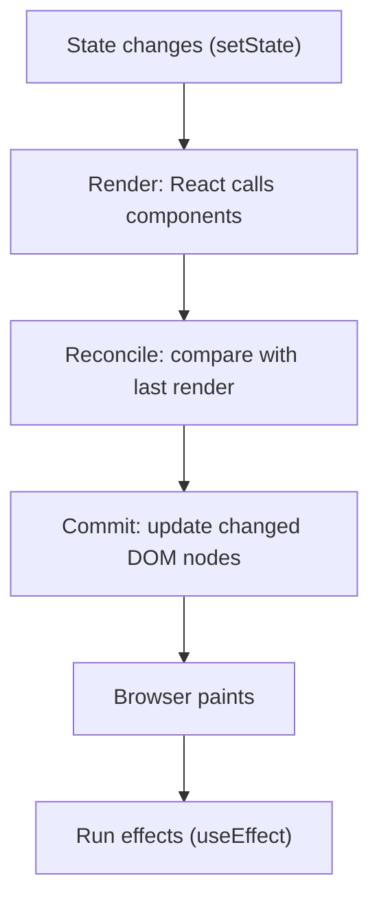

## In one line
When state changes, React calls your components again to get a new description of the UI, compares it with the previous one, and changes only the parts of the real page that differ.

## The problem it solves
Updating a web page by hand is error-prone. When a shopper adds a mug to the cart, you must update the cart badge, the cart list, the total, and the "Checkout" button, and forget none of them. Every manual `element.textContent = ...` is a chance for the screen and your data to disagree.

React's deal is: **you describe what the UI should look like for the current data, and React works out what to change.** That raises the questions interviewers ask:

- When does a component run again ("re-render")?
- How does React decide what to change on the page?
- Why does React warn about missing `key`s, and why is using the array index as a key sometimes a bug?

Some terms first:

- A **component** is a JavaScript function that returns a description of some UI, usually written in **JSX**, the HTML-like syntax inside JavaScript (`<li>{item.name}</li>`).
- **Props** are the inputs a parent passes to a component, like function arguments.
- **State** is data a component remembers between runs, created with `useState`. Changing it is how the UI changes.
- The **DOM** is the browser's live tree of page elements (see [How the browser renders a page](#/topic/critical-rendering-path)).

## Everyday analogy
A stage manager with a script. Each time the story moves on, the director hands over a fresh drawing of how the stage should look. The stage manager compares it with the stage as it is, and moves only what changed: swap one chair, keep the table. Actors stay in place if their position and role are the same, and they remember their lines.

Where it breaks down: if two actors swap positions without name tags, the stage manager assumes each spot still holds the same actor. In React, `key`s are those name tags.

## How it works
Every screen update happens in three steps (React's own docs call them trigger, render, commit):

1. **Trigger.** Something asks for an update: the first mount, or a state change (`setQuantity(2)`).
2. **Render.** React **calls your component functions**. Each returns **React elements**: plain JavaScript objects that describe the UI, like `{ type: 'li', props: {...} }`. If a component returns other components, React calls those too, all the way down. This phase must be **pure**: no changing the DOM, no network calls, same input gives the same output. React may run it more than once.
3. **Commit.** React compares the new elements with the previous render and applies only the **minimal** changes to the real DOM. Then the browser paints, and React runs your effects (`useEffect`).

The comparison in step 3 is called **reconciliation**. Comparing two arbitrary trees perfectly is too slow, so React uses two simple rules, checked at each position in the tree:

- **Same type at the same position** (still a `<CartItem>`, still a `<li>`): keep the existing DOM node and component, including its **state**. Just update the props that changed.
- **Different type** (a `<div>` became a `<section>`, or `<CartItem>` became `<Spinner>`): destroy the old one and everything below it, state included, and build the new one from scratch.

For lists, "position" alone is fragile, so React uses the **`key`** prop. A key identifies an item among its siblings. React matches old and new children by key, not by order. The same key means "same item, keep its state". A new key means "new item, start fresh".


*Notice: calling components (render) is separate from touching the DOM (commit), and only the commit changes the page.*

**What makes a component re-render?** Exactly three things:

1. **Its own state changed.** If the new value is the same as the old one by `Object.is`, React skips it.
2. **Its parent re-rendered.** By default, React re-renders **all** children of a component that renders, even if their props did not change.
3. **A context it reads changed** (see [State management](#/topic/state-management)).

"Its props changed" is not on the list by itself. Props only change because the parent re-rendered. Re-rendering is usually cheap: React calls a function and compares objects. It only touches the DOM where something differs.

## Real example
**The index-as-key bug.** Each cart row remembers its own quantity in state. The list uses the array index as the key.

**Setup:** a React 19 app, for example `npm create vite@latest shop -- --template react`, with this component rendered on a page.

```jsx
import { useState } from 'react';

function CartItem({ item, onRemove }) {
  const [quantity, setQuantity] = useState(1);  // state belongs to this position
  return (
    <li>
      {item.name} x {quantity}
      <button onClick={() => setQuantity(quantity + 1)}>+</button>
      <button onClick={() => onRemove(item.id)}>Remove</button>
    </li>
  );
}

export default function Cart() {
  const [items, setItems] = useState([
    { id: 'p42', name: 'Ceramic mug' },
    { id: 'p77', name: 'Desk lamp' },
  ]);
  const removeItem = (id) => setItems(items.filter((item) => item.id !== id));

  return (
    <ul>
      {items.map((item, index) => (
        <CartItem key={index} item={item} onRemove={removeItem} />  // the bug
      ))}
    </ul>
  );
}
```

What happens:

1. Click **+** twice on the mug. The screen shows `Ceramic mug x 3` and `Desk lamp x 1`.
2. Click **Remove** on the mug.
3. The screen shows `Desk lamp x 3`. The lamp "inherited" the mug's quantity.

Why: before removal, keys were `0` (mug) and `1` (lamp). After, the only item is the lamp, at index `0`. React sees key `0` in both renders, decides it is the **same** component, keeps its state (quantity 3), and just updates its `item` prop to the lamp. Key `1` disappeared, so that component (holding quantity 1) is destroyed.

**The fix:** use a stable ID from your data, `key={item.id}`. Now React sees `p42` disappear and `p77` stay, so the lamp keeps its own quantity of 1.

## How to say it in an interview

> [!INTERVIEW]
> **30 seconds:** "When state changes, React re-renders: it calls that component and its children to get a new description of the UI. Then it reconciles, comparing that with the previous render, and commits only the differences to the DOM. It compares by position and type: same type keeps the DOM node and state, a different type remounts. For lists it uses keys to match items, so keys must be stable and unique, like a database ID."

> [!INTERVIEW]
> **2 minutes:** Start with the 30-second answer, then add:
>
> "A component re-renders when its state changes, when its parent re-renders, or when a context it uses changes. Re-rendering doesn't mean the DOM changes; it means the function runs again. Usually that's cheap.
>
> Keys matter because state belongs to a position. If I use the array index as a key and delete the first cart item, the second item takes over index 0 and inherits the first item's state. Using `item.id` fixes it. The same mechanism is useful on purpose: changing a component's key, like `<ProductForm key={productId} />`, resets its state when switching products.
>
> When re-renders are actually expensive, for example a long product grid re-rendering on every keystroke in a search box, I'd first measure with the React DevTools Profiler. Then move state down closer to where it's used, or use `React.memo`. The tradeoff is that memoization adds comparisons and complexity, so I only add it where the profiler shows a problem. With the React Compiler, much of that memoization can now be done automatically at build time."

## Follow-up questions interviewers ask

<details>
<summary>What is the virtual DOM?</summary>

It is a popular name for the React elements: the lightweight JavaScript objects your components return. React compares the new objects with the previous ones and updates the real DOM only where they differ. The current React docs mostly avoid the term and describe it as render and commit, but interviewers still use it. The point is not that the virtual DOM is "faster than the DOM". It lets you write UI as a function of state while React keeps DOM changes small.

</details>

<details>
<summary>Does a child re-render if its props did not change?</summary>

Yes, by default. When a parent renders, React renders all its children. To skip a child when its props are equal (compared shallowly, one level deep), wrap it in `React.memo`. That only helps if the props really are equal: a new object or arrow function created on every parent render counts as a different prop, which is where `useMemo` and `useCallback` come in. See [React hooks](#/topic/react-hooks).

</details>

<details>
<summary>What does React Compiler change?</summary>

React Compiler is a build-time tool. React announced its stable 1.0 release in October 2025. It analyzes your components and adds memoization automatically, so children and calculations skip work when their inputs have not changed. It is opt-in: you add it to your build, and it works best when your code follows the Rules of React (pure render, no mutating props or state). React's docs say new code can rely on it instead of hand-written `useMemo`/`useCallback`, but existing memoization can stay.

</details>

<details>
<summary>Why does my component render twice in development?</summary>

**Strict Mode** (`<StrictMode>`) deliberately calls your components twice in development, and runs effects' setup and cleanup an extra time, to expose impure code. It does not happen in production builds. If a double call causes a bug, the render or effect has a side effect that needs fixing.

</details>

<details>
<summary>When is the array index an acceptable key?</summary>

When the list is static: never reordered, filtered, or added to except at the end, and items have no state or uncontrolled inputs. For example, a fixed list of footer links. For anything that changes, use a stable ID from the data. Never generate keys with `Math.random()` during render, because every render would remount every item.

</details>

## Common mistakes and misconceptions

> [!MISTAKE]
> "Re-render means React rebuilds the DOM." No. Re-render means React calls the component function again. The DOM is only touched in the commit phase, and only where something changed.

> [!MISTAKE]
> "A component re-renders when its props change." Incomplete. It re-renders whenever its parent renders, whether or not the props changed, unless it is memoized.

> [!MISTAKE]
> "Keys are only there to silence a console warning." Keys decide which component instance, and therefore which state, belongs to which item. A wrong key causes real bugs, like the inherited quantity above.

> [!MISTAKE]
> Defining a component inside another component. `function Parent() { function Row() {...} }` creates a new `Row` type on every render, so React treats it as a different type each time and remounts it, losing its state and focus. Define components at the top level of the file.

## Tradeoffs: when NOT to use it
"It" here means optimizing re-renders:

- **Don't wrap everything in `React.memo`.** Each memo adds a props comparison on every render. If the props change every time anyway, it is pure overhead.
- **Don't optimize without measuring.** Most re-renders take well under a millisecond. Use the React DevTools Profiler to find the slow ones first.
- **Prefer structure over memoization.** Moving state down into the component that uses it, or passing components as `children`, often removes the extra re-renders entirely and needs no memo.
- **Don't fight React for highly frequent updates.** Rendering thousands of rows or animating every frame through state can be too slow. Use list virtualization (render only visible rows) or CSS animations instead.

## Check yourself

<details>
<summary>1. Name the three reasons a component re-renders.</summary>

Its own state changed, its parent re-rendered, or a context it reads changed.

</details>

<details>
<summary>2. A `<div>` wrapping a form changes to a `<section>`. What happens to the form's state?</summary>

It is lost. A different element type at the same position makes React destroy the old subtree, including all state inside it, and mount a new one.

</details>

<details>
<summary>3. How can you deliberately reset a component's state when the user switches from product 42 to product 77?</summary>

Give it a key that changes with the product: `<ReviewForm key={productId} />`. A new key means React treats it as a new component and mounts it fresh, with fresh state.

</details>

## Go deeper
- [react.dev: Render and commit](https://react.dev/learn/render-and-commit)
- [react.dev: Preserving and resetting state](https://react.dev/learn/preserving-and-resetting-state)
- [react.dev: Rendering lists (keys)](https://react.dev/learn/rendering-lists)
