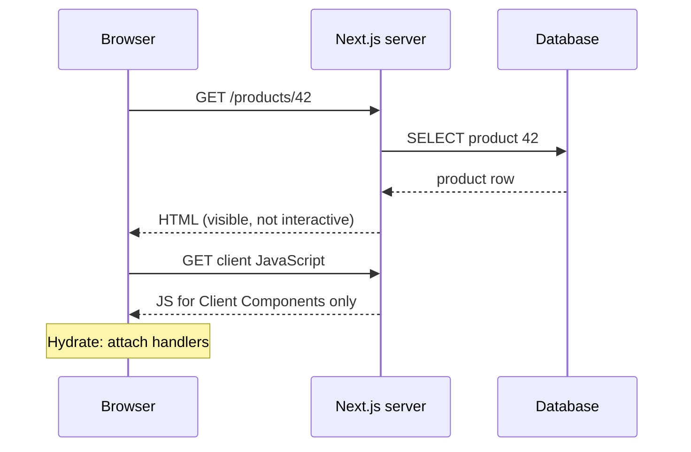

## In one line
Rendering strategies decide where and when a page's HTML is built: in the browser (CSR), on the server for each request (SSR), once at build time (SSG), or with Server Components that run only on the server and send no JavaScript for themselves.

## The problem it solves
Your shop has very different pages:

- The **home page and product pages** must appear fast, even on a cheap phone, and must be readable by search engines.
- The **order history page** is personal and needs fresh data for each user.
- The **video editor** in the creator dashboard is a heavy interactive tool used after login, where search engines do not matter.

One approach does not fit all three. If the browser builds every page from JavaScript, the product page shows a blank screen until a large **bundle** (the combined JavaScript file for your app) downloads and runs. If the server builds every page on every request, you pay server time for pages that never change.

It connects frontend speed, SEO, server cost, and caching, which makes it a classic full-stack question. Two terms first:

- **SEO** (search engine optimization) is making pages easy for search engines to read and rank. Crawlers handle plain HTML best.
- **Hydration** is the step where React, running in the browser, attaches event handlers and state to HTML that was already rendered on the server, so the page becomes interactive.

## Everyday analogy
A bakery. **CSR** is a meal kit: the customer gets ingredients and a recipe (JavaScript) and cooks at home. **SSR** is cooking each order fresh. **SSG** is baking bread before opening and selling it off the shelf all day. **Server Components** are the kitchen plating the dish fully and handing over only the plate, plus a small sauce kit for the bits you finish at the table (the interactive parts).

Where it breaks down: a bakery picks one style per product. A modern React app mixes them within a **single page**: a prebuilt shell, a few parts streamed fresh, and small interactive islands.

## How it works

**1. Client-side rendering (CSR).**
The server sends nearly empty HTML (`<div id="root"></div>`) plus a script. The browser downloads the JavaScript, runs React, fetches data from your API, and only then shows content. It is simple to host (static files on a CDN), and navigation after the first load feels fast. But the first meaningful paint waits for JavaScript and data, and crawlers see an empty page at first.

**2. Server-side rendering (SSR).**
For each request, the server runs your React components, queries the database, and sends complete HTML. The user sees content as soon as the HTML arrives. Then the browser downloads the JavaScript and **hydrates**:

1. React runs the components again in the browser, producing what the page *should* look like.
2. It walks the existing HTML and matches it, node by node, instead of recreating it.
3. It attaches event handlers and state. Now the buttons work.

If the browser's render differs from the server's HTML (for example, one side printed `Date.now()` or read `window`), React reports a **hydration mismatch**. Between paint and hydration, the page is visible but not interactive yet.

**3. Static site generation (SSG).**
Pages are rendered to HTML once, at **build time** (when you deploy), and served from a **CDN** (a network of servers close to users, see [CDNs](#/topic/cdn)). It is the fastest and cheapest option, and it is still hydrated if it has interactive parts. The catch: content is only as fresh as the last build. **Incremental static regeneration (ISR)** fixes this by rebuilding a page in the background after a time limit or when your code asks for it.

**4. Streaming.**
Instead of waiting for the slowest query, the server sends the HTML in pieces. Parts wrapped in React's `<Suspense>` show a fallback (like "Checking stock...") first, and the real content follows in the same response when its data is ready.

**5. React Server Components (RSC).**
A **Server Component** runs only on the server (at build time or per request). It can query the database directly and use secrets. Its code is **never sent to the browser**. React sends its rendered result in a compact format called the **RSC payload**. A **Client Component**, marked with `'use client'` at the top of its file, is the familiar kind: it can use state, effects, and event handlers. It is still prerendered to HTML on the server, then hydrated in the browser.

RSC is not the same as SSR. SSR is about producing **HTML** on the server. RSC is about which **components** run only on the server and ship no JavaScript. Frameworks use both together.


*Notice: the user sees the product before any JavaScript runs; only interactive parts download code to hydrate.*

**In Next.js 16 (App Router),** pages and layouts are Server Components by default. Next.js prerenders whatever it can at build time and renders the rest per request. With **Cache Components** (the `cacheComponents: true` option, on in new `create-next-app` projects), you mark cacheable data or components with the `'use cache'` directive, and anything uncached streams in behind `<Suspense>`. Next.js calls that mix of a static shell plus streamed dynamic parts **Partial Prerendering**.

## Real example
A product page in a Next.js 16 App Router project. The name and price render on the server, the stock level streams in, and only the button ships JavaScript.

**Setup:** `npx create-next-app@latest shop`, plus a `lib/db.js` that exports a `pg` pool as `db`, and an `app/api/cart/route.js` that accepts the POST.

`app/products/[id]/page.js` (Server Components):

```jsx
import { Suspense } from 'react';
import { db } from '@/lib/db';                    // server-only code: never sent to the browser
import AddToCartButton from './add-to-cart-button';

async function StockLevel({ id }) {                // slower query, streamed in later
  const { rows } = await db.query('SELECT stock FROM inventory WHERE product_id = $1', [id]);
  return <p>{rows[0]?.stock ?? 0} in stock</p>;
}

async function ProductDetails({ params }) {
  const { id } = await params;                      // params is a Promise in Next.js 15+
  const { rows } = await db.query('SELECT id, name, price_cents FROM products WHERE id = $1', [id]);
  const product = rows[0];
  return (
    <>
      <h1>{product.name}</h1>
      <p>${(product.price_cents / 100).toFixed(2)}</p>
      <Suspense fallback={<p>Checking stock...</p>}>
        <StockLevel id={id} />
      </Suspense>
      <AddToCartButton productId={product.id} />    {/* the only part that ships JS */}
    </>
  );
}

export default function ProductPage({ params }) {
  return (
    <main>
      <Suspense fallback={<p>Loading product...</p>}>
        <ProductDetails params={params} />
      </Suspense>
    </main>
  );
}
```

`app/products/[id]/add-to-cart-button.js` (a Client Component):

```jsx
'use client';                                       // runs in the browser after hydration

import { useState } from 'react';

export default function AddToCartButton({ productId }) {
  const [status, setStatus] = useState('idle');

  async function addToCart() {
    setStatus('adding');
    await fetch('/api/cart', {
      method: 'POST',
      headers: { 'Content-Type': 'application/json' },
      body: JSON.stringify({ productId, quantity: 1 }),
    });
    setStatus('added');
  }

  return (
    <button onClick={addToCart} disabled={status === 'adding'}>
      {status === 'added' ? 'Added to cart' : 'Add to cart'}
    </button>
  );
}
```

What happens on `GET /products/42`:

1. The response starts immediately with "Loading product...". With Cache Components on, that shell is prerendered at build time; `next build` marks the route as Partial Prerender.
2. When the product query finishes, the name, price, button, and a "Checking stock..." fallback stream in.
3. When the slower inventory query finishes, the stock line replaces its fallback, still in the same HTTP response.
4. The browser downloads JavaScript for `AddToCartButton` only, and hydrates it. The database code and the SQL never reach the browser.

The page works the same without Cache Components; the route is then rendered on demand for each request, still streaming.

## How to say it in an interview

> [!INTERVIEW]
> **30 seconds:** "CSR builds the page in the browser from JavaScript, so it's simple to host but slow to first content and weak for SEO. SSR renders HTML on the server per request, then hydrates it in the browser so it becomes interactive. SSG renders HTML at build time and serves it from a CDN, which is fastest but only as fresh as the last build, and ISR regenerates it periodically. React Server Components run only on the server and send no JavaScript for themselves; only Client Components get hydrated."

> [!INTERVIEW]
> **2 minutes:** Start with the 30-second answer, then add:
>
> "I pick per page, by asking how fresh the data must be and whether it's personal. A marketing page or product description can be static or cached. An order history is personal, so it's rendered per request or fetched on the client after login. A heavy editor behind login can just be a client-rendered app.
>
> In Next.js App Router, components are Server Components by default. On a product page, the server queries the database for the name and price, streams slower parts like stock behind Suspense, and only the Add to cart button is a Client Component. That keeps the JavaScript bundle small, which helps on cheap phones.
>
> The tradeoffs: SSR costs server CPU on every request, and without streaming the first byte waits for the slowest query. Hydration still costs time, so the page can look ready before it is. And Server Components can't use state or browser APIs, and props passed to Client Components must be serializable."

## Follow-up questions interviewers ask

<details>
<summary>What causes a hydration mismatch, and how do you fix it?</summary>

The HTML from the server differs from what React renders in the browser. Common causes: `Date.now()` or `Math.random()` during render, reading `window` or `localStorage` during render, time zones and locale formatting, and invalid HTML nesting (like a `<div>` inside a `<p>`, which the browser rearranges). Fixes: render browser-only values after mount in an effect, pass the same value from the server, or fix the HTML.

</details>

<details>
<summary>Is SSR always faster than CSR?</summary>

For the first view, usually yes: content appears without waiting for JavaScript. But the server must do work before sending anything, so a slow database query delays the first byte. Streaming helps. After the first load, a CSR app can navigate quickly without full page loads, and modern SSR frameworks also do client-side navigation. So the honest answer is "faster first content, at the cost of server work".

</details>

<details>
<summary>What is the difference between SSR and Server Components?</summary>

SSR answers "where is the initial HTML produced?": on the server. Server Components answer "which components run only on the server and never ship their code?". A Client Component is still server-rendered to HTML on first load (SSR) and then hydrated. A Server Component is never hydrated, because it has no browser code. You can have SSR without Server Components (the classic Next.js Pages Router) and Server Components rendered at build time.

</details>

<details>
<summary>Can a Server Component use useState or onClick?</summary>

No. It runs once on the server and never in the browser, so there is no state or event to handle. Move the interactive part into a small Client Component (with `'use client'`) and pass it data as props. Those props must be serializable: plain data, not functions or class instances (Server Actions are the exception for functions).

</details>

## Common mistakes and misconceptions

> [!MISTAKE]
> "Server-rendered pages don't need JavaScript." Interactive parts still need it. SSR makes content visible earlier; hydration makes it work. Until then, buttons do nothing.

> [!MISTAKE]
> "`'use client'` means the component is not server-rendered." No. Client Components are still prerendered to HTML on the server. The directive means "this code also ships to and runs in the browser".

> [!MISTAKE]
> "SSG means no dynamic data." Static pages can fetch personal or live data on the client after load, and ISR keeps the static part fresh.

> [!MISTAKE]
> Putting `'use client'` at the top of the root layout "to make things work". It turns the whole tree into client code and loses the benefit of Server Components. Push it down to the small interactive leaves.

## Tradeoffs: when NOT to use it
- **SSR is not needed for apps behind a login with no SEO needs**, like an admin dashboard or the video editor. CSR is simpler to build, host, and cache.
- **SSG is wrong for personal or rapidly changing pages**: a cart, order history, live stream viewer counts. You would rebuild constantly or show stale data.
- **Server Components are not worth a rewrite for an existing, working SPA.** They need a framework that supports them (such as Next.js App Router) and a new mental model. Adopt them for new code, or where bundle size really hurts.
- **Don't SSR expensive personalized pages without caching.** Every request pays the full database cost. Cache shared parts, stream slow parts, and measure time to first byte.

## Check yourself

<details>
<summary>1. What is hydration?</summary>

React running in the browser over HTML that the server already rendered: it matches the existing elements and attaches event handlers and state, instead of rebuilding the page. After hydration, the page is interactive.

</details>

<details>
<summary>2. Which strategy fits a product description that changes once a week, and why?</summary>

Static generation (or a cached prerender) with regeneration on change: it is served from a CDN, very fast and cheap, and ISR or on-demand revalidation updates it when the description changes. Live stock can be streamed or fetched separately.

</details>

<details>
<summary>3. Why does the product page example send no JavaScript for the product name and price?</summary>

They are rendered by Server Components, which run only on the server. The browser gets their result as HTML and RSC payload, not their code. Only `AddToCartButton`, a Client Component, ships JavaScript for hydration.

</details>

## Go deeper
- [Next.js docs: Server and Client Components](https://nextjs.org/docs/app/getting-started/server-and-client-components)
- [react.dev: Server Components](https://react.dev/reference/rsc/server-components)
- [web.dev: Rendering on the web](https://web.dev/articles/rendering-on-the-web)
