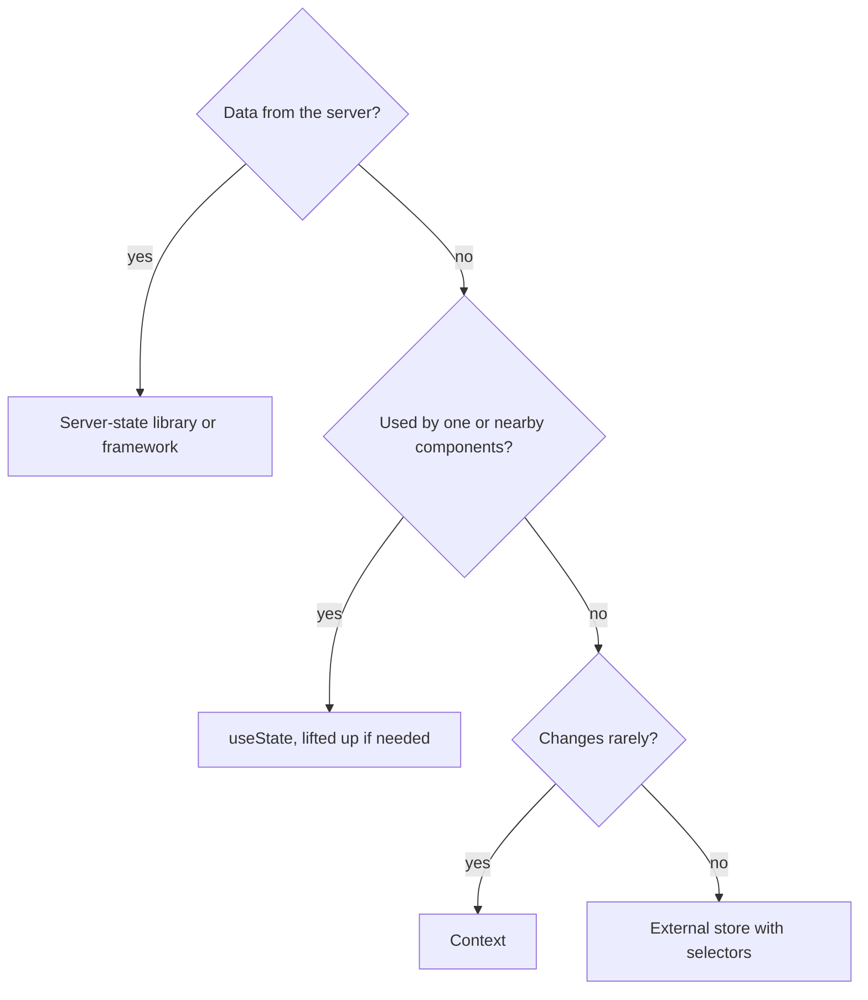

## In one line
State management is deciding where each piece of changing data lives, so every component that needs it can read it and update it, without passing it through ten layers or re-rendering the whole app.

## The problem it solves
**State** is data that changes while the app runs and affects what is on screen: the text in a search box, the items in a cart, the logged-in user.

In the shop app, the cart is needed in three places that are far apart: the badge in the header, the Add to cart button on the product page, and the checkout page. With only `useState`, the cart must live in the closest common parent (often the top `App`) and be passed down as **props** through every component in between, even ones that never use it. That is called **prop drilling**. It is tedious, and every cart change re-renders everything along the way.

The opposite mistake is just as common: putting **everything** in one global store, including data that only one form uses, and data that really belongs to the server.

Interviewers want to see you pick the simplest tool for each kind of state.

## Everyday analogy
Where you keep things at home. Your toothbrush stays in the bathroom (local state). The family calendar hangs in the hallway, where everyone passes it (shared state near its users). The house address is on the front door and almost never changes (context). The shopping list is on a shared app that everyone can edit and get notified about (an external store). Your bank balance is not copied onto the fridge at all: you check the bank (server state).

Where it breaks down: at home, the wrong place is merely annoying. In React, it causes extra re-renders or stale data.

## How it works
There are five kinds of state. Naming the kind usually picks the tool.

1. **Local UI state**: used by one component. Is a dropdown open? What is typed in this input? Use `useState` in that component.
2. **Shared state between nearby components**: two siblings need it. **Lift state up**: move it to their closest common parent and pass it down as props. This is the default for sharing.
3. **App-wide, rarely changing values**: the theme, the current user, the language. Use **Context**: React's way to make a value available to every component below a provider, without passing props. Any component reads it with `useContext`.
4. **App-wide, frequently changing client state**: a cart, a video player's queue, a multi-step editor. Use an **external store**, such as Zustand or Redux Toolkit. The data lives outside React, and each component **subscribes** to just the slice it needs, through a **selector** function like `(state) => state.items.length`. It re-renders only when that slice changes.
5. **Server state**: data that lives in your database and is only borrowed by the browser, like products and orders. It goes stale, needs refetching and caching. Use a server-state library (TanStack Query, SWR) or your framework's server-side data loading.

Two more places are easy to forget: **URL state** (filters and page numbers in `?category=mugs&page=2`, so links can be shared) and **form state** (often handled by the form library or the browser itself).


*Notice: most state ends at `useState` or the server; a global store is the last option, not the first.*

**Why Context is not a full state manager.** When a provider's `value` changes (compared with `Object.is`), **every** component that reads that context re-renders, even if it only uses one field that did not change. For a theme that changes once a session, that is fine. For a cart that changes on every click, read by 50 components, it adds up. External stores avoid this with selectors.

## Real example
**Setup:** a React 19 app. For the store, `npm install zustand` (examples use Zustand 5).

**1. Context for the theme.** It changes rarely and nearly every component may need it.

```jsx
import { createContext, useContext, useState } from 'react';

const ThemeContext = createContext('light');      // default if no provider above

export function ThemeProvider({ children }) {
  const [theme, setTheme] = useState('light');
  const toggle = () => setTheme((t) => (t === 'light' ? 'dark' : 'light'));
  // React 19: render the context itself as the provider
  return <ThemeContext value={{ theme, toggle }}>{children}</ThemeContext>;
}

export function ThemeButton() {
  const { theme, toggle } = useContext(ThemeContext); // re-renders when the value changes
  return <button onClick={toggle}>Theme: {theme}</button>;
}
```

Before React 19, you wrote `<ThemeContext.Provider value={...}>`. That still works.

**2. An external store for the cart.** It changes often and is read in far-apart places.

```jsx
import { create } from 'zustand';

// The store lives outside React. Any component can subscribe to part of it.
export const useCartStore = create((set) => ({
  items: [],
  addItem: (product) => set((state) => ({ items: [...state.items, product] })),
  clear: () => set({ items: [] }),
}));

// Header badge: re-renders only when the item count changes.
export function CartBadge() {
  const count = useCartStore((state) => state.items.length);
  return <span aria-label={`${count} items in cart`}>{count}</span>;
}

// Product page button: subscribes only to the action, which never changes.
export function AddToCartButton({ product }) {
  const addItem = useCartStore((state) => state.addItem);
  return <button onClick={() => addItem(product)}>Add to cart</button>;
}
```

Click **Add to cart** twice: the badge shows `2`. The button does not re-render, because its selected value (`addItem`) never changes. No provider, no prop drilling.

**3. Products are not in either.** The product list comes from `GET /api/products`. It belongs to a server-state library or server-side rendering, which handle caching and refetching. Copying it into the cart store would create a second copy that goes stale.

## How to say it in an interview

> [!INTERVIEW]
> **30 seconds:** "I start by asking what kind of state it is. Local UI state stays in `useState`. If siblings need it, I lift it to their common parent. App-wide values that rarely change, like theme or the current user, go in Context. Frequently changing global client state, like a cart, goes in an external store like Zustand or Redux, where components subscribe with selectors. And server data goes in a server-state library like TanStack Query, not in a global store."

> [!INTERVIEW]
> **2 minutes:** Start with the 30-second answer, then add:
>
> "The tradeoff with Context is that every consumer re-renders when the value changes. That's fine for a theme, but for a cart that updates on every click and is read across the app, a store with selectors only re-renders the components whose slice changed.
>
> The most common mistake I see is treating server data as client state: fetching products into Redux and then hand-writing loading flags, caching, and refetching. A server-state library does that, including deduplicating requests and refetching stale data.
>
> In a Next.js App Router app with Server Components, a lot of state disappears entirely, because data is fetched on the server and passed down as props. What's left on the client is mostly UI state."

## Follow-up questions interviewers ask

<details>
<summary>Redux vs Context: what is the difference?</summary>

Context is a **transport** mechanism: it passes a value down the tree. It has no opinion on how the value changes, and every consumer re-renders on any change. Redux (today, Redux Toolkit) is a **store**: state lives outside React, changes go through explicit actions and reducers (pure functions that compute the next state), components subscribe with selectors, and you get developer tools to replay changes. React-Redux, the binding library, even uses Context internally, but only to pass the store reference, which never changes.

</details>

<details>
<summary>How do you stop Context from re-rendering everything?</summary>

- Split it: one context per concern (theme, user, cart), so a change in one does not re-render readers of another.
- Keep the value stable: avoid creating a new object every render unless something changed (React Compiler or `useMemo` can help).
- Move fast-changing values out of Context into a store with selectors.

</details>

<details>
<summary>What is server state, and why treat it differently?</summary>

Server state is a cached copy of data owned by the backend: products, orders, a user's profile. Unlike UI state, it can be changed by other users, it goes stale, and loading it can fail. A server-state library gives you caching by key, deduplicating identical requests, background refetching, and retries. Treating it as plain client state means re-building all of that yourself.

</details>

<details>
<summary>When would you put state in the URL?</summary>

When the state describes **what** the user is looking at and should survive a refresh or be shareable: search query, filters, sort order, page number, the selected tab. `shop.example.com/products?category=mugs&sort=price` can be bookmarked or sent to a friend. A modal's open state usually should not be in the URL.

</details>

## Common mistakes and misconceptions

> [!MISTAKE]
> "Every app needs Redux." No. Many apps only need `useState`, lifted state, a little Context, and a server-state library. Add a store when you have real, frequently changing, widely shared client state.

> [!MISTAKE]
> "Context is a performance optimization." It is the opposite of one. It removes prop drilling, but every consumer re-renders when the value changes.

> [!MISTAKE]
> Copying props or server data into state, like `const [product, setProduct] = useState(props.product)`. The copy does not update when the prop changes. Use the prop directly, or derive the value during render.

> [!MISTAKE]
> Storing derived data in the store, such as `cartTotal` next to `items`. It can drift out of sync. Store `items` and compute the total in a selector.

## Tradeoffs: when NOT to use it
"It" here means global state tools (Context and stores):

- **Not for local state.** A dropdown's open flag in a global store makes every change harder to trace and couples unrelated parts of the app.
- **Not for server data.** Use a server-state library or server rendering, not a hand-built cache in Redux or Context.
- **Context not for fast-changing values read by many components.** A playback position updated 60 times a second, read by many components, will re-render all of them.
- **Not before you feel the pain.** Prop drilling through two or three levels is fine and easy to follow.

## Check yourself

<details>
<summary>1. A search input's text is used only by the search box. Where should it live?</summary>

In `useState` inside the search box component. It is local UI state. If you want the search to be shareable as a link, put the submitted query in the URL instead.

</details>

<details>
<summary>2. Why does every component reading a cart Context re-render when one item is added?</summary>

When the provider's `value` changes, React re-renders every component that reads that context, whether or not it uses the part that changed. Context has no selectors. A store like Zustand or Redux lets each component subscribe to just its slice.

</details>

<details>
<summary>3. Where should the product list fetched from the API live?</summary>

In a server-state library (such as TanStack Query) or be fetched on the server and passed down as props. It is server state: it can go stale and needs caching and refetching, which those tools handle.

</details>

## Go deeper
- [react.dev: Sharing state between components (lifting state up)](https://react.dev/learn/sharing-state-between-components)
- [react.dev: Passing data deeply with context](https://react.dev/learn/passing-data-deeply-with-context)
- [Redux docs: When should I use Redux?](https://redux.js.org/faq/general)
