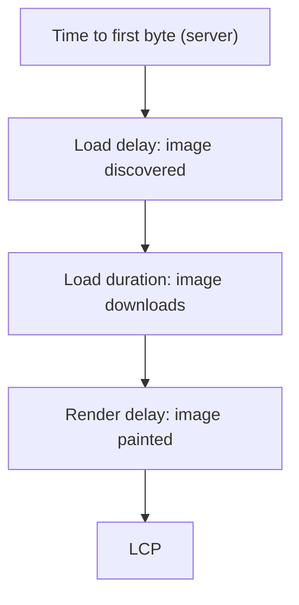

## In one line
Core Web Vitals are three numbers Google uses to measure how a page feels to real users: how fast the main content appears (LCP), how quickly the page responds to taps (INP), and how much the layout jumps around (CLS).

## The problem it solves
"The site feels slow" is not something you can fix. Slow how? A product page can:

- Take four seconds to show the product photo.
- Show the photo quickly, but freeze for half a second every time you tap "Add to cart".
- Load fast, then push the Buy button down just as you tap it, because a banner appeared above it.

Each is a different problem with a different fix. **Core Web Vitals** give each one a name, a number, and a target. Google uses them as one of many search ranking signals, and teams use them to check whether a change helped.

For a backend-leaning developer, the interesting part is that the first number often depends on **your server**: a slow API or missing cache shows up directly as a bad LCP.

## Everyday analogy
A restaurant review with three scores. How long until your main dish arrives (LCP)? When you wave at the waiter, how long until they respond (INP)? Did anyone bump the table and move your plate while you were eating (CLS)?

Where it breaks down: a restaurant gets one review per visit. Web Vitals are collected from thousands of real visits, and you are judged on the slow end of them, not the average.

## How it works
Some terms first:

- **Field data** is measured from real users' browsers on real devices and networks. **Lab data** is measured in a controlled test, like Lighthouse in Chrome DevTools. Rankings use field data.
- The **75th percentile** (p75) is the value that 75% of visits beat. A page "passes" a metric if its p75 is in the good range. Mobile and desktop are judged separately.
- The **viewport** is the part of the page visible on screen without scrolling.

The three Core Web Vitals and their thresholds (from web.dev):

| Metric | Measures | Good | Needs improvement | Poor |
|---|---|---|---|---|
| **LCP**, Largest Contentful Paint | When the largest image or text block in the viewport is painted | ≤ 2.5 s | 2.5 s to 4 s | > 4 s |
| **INP**, Interaction to Next Paint | Delay from a click, tap, or key press to the next frame, for nearly the worst interaction of the visit | ≤ 200 ms | 200 ms to 500 ms | > 500 ms |
| **CLS**, Cumulative Layout Shift | How much visible content moves unexpectedly (a score, not a time) | ≤ 0.1 | 0.1 to 0.25 | > 0.25 |

INP replaced an older metric, First Input Delay (FID), as a Core Web Vital in March 2024. FID only measured the delay before the **first** interaction started; INP covers every interaction, through to the next paint.

**Each metric has internal parts, and that is where the fixes are.**

**LCP** breaks into four phases. Find the biggest one:


*Notice: the first phase is pure backend time, so a slow server caps how good LCP can be.*

**INP** has three parts per interaction: **input delay** (the main thread was busy with another task), **processing time** (your event handlers run), and **presentation delay** (the browser renders the next frame). Long JavaScript tasks hurt all three. See [Browser event loop](#/topic/browser-event-loop).

**CLS** adds up layout shifts. Each shift scores how much of the viewport moved times how far it moved. Shifts within 500 ms after a user's tap or key press do not count, because the user expected a change. Shifts are grouped into bursts, and CLS is the worst burst.

**Common fixes, by metric:**

- **LCP:** reduce **TTFB** (time to first byte: how long until the server starts responding) with caching, a CDN, and fast queries. Put the main image directly in the HTML with `fetchpriority="high"`, never `loading="lazy"` on it. Serve compressed formats (WebP or AVIF) at the right size with `srcset`.
- **INP:** ship less JavaScript, break long tasks into smaller ones, and keep event handlers short (do the visible update first, defer the rest).
- **CLS:** set `width` and `height` (or `aspect-ratio`) on images and video, reserve space for ads and embeds, and never insert content above what the user is reading.

Two general tools appear in almost every answer:

- **Lazy loading**: delay loading something until it is needed. `` for images below the fold, and `import()` to load code on demand.
- **Code splitting**: split the JavaScript bundle into smaller files, so each page downloads only what it uses. `React.lazy(() => import('./VideoEditor'))` loads the editor only when it is opened.

## Real example
Measure your real users' vitals and send them to your own backend. This uses Google's `web-vitals` library.

**Setup:** `npm install web-vitals` in the frontend (examples use web-vitals 5 or later), and an Express backend serving the same origin.

**Browser side:**

```js
import { onCLS, onINP, onLCP } from 'web-vitals';

function sendToBackend(metric) {
  const body = JSON.stringify({
    name: metric.name,          // 'LCP', 'INP', or 'CLS'
    value: metric.value,        // ms for LCP and INP, a unitless score for CLS
    rating: metric.rating,      // 'good', 'needs-improvement', or 'poor'
    page: location.pathname,
  });
  // sendBeacon survives the page being closed; fall back to fetch with keepalive
  if (!navigator.sendBeacon('/api/vitals', body)) {
    fetch('/api/vitals', { method: 'POST', body, keepalive: true });
  }
}

onLCP(sendToBackend);
onINP(sendToBackend);   // reported when the page is hidden or closed
onCLS(sendToBackend);
```

**Server side (Express):**

```js
import express from 'express';

const app = express();

// sendBeacon posts the JSON string as text/plain, so parse it as text first
app.post('/api/vitals', express.text({ type: '*/*', limit: '10kb' }), (req, res) => {
  try {
    const { name, value, rating, page } = JSON.parse(req.body);
    console.log(JSON.stringify({ msg: 'web-vital', name, value, rating, page }));
  } catch {
    return res.sendStatus(400);  // ignore malformed reports
  }
  res.sendStatus(204);           // nothing to send back
});

app.listen(3000);
```

A report looks like this in your logs:

```text
{"msg":"web-vital","name":"LCP","value":2310.5,"rating":"good","page":"/products/42"}
```

Group these by page and compute the p75 per metric. If `/products/42` has a poor LCP and a high TTFB, fix the server: cache the product query (see [Redis caching](#/topic/redis-caching)) or serve the page from a CDN. If TTFB is low, check the image: discovered late, too large, or lazy-loaded by mistake?

## How to say it in an interview

> [!INTERVIEW]
> **30 seconds:** "Core Web Vitals are three field metrics. LCP is when the main content appears, and good is 2.5 seconds or less. INP is how quickly the page responds to interactions, good is 200 milliseconds or less. CLS is how much the layout shifts unexpectedly, good is 0.1 or less. They're judged at the 75th percentile of real user visits. I'd measure them from real users, then fix the biggest part of the worst metric."

> [!INTERVIEW]
> **2 minutes:** Start with the 30-second answer, then add:
>
> "Each metric breaks into parts. LCP is server response time, then how soon the image is discovered, how long it downloads, and how long until it's painted. So if a product page has a poor LCP, I first check time to first byte. If the server is slow, that's a caching or query problem, not a frontend one. Otherwise I make sure the main image is in the HTML, prioritized, correctly sized, and not lazy-loaded.
>
> INP is mostly about long JavaScript tasks, so the fixes are less JavaScript, code splitting, and breaking up work. CLS is fixed by reserving space for images, ads, and fonts.
>
> One tradeoff: Lighthouse is great for debugging, but it's a lab test on one simulated device and can't measure INP directly. It uses Total Blocking Time as a stand-in. Real users on cheap phones can see very different numbers, so I trust field data for decisions and use lab tools to find causes."

## Follow-up questions interviewers ask

<details>
<summary>What is the difference between lab and field data?</summary>

Lab data (Lighthouse, WebPageTest) runs one test in a controlled environment: repeatable and great for debugging, but it may not match your users' devices and networks, and it has no real interactions. Field data (the Chrome User Experience Report, or your own `web-vitals` reporting) comes from real visits. Search ranking and the official pass/fail use field data at p75.

</details>

<details>
<summary>Why not lazy-load every image?</summary>

Lazy loading delays the download until the image is near the viewport. For images below the fold, that saves bandwidth. For the main product image at the top, it delays the LCP element, because the browser waits for layout before starting the download. Lazy-load below-the-fold images only.

</details>

<details>
<summary>How can a backend change improve a Core Web Vital?</summary>

TTFB is the first phase of LCP. Caching expensive queries, adding missing database indexes, serving static or cached HTML from a CDN, and compressing responses all shorten TTFB, which moves LCP directly. Smaller API responses also help pages that render after fetching data on the client.

</details>

<details>
<summary>What causes layout shift from web fonts, and how do you fix it?</summary>

The browser first shows text in a fallback font, then swaps to the web font when it loads. If the two fonts have different sizes, the text reflows and content moves. Fixes: preload the main font, use `font-display: optional` or a size-matched fallback (`size-adjust` in `@font-face`), and self-host fonts so they load sooner.

</details>

## Common mistakes and misconceptions

> [!MISTAKE]
> "A Lighthouse score of 100 means users have a fast experience." It is a lab result on one simulated device. Real users with slow phones or networks can still see poor field metrics.

> [!MISTAKE]
> "FID is a Core Web Vital." Not since March 2024. INP replaced it.

> [!MISTAKE]
> "CLS is measured in milliseconds." No. It is a unitless score based on how much of the viewport moved and how far.

> [!MISTAKE]
> "Performance is a frontend problem." LCP starts with the server response. A slow database query is a frontend metric problem too.

## Tradeoffs: when NOT to use it
"It" here means optimizing for Core Web Vitals specifically:

- **Don't chase a perfect lab score.** Going from "good" to a slightly better "good" rarely changes anything for users. Fix poor and needs-improvement pages first.
- **Don't optimize pages nobody visits.** Start with the highest-traffic and highest-value pages: product pages and checkout.
- **Vitals don't cover everything users feel.** A logged-in dashboard where slow API calls happen after load, or a video that buffers, may pass all three and still feel slow. Track your own metrics too: API latency and video start time. See [Finding performance bottlenecks](#/topic/performance-bottlenecks).

## Check yourself

<details>
<summary>1. Give the "good" threshold for each Core Web Vital.</summary>

LCP 2.5 seconds or less, INP 200 milliseconds or less, CLS 0.1 or less, all at the 75th percentile of page visits.

</details>

<details>
<summary>2. The Buy button jumps down as a promo banner loads above it. Which metric, and what is the fix?</summary>

CLS. Reserve the banner's space in advance (a fixed-height container), or place it where it does not push existing content, such as below the button or as an overlay.

</details>

<details>
<summary>3. A product page has a poor LCP and a TTFB of 1.8 seconds. Where do you look first?</summary>

The server. A 1.8-second time to first byte leaves almost no room within 2.5 seconds. Check slow queries, missing caching, and whether the page could be served from a CDN, before touching images or JavaScript.

</details>

## Go deeper
- [web.dev: Web Vitals](https://web.dev/articles/vitals)
- [web.dev: Optimize Largest Contentful Paint](https://web.dev/articles/optimize-lcp)
- [web-vitals library (GitHub)](https://github.com/GoogleChrome/web-vitals)
