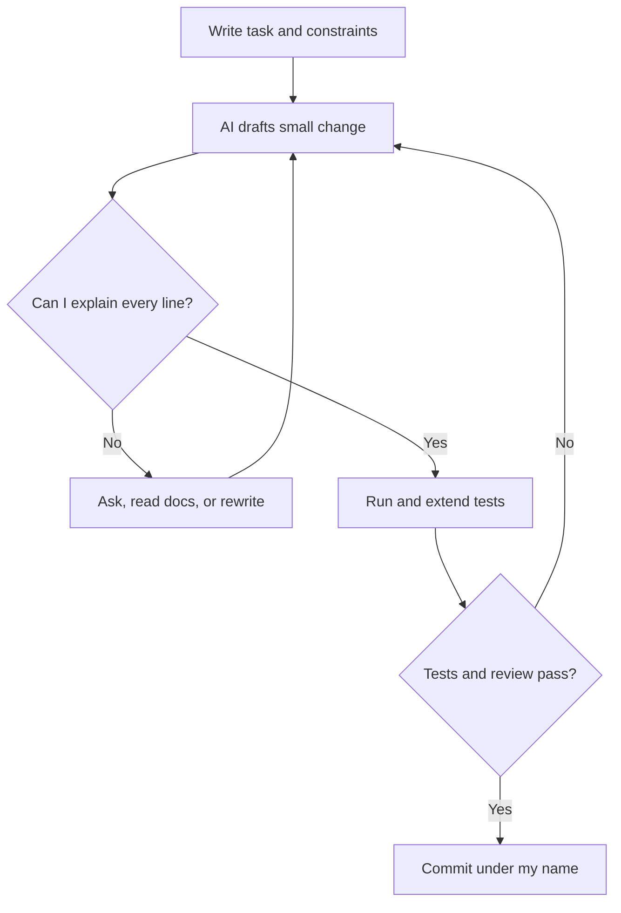

## In one line
AI coding tools can draft code in seconds, but you are still the engineer: you must understand, test, and stand behind every line you ship.

## The problem it solves
You ask an AI tool for "an endpoint that returns an order by ID". Thirty seconds later you have working code. You try it with your own order and it works.

But it also lets any logged-in user read **any** order, including other people's addresses and payment details. You didn't notice, because the code looked clean and the happy path worked.

That is the real problem. AI makes **writing** code cheap, so the valuable part becomes **checking** it. Skip the checking and you ship bugs faster than ever.

Interviews have caught up too. "Do you use AI tools? How?" is now a common question. An honest, specific answer shows maturity. A vague one ("AI writes most of it") is a red flag.

## Everyday analogy
A very fast, very confident new hire. They have read millions of codebases but have never seen yours. They never say "I'm not sure". You would never merge their work unread, and if it breaks production, "the new hire wrote it" is no excuse. You approved it.

Where it breaks down: a real new hire learns your system over months. An AI tool mostly starts fresh each session and knows only what you show it, unless you set up project instructions for it.

## How it works
A few terms first:

- An **LLM** (large language model) is a program that writes text by predicting what most plausibly comes next, based on patterns from its training data.
- An **AI coding assistant** wraps an LLM for programming. It may autocomplete lines in your editor, answer in a chat panel, or act as an **agent**: a tool that can read files, run commands, and edit code across many steps.
- The **context** is everything the model sees for this request: your instructions, the files the tool includes, error messages. It sees nothing else.
- A **hallucination** is confident output that is false: a function that doesn't exist, a wrong config flag, or a package name nobody ever published.

The key internal fact: the model produces **plausible** code, not **verified** code. It doesn't know your database schema unless you show it. It can't see your production data. Its knowledge of libraries stops at its training date, so it may use an outdated API. Code that looks right and code that is right are different things. Only you, your tests, and your reviewers can close that gap.

A safe workflow:

1. **Write the task and constraints.** "Logged-in users may only see their own orders. Use parameterised queries."
2. **Give the right context.** Point it at the relevant files, the table schema, and how errors are handled in your codebase.
3. **Ask for a small change.** A 30-line diff can be reviewed properly. A 600-line one gets skimmed.
4. **Read every line.** If you can't explain a line, ask the tool to explain it, check the docs, or rewrite it.
5. **Run the tests, and add the missing ones,** especially for failure and permission cases.
6. **Check what it added.** New packages, new environment variables, changed config, deleted checks.
7. **Commit it as your own work,** because it now is.


*Notice: the AI only drafts; nothing reaches a commit until you can explain it and the tests pass.*

## Real example
**Setup:** an Express app with a PostgreSQL `orders` table and a `requireLogin` middleware that sets `req.user`. `db` is a `pg` pool.

**The AI draft** for "add GET /api/orders/:id":

```js
app.get('/api/orders/:id', async (req, res) => {
  const result = await db.query(`SELECT * FROM orders WHERE id = ${req.params.id}`);
  res.json(result.rows[0]);
});
```

It works when you test it with your own order. A careful read finds four problems:

1. **SQL injection.** The ID is pasted into the SQL text, so a crafted URL can change the query. See [OWASP essentials](#/topic/owasp-essentials).
2. **Broken access control.** There is no check that the order belongs to the user. User 981 can read user 982's order just by changing the number.
3. **`SELECT *`** returns every column, including ones the client should never see.
4. **No error handling.** In Express 4, a rejected promise in a route never reaches the error handler. The request hangs, or the unhandled rejection crashes the Node process.

**After review:**

```js
app.get('/api/orders/:id', requireLogin, async (req, res, next) => {
  try {
    const { rows } = await db.query(
      'SELECT id, status, total_cents, created_at FROM orders WHERE id = $1 AND user_id = $2',
      [req.params.id, req.user.id], // values sent separately: no SQL injection
    );
    if (!rows[0]) return res.status(404).json({ error: 'Order not found' }); // same answer for "not yours"
    res.json(rows[0]);
  } catch (err) {
    next(err); // let the central error handler respond
  }
});
```

Then prove the important part with a request as user 981 for order 8, which belongs to user 982. It must return `404`. Better still, write that as an automated test so nobody can break it later. See [Unit vs integration vs end-to-end](#/topic/test-levels).

**Check any package the AI suggests before installing it:**

```bash
npm view express-rate-limit version time.created repository.url
# version = '8.7.1'
# time.created = '2014-12-11T01:58:05.543Z'
# repository.url = 'git+https://github.com/express-rate-limit/express-rate-limit.git'
```

A package created last week, with no real repository, deserves suspicion. Attackers can publish malicious packages under names that AI tools tend to invent.

## How to say it in an interview

> [!INTERVIEW]
> **30 seconds:** "Yes, I use AI tools daily, mostly for boilerplate, tests, unfamiliar APIs, and first drafts. I treat the output like a pull request from a fast junior developer: I keep changes small, read every line, and run and extend the tests before I commit. If I can't explain a line, it doesn't go in. Anything I submit is my code, and I can walk you through any of it."

> [!INTERVIEW]
> **2 minutes:** Start with the 30-second answer, then add:
>
> "The main risk is that AI code is plausible, not verified. It looks clean and the happy path works, so the bugs hide in the edges: permissions, error handling, concurrency, security.
>
> A real example: I asked for an endpoint to fetch an order by ID. The draft worked, but it built SQL by string concatenation and never checked that the order belonged to the logged-in user. I fixed both and added a test that one user gets a 404 for another user's order.
>
> I give the tool context, like the schema and constraints, and ask for small diffs. I check new dependencies, because models sometimes suggest packages that don't exist. And I never paste secrets or customer data into a tool our company hasn't approved.
>
> The tradeoff: AI saves me real time on routine work, but on critical code, like payments or auth, I slow down. There the review takes longer than the writing, and that's fine."

## Follow-up questions interviewers ask

<details>
<summary>How do you know AI-generated code is correct?</summary>

The same way as any code: I read it, run it, and test it. I write or check the test cases myself, especially the failure cases: wrong user, missing data, invalid input, timeouts. Then CI and a teammate's review add two more checks. "The AI said so" is never evidence.

</details>

<details>
<summary>Is it fine to let the AI write the tests too?</summary>

It can draft them, but read the assertions closely. A model that misunderstood the requirement writes tests that confirm the misunderstanding, so code and tests agree and both are wrong. Decide **what** to test yourself: the business rules and edge cases. Let the tool help with the typing.

</details>

<details>
<summary>What would you not use AI tools for?</summary>

- Code I can't evaluate yet, like cryptography or tricky concurrency, without an expert review.
- Pasting secrets, customer data, or private code into tools my company hasn't approved.
- Learning a fundamental for the first time. If it always writes the code for me, I never build the skill to review it.
- Large rewrites I can't review properly.

</details>

<details>
<summary>Can you code without it?</summary>

Answer honestly. Say what you can do unaided (read and debug code, design an API, write SQL) and where AI speeds you up. Some interviews allow AI tools, and many live-coding rounds don't, so ask before the interview and practise both ways. See [What to say when you don't know](#/topic/when-you-dont-know).

</details>

<details>
<summary>How do you get better results from these tools?</summary>

Give context and constraints up front: relevant files, schema, and what must not change. Ask for a plan before code on bigger tasks, and keep each request small. When it's wrong, say exactly what is wrong instead of "try again". Many tools also read a project instructions file holding your conventions.

</details>

## Common mistakes and misconceptions

> [!MISTAKE]
> "It runs and the tests pass, so it's correct." If the same tool wrote the tests, they may test the wrong thing. Passing tests only prove what they actually check.

> [!MISTAKE]
> Hiding AI use in an interview, or overclaiming it ("AI wrote the whole app"). Interviewers want to know you understand your code. Be specific about what you used it for and how you checked it.

> [!MISTAKE]
> Accepting big diffs in one go. Nobody reviews 600 lines carefully. Ask for small steps and review each one.

> [!MISTAKE]
> Installing every package it suggests. Check that the package exists, is maintained, and is actually needed. Every dependency is code you now trust.

## Tradeoffs: when NOT to use it
- **When you can't judge the output.** In an unfamiliar, high-risk area, a confident wrong answer is worse than no answer. Read the docs or ask an expert.
- **When the data is sensitive.** Company policy and privacy law may forbid sending code or customer data to outside services.
- **When you are learning the basics.** Write it yourself first. You need the skill to review AI output later.
- **When it adds risk without saving time.** Auth, payments, and data migrations deserve slow, human-led work, with AI as a helper at most.

## Check yourself

<details>
<summary>1. Why is AI-generated code risky even when it compiles and works on your first try?</summary>

The model produces plausible code, not verified code. The happy path usually works. The bugs hide in what you didn't try: other users' data, bad input, errors, and concurrency.

</details>

<details>
<summary>2. The AI suggests installing a package you've never heard of. What do you check?</summary>

That it exists and is the real package (`npm view` shows its creation date and repository), that it's maintained and widely used, and whether you need it at all. Models sometimes invent package names, and attackers can publish packages under those names.

</details>

<details>
<summary>3. An interviewer asks, "Did you write this project yourself?" You used AI heavily. What's a good answer?</summary>

Be honest and specific: "I designed it and made the key decisions. AI drafted a lot of the code, and I reviewed, tested, and often rewrote it. I can explain any part." Then prove it by walking through the code.

</details>

## Go deeper
- [GitHub docs: best practices for using Copilot](https://docs.github.com/en/copilot/get-started/best-practices)
- [OWASP Top 10 for LLM apps: misinformation, including unsafe code suggestions](https://genai.owasp.org/llmrisk/llm092025-misinformation/)
