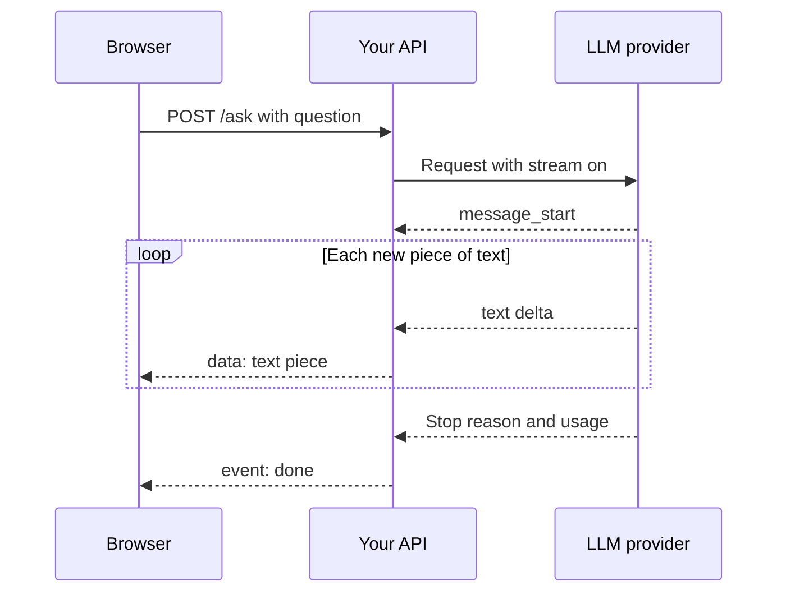

## In one line
Calling an LLM from your backend means sending text to a paid, slow, rate-limited API, so you stream the answer, set timeouts, retry carefully, and cap how many tokens anyone can spend.

## The problem it solves
Your shop wants an "Ask about this product" box. A shopper types "Is this mug dishwasher safe?" and an AI answers.

An **LLM** (large language model) is a program trained on huge amounts of text that writes text by predicting what comes next. You don't run it yourself. You call a provider's **API** over HTTPS and pay per use.

Built naively, four things go wrong:

1. **It feels broken.** A long answer can take 10 to 30 seconds. The shopper stares at a spinner and leaves.
2. **It fails sometimes.** The provider is busy, or you hit your limit, and the call errors out.
3. **Every request costs money.** One person scripting 10,000 questions becomes a surprise bill.
4. **The secret leaks.** Calling the provider from the browser exposes your **API key**, the password that bills your account.

So the call always goes through your backend, which handles speed, failure, and cost.

## Everyday analogy
Hiring an expert by phone, billed per word: every word you read to them, and at a higher rate every word they say back. You listen while they talk instead of waiting for a letter. That is streaming. When their line is busy, you call back after a short wait.

Where it breaks down: this expert remembers nothing between calls. Each call, you re-read the whole conversation so far, and pay for it again.

## How it works
First, the internal pieces interviewers ask about:

- A **token** is the unit an LLM reads and writes: a word, part of a word, or a punctuation mark. A typical English word is roughly one or two tokens, but the exact split depends on the model's **tokenizer**, the component that cuts text into tokens. Providers bill and rate-limit by tokens, not characters.
- **Input tokens** are everything you send: instructions, history, documents. **Output tokens** are what the model writes back, and they are usually priced several times higher. At the time of writing, Anthropic's current models charge 5× more for output than input.
- The **context window** is the most tokens one request can hold, input and output together. At the time of writing, Anthropic lists 1M tokens for its current models. Many other models have less.
- The API is **stateless**: it remembers nothing between requests. Chat "memory" is your server re-sending the history every time, so each turn costs more than the last.
- The **system prompt** is the standing instruction sent with each request ("You answer questions about product 42"). The user's text goes in a separate message.

A streamed request then runs like this:

1. The browser sends the question to **your** API, never to the provider directly.
2. Your server sends the model name, system prompt, messages, and `max_tokens`, a hard cap on output length.
3. The provider checks your **rate limits**: caps on requests and tokens per minute. Over the limit, it answers `429 Too Many Requests`.
4. The model generates the answer one token at a time.
5. With **streaming**, the provider sends each piece as soon as it exists, using **server-sent events (SSE)**: one long HTTP response made of short text events, each a `data:` line followed by a blank line.
6. Your server forwards each piece to the browser, also as SSE.
7. The final events carry the **stop reason** (finished, or cut off by `max_tokens`) and the **usage**: exact input and output token counts. Log them. That is your cost data.


*Notice: the browser sees the first words long before the model finishes, and only your API ever talks to the provider.*

## Real example
**Setup:** Node.js 20, `npm install express @anthropic-ai/sdk`, and `ANTHROPIC_API_KEY` set as an environment variable. This uses Anthropic's official SDK (a library that wraps the API). Other providers' SDKs have the same ideas under different names.

**1. Create one client with a timeout and retries** (`llm.js`):

```js
import Anthropic from '@anthropic-ai/sdk';

// Reads ANTHROPIC_API_KEY from the environment. The key never reaches the browser.
export const llm = new Anthropic({
  timeout: 60_000, // give up on one attempt after 60 s (milliseconds in the JS SDK)
  maxRetries: 2,   // retry 429s, 5xx errors, and network failures, with backoff
});
```

**2. Stream the answer to the browser** (`server.js`):

```js
import express from 'express';
import { llm } from './llm.js';

const app = express();
app.use(express.json());

app.post('/api/products/:id/ask', async (req, res) => {
  const question = String(req.body.question ?? '').slice(0, 2000); // cap input = cap cost
  res.set({ 'Content-Type': 'text/event-stream', 'Cache-Control': 'no-cache' });
  res.flushHeaders(); // send headers now; the body follows piece by piece

  const stream = llm.messages.stream({
    model: process.env.LLM_MODEL ?? 'claude-opus-5-5',
    max_tokens: 1500, // hard cap on output tokens, and so on cost
    system: `You answer short questions about product ${req.params.id} in our shop.`,
    messages: [{ role: 'user', content: question }],
  });
  res.on('close', () => stream.abort()); // user left: stop generating (and paying)

  stream.on('text', (text) => res.write(`data: ${JSON.stringify(text)}\n\n`));
  try {
    const msg = await stream.finalMessage();
    console.log('llm usage', msg.usage.input_tokens, msg.usage.output_tokens); // cost data
    res.write(`event: done\ndata: ${JSON.stringify(msg.stop_reason)}\n\n`);
  } catch (err) {
    if (!stream.aborted) res.write('event: error\ndata: "Assistant unavailable, try again"\n\n');
    console.error('llm error', err.status ?? err.message);
  }
  res.end();
});

app.listen(3000);
```

**Watch it stream.** `curl -N` prints each event the moment it arrives:

```bash
curl -N -X POST localhost:3000/api/products/42/ask \
  -H 'Content-Type: application/json' -d '{"question":"Is it dishwasher safe?"}'
# data: "Yes, "
# data: "the mug "
# ...
# event: done
# data: "end_turn"
```

On a `429` or `5xx`, the SDK retries twice with growing waits, honouring the provider's `retry-after` header; if all attempts fail, the browser gets the `error` event. If the shopper closes the tab, `stream.abort()` cancels the upstream call. If the stop reason is `max_tokens`, the UI can say the answer was cut short.

## How to say it in an interview

> [!INTERVIEW]
> **30 seconds:** "I always call the LLM from the backend, so the API key stays secret and I control cost. I stream the response with server-sent events, so users see words within a second or two instead of waiting for the whole answer. I set a timeout, retry rate-limit and server errors with exponential backoff, and cap output with max_tokens. I log token usage on every call and put per-user limits in front of the endpoint, because each request costs money."

> [!INTERVIEW]
> **2 minutes:** Start with the 30-second answer, then add:
>
> "Pricing, rate limits, and the context window are all measured in tokens, and output costs more than input. The API is stateless, so chat history is re-sent every turn and cost grows with the conversation. I trim or summarise old history.
>
> For a product Q&A box, I'd stream from the provider into my Express route and forward each chunk to the browser. If the user disconnects, I abort the upstream call so we stop paying for tokens nobody reads.
>
> On cost, I cap input length and max_tokens, use the smallest model that answers well, and cache repeated work. A product description generated once can be stored in Postgres instead of regenerated per visitor.
>
> The tradeoff with streaming is error handling. Once I've sent a 200 status and some text, I can't switch to an error status. A mid-stream failure becomes an error event, and the client must handle a half-finished answer."

## Follow-up questions interviewers ask

<details>
<summary>Which errors should you retry, and how?</summary>

Retry temporary failures: `429`, `5xx` server errors (Anthropic uses `529` for "overloaded"), timeouts, and dropped connections. Don't retry `400` or `401`; they fail the same way every time.

Use **exponential backoff**: wait roughly 1 s, then 2 s, then 4 s, plus **jitter** (a little randomness) so many servers don't retry in sync. Honour `retry-after` when present, and cap the retries. Each timed-out attempt costs a full timeout, so 60 s with 2 retries can take about 3 minutes. See [Retries, backoff, and DLQs](#/topic/retries-backoff-dlq).

</details>

<details>
<summary>Can you retry a stream that failed halfway?</summary>

Not transparently. The provider can't resume from the middle, and the user has already seen part of the answer. Either restart and tell the client to clear what it showed, or keep the partial text and show "answer interrupted, try again". SDK retries apply to failures before the stream starts, not mid-stream.

</details>

<details>
<summary>How do you stop one user from running up a huge bill?</summary>

Layer the limits:

- Cap input size and `max_tokens` per request.
- Rate-limit per user and per IP, for example 20 questions an hour. See [Rate limiting](#/topic/rate-limiting).
- Track tokens per user per day from the usage numbers, and refuse once a budget is spent.
- Set spending alerts or limits in the provider's console.
- Require login for expensive features.

</details>

<details>
<summary>How would the browser read this stream?</summary>

The built-in `EventSource` only makes GET requests. For a POST with a JSON body, use `fetch` and read `response.body` with a stream reader, splitting events on blank lines. See [Real-time: WebSockets vs SSE vs polling](#/topic/realtime).

</details>

<details>
<summary>Answers are slow and expensive. What do you look at?</summary>

The usage logs. High input tokens mean you send too much: full history, whole documents, a long system prompt. Trim history, send only relevant passages (see [RAG](#/topic/rag)), and use the provider's prompt caching for a repeated prefix if offered. High output tokens: ask for shorter answers and lower `max_tokens`. Some models also spend output tokens on hidden reasoning, so a cheaper setting may be enough for simple tasks.

</details>

## Common mistakes and misconceptions

> [!MISTAKE]
> "Streaming makes the model faster." No. The total time is about the same. Streaming shows the first words sooner, so the wait feels much shorter.

> [!MISTAKE]
> "The model remembers our earlier chat." The API is stateless. Your server re-sends the history each time and pays for those tokens again.

> [!MISTAKE]
> Retrying every error in a tight loop. Retrying a `400` never helps, and retrying a `429` immediately makes the rate limiting worse. Retry only temporary errors, with backoff and a cap.

> [!MISTAKE]
> Trusting the output like your own code. The model can be wrong, and attackers can steer its text. Escape it before showing it as HTML, and validate it before acting on it. See [Prompt injection](#/topic/prompt-injection).

## Tradeoffs: when NOT to use it
- **Plain code can do it.** Formatting a price or sorting orders needs no LLM. Code is instant, free, and consistent.
- **Answers must be exact.** Refund amounts, stock, and prices come from your database. An LLM may phrase them, never invent them.
- **Nobody is waiting.** Writing descriptions for 5,000 products needs no streaming. Run it as a [background job](#/topic/background-jobs); many providers offer a cheaper batch API for work that can wait.
- **Latency budgets are tight.** A checkout step that must answer in 200 ms can't wait seconds for a model.

## Check yourself

<details>
<summary>1. A chat costs more on its 20th message than on its 1st, even though the questions are the same length. Why?</summary>

The API is stateless, so your server re-sends the whole conversation each time. Message 20 carries 19 earlier exchanges, all billed again.

</details>

<details>
<summary>2. The provider returns 429 with retry-after: 5. What should your code do?</summary>

Wait about 5 seconds, then retry, up to a small limit. If it still fails, return a friendly error.

</details>

<details>
<summary>3. Why does the example call stream.abort() when the response closes?</summary>

If the shopper closes the tab, nobody reads the rest. Aborting cancels the upstream request, so you stop paying for output tokens.

</details>

## Go deeper
- [Anthropic docs: streaming messages](https://platform.claude.com/docs/en/build-with-claude/streaming)
- [Anthropic docs: rate limits](https://platform.claude.com/docs/en/api/rate-limits)
- [MDN: using server-sent events](https://developer.mozilla.org/en-US/docs/Web/API/Server-sent_events/Using_server-sent_events)
