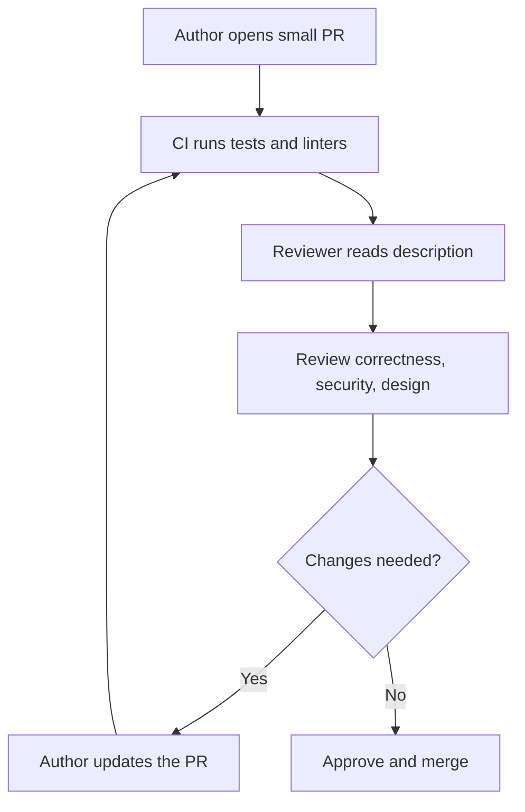

## In one line
Code review means a teammate reads your change before it merges, looking first for bugs, security holes, and risky design, and only last for style.

## The problem it solves
A developer adds "cancel order" to your shop. It works on their laptop. But it refunds the full amount even after a partial refund, lets anyone cancel anyone's order, and has no test. Nobody else looked at it. The bug ships on Friday evening.

Code review puts a second pair of eyes on every change. It catches bugs while they're cheap to fix, spreads knowledge across the team, and keeps the codebase consistent.

A few terms:

- A **pull request** (PR; GitLab calls it a merge request) is a proposal to merge a branch into `main`, with a description and a discussion thread. See [Git essentials](#/topic/git-essentials).
- A **diff** is the set of lines added and removed by the change.
- **CI** (continuous integration) runs tests and checks automatically on every PR.

## Everyday analogy
An editor reading an article before it's published. A good editor first asks "is this true, and does it make sense?", then "is it well structured?", and only last fixes commas.

Where it breaks down: an editor can rewrite your article. A reviewer should point out problems and explain why, but the author usually makes the changes.

## How it works
Before a human looks, let tools handle the mechanical checks: **linters** (tools that flag suspicious code and style issues), formatters, type checks, and tests in CI. Humans shouldn't spend time on what a machine can catch.

Then the reviewer reads the PR description (what and why), and reviews in rough priority order:

1. **Correctness.** Does it do what the description says? Edge cases: empty lists, missing records, retries, two requests at once.
2. **Security.** Is input validated? Is authorization checked, so users only touch their own data? Any secrets or personal data in logs?
3. **Design.** Is the logic in the right place? Is it simpler than it could be? Will it be easy to change later?
4. **Tests.** Do tests cover the new behaviour and its failure cases? Would they fail if the code were broken?
5. **Operability.** Will we know when it breaks in production (logs, metrics)? Is the database migration safe on a big table? Can we roll back?
6. **Readability.** Clear names, small functions, comments explaining *why*.
7. **Style.** Only what the formatter and linter don't already enforce.

The reviewer then approves, approves with minor comments, or requests changes. The author responds, updates, and the loop repeats until it's merged.


*Notice: machines check first, and humans spend their attention on correctness and design.*

**Size matters most.** A 50-line PR gets a careful read. A 1,500-line PR gets skimmed and approved. Small PRs get better reviews, faster.

## Real example
**Setup:** a PR titled "Add order cancellation". The key part of the diff:

```js
app.post('/api/orders/:id/cancel', requireLogin, async (req, res) => {
  const { rows } = await db.query('SELECT * FROM orders WHERE id = $1', [req.params.id]);
  await payments.refund(rows[0].payment_id, rows[0].total_cents);
  await db.query("UPDATE orders SET status = 'cancelled' WHERE id = $1", [req.params.id]);
  res.json({ ok: true });
});
```

Useful review comments, labelled by severity so the author knows what blocks the merge:

```text
[blocking] Authorization: any logged-in user can cancel any order. Add
"AND user_id = $2" with req.user.id, and return 404 when no row comes back.

[blocking] Missing order: if rows[0] is undefined this throws, and in Express 4
an unhandled async error never reaches the error handler. Wrap in try/catch + next(err).

[blocking] Business rule: what about orders already shipped, or partly refunded?
Should we refund total_cents, or the amount actually captured minus refunds?

[question] If the refund succeeds but the UPDATE fails, the customer is refunded
but the order still looks active. Could we mark it 'cancelling' first, and pass
an idempotency key to the refund so a retry can't refund twice?

[blocking] Tests: please add tests for cancelling another user's order (404)
and an already-cancelled order.

[nit] SELECT * fetches columns we don't use. Not blocking.
```

Each comment names the problem, explains why it matters, and suggests a direction. None argues about formatting.

## How to say it in an interview

> [!INTERVIEW]
> **30 seconds:** "I let CI handle formatting, linting, and tests, so my review time goes on what matters: correctness, edge cases, security like authorization checks, design, tests, and whether we can operate it in production. I label comments as blocking, questions, or nits, and explain the why. As an author, I keep PRs small and write a clear description, because small PRs get much better reviews."

> [!INTERVIEW]
> **2 minutes:** Start with the 30-second answer, then add:
>
> "For example, reviewing an order-cancellation endpoint, I'd check that users can only cancel their own orders, what happens with shipped or partly refunded orders, and what happens if the refund succeeds but the database update fails. That last one is easy to miss and costs real money.
>
> I review the code, not the person. I ask questions when I'm unsure, like 'what happens if this runs twice?', and I approve with nits rather than blocking on preferences.
>
> The tradeoff is speed versus thoroughness. Reviews that sit for days slow the whole team, so I try to respond within a few hours. And I match depth to risk: a copy change gets a quick look, a payment change gets a careful one."

## Follow-up questions interviewers ask

<details>
<summary>How do you handle disagreement in a review?</summary>

Separate facts from preferences. For facts (a bug, a security hole), show evidence: a failing test case or a link to the docs. For preferences, defer to the team's style guide, or let the author decide. If a thread goes back and forth more than twice, talk it through on a call, then write the decision in the PR.

</details>

<details>
<summary>What do you do with a huge PR?</summary>

Ask, kindly, for it to be split: for example the database migration first, then the backend, then the UI. If splitting isn't possible, ask the author to walk you through it, and review in passes, starting with the riskiest parts. Approving 1,500 lines after a skim gives false confidence.

</details>

<details>
<summary>What makes a good PR description?</summary>

What changed and why, a link to the ticket, how it was tested, screenshots for UI changes, and anything risky: migrations, new environment variables, rollout or rollback steps. It saves the reviewer from guessing the intent.

</details>

<details>
<summary>How do you review AI-generated code?</summary>

Exactly as strictly as human code, and with extra attention to code that looks plausible but is wrong: missing authorization checks, invented functions or packages, swallowed errors. The author must be able to explain every line. See [Using AI coding tools well](#/topic/ai-coding-tools).

</details>

## Common mistakes and misconceptions

> [!MISTAKE]
> Spending the review on style. Twenty comments about spacing and none about the missing authorization check. Automate style with a formatter and linter, and look for bugs.

> [!MISTAKE]
> "LGTM" (looks good to me) on a large PR after a two-minute skim. If you didn't really review it, say what you checked and what you didn't.

> [!MISTAKE]
> Comments that attack or command, like "This is wrong" or "Why would you do this?". Explain the problem and suggest a fix: "This lets users cancel others' orders. Could we filter by user_id?"

> [!MISTAKE]
> "Review is the reviewer's job to find bugs." The author owns quality. Test your change and review your own diff before asking anyone else.

## Tradeoffs: when NOT to use it
- **Don't block on preferences.** If it's correct, readable, and consistent, approve it, with an optional nit.
- **Don't let review replace tests.** Humans miss things. Tests check every time.
- **In an emergency fix,** a fast review by one person beats waiting for three. Do a fuller follow-up review afterwards.

## Check yourself

<details>
<summary>1. Name the first three things to look for in a review, in priority order.</summary>

Correctness (including edge cases), security (validation and authorization), and design. Style comes last, ideally handled by tools.

</details>

<details>
<summary>2. Why do small PRs get better reviews?</summary>

A reviewer can hold a small change in their head and check it carefully. Large PRs overwhelm attention, so they get skimmed, and bugs slip through.

</details>

<details>
<summary>3. Rewrite this comment to be useful: "This query is bad."</summary>

For example: "[blocking] This query has no user_id filter, so any user can read any order. Could we add AND user_id = $2 with req.user.id?" It names the problem, the impact, and a fix.

</details>

## Go deeper
- [Google engineering practices: how to do a code review](https://google.github.io/eng-practices/review/)
- [Google engineering practices: what to look for in a code review](https://google.github.io/eng-practices/review/reviewer/looking-for.html)
