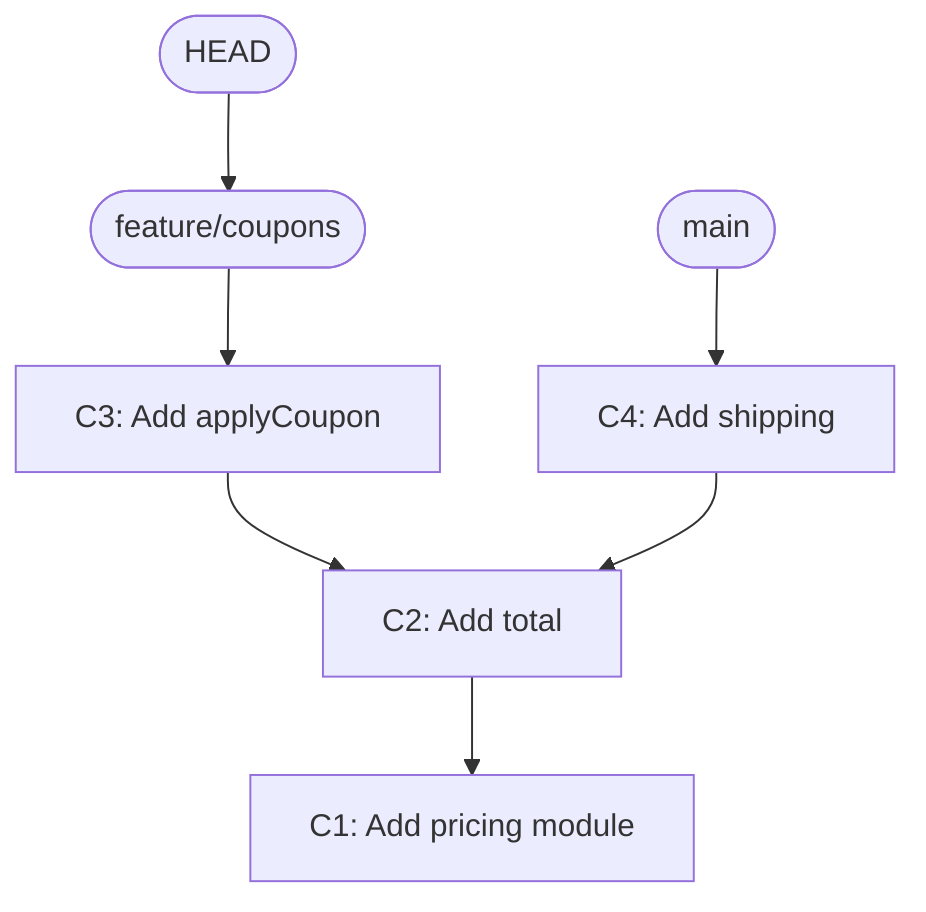

## In one line
Git records your project as a chain of snapshots called commits, and branches are just movable labels pointing at commits. Once you see that, merging, rebasing, and undoing mistakes stop being scary.

## The problem it solves
Three developers work on your shop's code at once. One adds coupons, one changes shipping rules, one fixes a checkout bug that is live in production right now. Without a system:

- They overwrite each other's changes.
- Nobody can say which change broke checkout, or go back to yesterday's working version.
- The urgent fix must wait until half-finished coupon code is ready to ship.

**Git** is a **version control system**: a tool that records every change to your files, who made it, and why, and lets people work in parallel and combine their work later. A **repository** (repo) is a project folder plus its full history. GitHub and GitLab host copies of repos, but Git itself runs on your laptop.

Interviewers rarely ask you to recite commands. They ask what merge and rebase actually do, how you'd fix a conflict, and how you'd undo a bad commit without hurting teammates. That all comes from understanding the model below.

## Everyday analogy
A photo album of your project. Every time you're happy with your work, you take a photo of the whole project (a commit) and write a caption. Each photo notes which photo came before it. Sticky notes (branches) mark the latest photo of each line of work, and a "you are here" pin (HEAD) shows which sticky note you're following.

Where it breaks down: Git is smarter than a photo album. Files that didn't change aren't stored twice, so a "photo" of an unchanged file costs almost nothing.

## How it works
**The model in four parts:**

1. **A commit is a snapshot, not a diff.** It records the full state of every tracked file, plus the author, time, message, and a pointer to its **parent** (the commit before it). Each commit gets a **hash**: a long ID like `6dbe87e…`, calculated from its contents. Change anything about a commit and you get a different hash, so commits never change. "Editing" a commit really creates a new one.
2. **A branch is a pointer.** `main` is a tiny file holding one commit hash. When you commit on a branch, Git creates the new commit and moves the pointer forward. Creating a branch is instant, because nothing is copied.
3. **HEAD is "where you are".** Normally it points to a branch, such as `main`. `git switch feature/coupons` moves HEAD to that branch and updates your files to match its commit.
4. **Three areas.** The **working tree** is the files you edit. The **staging area** (or index) is what will go into the next commit; `git add` puts changes there. The **repository** holds the commits.


*Notice: each commit points back to its parent, branches are labels on single commits, and HEAD says which label you're on.*

Here both branches share history up to C2, then split. Combining them is where merge and rebase come in.

**Merge** creates a new **merge commit** with two parents, C3 and C4. History keeps exactly what happened, including that work ran in parallel. If `main` has no new commits of its own, Git just slides the pointer forward. That's a **fast-forward** merge, with no merge commit.

**Rebase** replays your branch's commits on top of the other branch, one at a time. C3 becomes a new commit C3′, with C4 as its parent. History becomes one straight line. Because C3′ has a different parent, it has a **different hash**. The old C3 is abandoned.

```text
Before                 After merge                After rebase of feature onto main
C1-C2-C4  main         C1-C2-C4----M  main        C1-C2-C4-C3'  feature
     \                      \     /
      C3  feature            C3--'  feature
```

**The golden rule:** never rebase commits that others have already pulled. Rebasing replaces commits with new ones. Your teammates still have the old ones, and the histories conflict. Rebase your own unpushed work freely.

**Conflicts.** If both branches changed the same lines, Git can't choose. It stops, marks the file, and waits for you to edit it, `git add` it, and continue.

**Undo, from safest to most powerful:**

| Situation | Command | Rewrites history? |
|---|---|---|
| Discard unsaved edits to a file | `git restore file.js` | No (but the edits are gone) |
| Unstage a file, keep the edits | `git restore --staged file.js` | No |
| Fix the last commit's message or contents (not pushed) | `git commit --amend` | Yes |
| Undo the last commit, keep its changes staged (not pushed) | `git reset --soft HEAD~1` | Yes |
| Undo a commit that is already pushed | `git revert <hash>` | No: adds a new "opposite" commit |
| Recover "lost" commits | `git reflog`, then `git reset --hard` or `git branch` | Moves pointers back |

`HEAD~1` means "one commit before HEAD". The **reflog** is your local diary of everywhere HEAD has pointed. After a bad `reset` or rebase, the old commits still exist for a while (by default, Git keeps reflog entries for commits no branch points to for 30 days), and the reflog tells you their hashes.

## Real example
**Setup:** Git 2.40 or later (`git --version`). These commands ran in a throwaway repo.

**1. Feature branch, conflict, and resolution:**

```bash
git switch -c feature/raise-threshold        # create a branch and move HEAD to it
# ...edit shipping.js to 7500...
git commit -am "Raise threshold to 75"       # -a stages changes to tracked files
git switch main                               # meanwhile, main changed the same line to 6000
git merge feature/raise-threshold
# CONFLICT (content): Merge conflict in shipping.js
```

Git marks the clash inside the file:

```text
<<<<<<< HEAD
export const FREE_SHIPPING_CENTS = 6000;
=======
export const FREE_SHIPPING_CENTS = 7500;
>>>>>>> feature/raise-threshold
```

The top half is what your current branch has; the bottom half is what's coming in. Talk to whoever wrote the other change if needed. Then edit the file to the correct final version, delete the markers, and finish:

```bash
git add shipping.js          # mark the conflict as resolved
git commit --no-edit         # complete the merge (during a rebase: git rebase --continue)
git log --oneline --graph
# *   6b165c4 Merge branch 'feature/raise-threshold'
# |\
# | * f2d1272 Raise threshold to 75
# * | a39b1cf Raise threshold to 60
# |/
# * 34a4b8f Add free shipping threshold
```

Changed your mind mid-conflict? `git merge --abort` or `git rebase --abort` puts everything back as it was.

**2. Rebase before opening a pull request:**

```bash
git switch feature/coupons
git rebase main              # replay my commits on top of the latest main
# Successfully rebased and updated refs/heads/feature/coupons.
git push --force-with-lease  # update MY remote branch; refuses if someone else pushed to it
```

The commit hash changed from `d1f41e9` to `8ec1e88`. Same change, new commit. That's why you only force-push branches you own. `--force-with-lease` is the safer force: it refuses if the remote branch has commits you haven't seen.

**3. Recover from a bad reset with the reflog:**

```bash
git reset --hard HEAD~3      # oops: three commits gone from the branch
git reflog -3
# a39b1cf HEAD@{0}: reset: moving to HEAD~3
# 44bacc3 HEAD@{1}: revert: Revert "Add notes (fixed)"
# c10838e HEAD@{2}: commit: Add notes (fixed)
git reset --hard HEAD@{1}    # move the branch back to where it was before the reset
# HEAD is now at 44bacc3 Revert "Add notes (fixed)"
```

Note that `reset --hard` also throws away uncommitted edits, and the reflog can't bring those back. Commit or `git stash` first.

## How to say it in an interview

> [!INTERVIEW]
> **30 seconds:** "Git stores history as commits, which are snapshots that point to their parent, and branches are just movable pointers to commits. I work on short-lived feature branches. Merge combines branches with a merge commit and keeps the true history. Rebase replays my commits on top of main for a straight history, but it creates new commits, so I only rebase work nobody else has pulled. For undoing pushed work I use git revert, and if I lose commits locally, git reflog finds them."

> [!INTERVIEW]
> **2 minutes:** Start with the 30-second answer, then add:
>
> "Day to day: I branch off main, make small commits, and before opening a pull request I rebase onto the latest main, so conflicts are resolved by me, on my branch, and the history is easy to read. Then I push with force-with-lease, which won't overwrite someone else's work.
>
> For conflicts, I read both sides, check with the other author if the intent isn't clear, resolve, then run the tests before continuing, because a merge that compiles can still be wrong.
>
> The merge-versus-rebase tradeoff is honesty versus readability. Merge keeps the real history but can get noisy with merge commits. Rebase gives a clean line but rewrites commits. Many teams rebase locally and then squash-merge pull requests into main, so each feature is one commit. That's easy to read and easy to revert.
>
> For mistakes: if it's local, reset or amend. If it's pushed to a shared branch, revert, never rewrite."

## Follow-up questions interviewers ask

<details>
<summary>What's the difference between git reset and git revert?</summary>

`reset` moves the branch pointer back, so later commits disappear from the branch. That rewrites history, so use it only on unpushed work. `revert` adds a **new** commit that undoes an earlier one. History only grows, so it's safe on shared branches like `main`.

</details>

<details>
<summary>What is a squash merge?</summary>

All of a branch's commits are combined into a single new commit on `main`. The history shows one commit per feature, which is easy to read and to revert. The cost is losing the individual steps on `main`; they remain visible in the pull request.

</details>

<details>
<summary>git fetch vs git pull?</summary>

`git fetch` downloads new commits from the remote and updates your **remote-tracking branches**, like `origin/main`, without touching your own branches or files. `git pull` is a fetch followed by a merge (or a rebase, with `--rebase` or the `pull.rebase` setting) into your current branch. Fetch first when you want to look before combining.

</details>

<details>
<summary>What is "detached HEAD"?</summary>

HEAD points directly at a commit instead of at a branch, for example after `git switch --detach a39b1cf`. You can look around and even commit, but no branch moves with your new commits, so they're easy to lose. If you want to keep them, create a branch: `git switch -c my-fix`.

</details>

<details>
<summary>You committed a secret, like an API key. What do you do?</summary>

First, **revoke and replace the key** at the provider, immediately. Once pushed, assume it's been copied. Then remove it from the code and from history if needed (tools like `git filter-repo` rewrite history, which needs coordination with the team). Add the file to `.gitignore` and load secrets from environment variables. See [Environment variables and secrets](#/topic/env-secrets).

</details>

## Common mistakes and misconceptions

> [!MISTAKE]
> "A branch is a copy of the code." It's a pointer to one commit, a file holding a hash. That's why creating and switching branches is instant.

> [!MISTAKE]
> Rebasing or force-pushing a shared branch like `main`. Teammates' histories no longer match, and work can be lost. Rewrite only your own unpushed or personal branches, and use `--force-with-lease`, never plain `--force`.

> [!MISTAKE]
> Resolving a conflict by blindly taking "mine" or "theirs". Often the right answer combines both changes. Read both sides and run the tests before finishing.

> [!MISTAKE]
> "`reset --hard` deleted my commits forever." Committed work is usually recoverable from `git reflog` for a while. Uncommitted changes, however, really are gone.

> [!MISTAKE]
> Long-lived feature branches. After three weeks apart, the merge conflicts are huge. Merge small changes often, and hide unfinished features behind a **feature flag** (a setting that turns code on or off without deploying).

## Tradeoffs: when NOT to use it
- **Don't rebase public history.** Merge or revert instead.
- **Don't rewrite history to look tidy at the cost of safety.** An extra merge commit is harmless. A lost teammate's commit is not.
- **Don't store large binary files in Git.** Videos and big datasets bloat every clone forever. Use object storage like S3, or Git LFS (Large File Storage) for assets that must be versioned.
- **Don't use Git as a deployment or backup tool.** Committing database dumps or `node_modules` is the wrong tool. See [Backups and restore](#/topic/backups).

## Check yourself

<details>
<summary>1. You rebased your feature branch. Why did every commit hash on it change?</summary>

A commit's hash covers its contents and its parent. Rebasing gives each commit a new parent, so Git creates new commits with new hashes. The originals still exist until cleanup, and the reflog can find them.

</details>

<details>
<summary>2. A bad commit is already on main and teammates have pulled it. How do you undo it?</summary>

`git revert <hash>`, then push. It adds a new commit that reverses the change, without rewriting the history others already have.

</details>

<details>
<summary>3. What do HEAD, main, and origin/main each point to?</summary>

`main` points to the latest commit of your local main branch. `origin/main` is your last-known position of main on the remote, updated by `git fetch`. HEAD points to whatever you have checked out, usually a branch like `main`.

</details>

## Go deeper
- [Pro Git book: branches in a nutshell](https://git-scm.com/book/en/v2/Git-Branching-Branches-in-a-Nutshell)
- [Pro Git book: rebasing (and when not to)](https://git-scm.com/book/en/v2/Git-Branching-Rebasing)
- [Git docs: git reflog](https://git-scm.com/docs/git-reflog)
