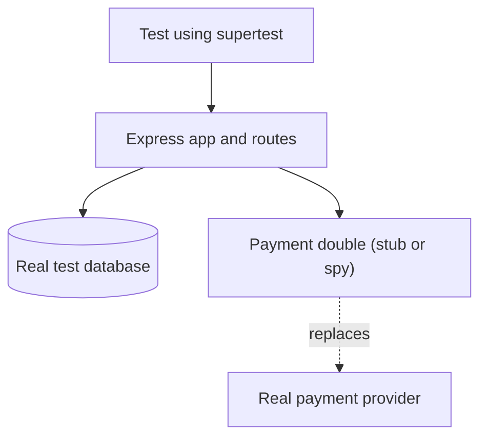

## In one line
To test an API, send it real HTTP requests in your tests, and replace only the things you can't or shouldn't use for real, like a payment provider, with test doubles that you control.

## The problem it solves
Your shop's `POST /orders/:id/pay` route charges a card through a payment provider such as Stripe. You want tests for it. But:

- You can't charge a real card on every test run.
- You can't make the real provider decline a card, or go down, on demand. Yet those are exactly the cases you must test.
- Calls over the internet are slow, and they fail when the network does. Tests that depend on them become **flaky**: they fail sometimes without any real bug.

So you swap the payment provider for a stand-in that answers however each test needs. Done badly, though, you swap out so much that the tests only test your stand-ins, and pass while production is broken. The skill is choosing what to fake.

## Everyday analogy
A film stunt double. For the dangerous car crash, a double stands in for the actor. Everything else, the dialogue and the close-ups, uses the real actor, because that's what the audience comes to see.

Where it breaks down: a stunt double looks like the actor. A test double only behaves like the real service in the ways you programmed. If the real provider changes its responses, your double won't notice, and your tests keep passing.

## How it works
A **test double** is any object that stands in for a real dependency during a test. A **dependency** is something your code relies on: a database, a payment API, an email service. The standard names (from Gerard Meszaros, popularised by Martin Fowler) are worth knowing, because interviewers use them:

| Double | What it does | Shop example |
|---|---|---|
| **Dummy** | Passed in but never used | A logger the test doesn't care about |
| **Stub** | Returns canned answers | `charge()` always returns `declined` |
| **Spy** | A stub that also records how it was called | Checks `charge()` ran once, with 2598 cents |
| **Mock** | Pre-programmed with expected calls; fails if they don't happen | "Expect exactly one `charge` call" |
| **Fake** | A working, simplified version | An in-memory orders store using a `Map` |

In everyday JavaScript, people say "mock" for all of these. `mock.fn()` in Node's built-in test runner is, strictly, a spy.

**What to replace, and what to keep real:**

1. **Send real HTTP requests to your app.** **supertest** calls your Express app in-process, through routing, middleware, validation, and error handling, without opening a network port.
2. **Keep your own database real where practical.** A real PostgreSQL in Docker catches SQL bugs a double would hide. See [Unit vs integration vs end-to-end](#/topic/test-levels).
3. **Replace what crosses your system's edge:** payment providers, email and SMS senders, third-party APIs, the clock. These are slow, cost money, have side effects, or can't be made to fail on demand.
4. **Get the double in through dependency injection.** That means passing dependencies in as arguments, as in `createCheckoutApp({ orders, payments })`, instead of importing them deep inside. Then a test simply passes different objects.
5. **Assert on outcomes first:** the HTTP status, the body, the saved data. Check calls on a spy only when the call itself is the point, like "charged exactly once".


*Notice: everything you own runs for real; only the external provider is replaced.*

## Real example
**Setup:** Node.js 20, `npm install express`, `npm install --save-dev supertest`, `"type": "module"` in `package.json`. To keep this example self-contained, the orders store is a fake. In a real project you'd often use a test database instead.

**1. The app takes its dependencies as arguments** (`checkout.js`):

```js
import express from 'express';

// Dependencies are passed in, so tests can swap in test doubles.
export function createCheckoutApp({ orders, payments }) {
  const app = express();

  app.post('/orders/:id/pay', async (req, res, next) => {
    try {
      const order = await orders.findById(Number(req.params.id));
      if (!order) return res.status(404).json({ error: 'Order not found' });

      const result = await payments
        .charge({ amountCents: order.totalCents, idempotencyKey: `order-${order.id}` })
        .catch(() => null); // provider down or timed out
      if (!result) return res.status(503).json({ error: 'Payment service unavailable' });
      if (result.status === 'declined') return res.status(402).json({ error: 'Card declined' });

      await orders.markPaid(order.id, result.chargeId);
      res.json({ status: 'paid' });
    } catch (err) {
      next(err); // anything else goes to the central error handler
    }
  });
  return app;
}
```

The **idempotency key** lets the provider recognise a retried request and not charge twice. See [Idempotency](#/topic/idempotency).

**2. The happy path, with a fake and a spy** (`checkout.test.js`):

```js
import { test, mock } from 'node:test';
import assert from 'node:assert/strict';
import request from 'supertest';
import { createCheckoutApp } from './checkout.js';

function fakeOrders() { // FAKE: a small working in-memory orders store
  const rows = new Map([[7, { id: 7, totalCents: 2598, status: 'pending' }]]);
  return {
    rows,
    findById: async (id) => rows.get(id) ?? null,
    markPaid: async (id, chargeId) => Object.assign(rows.get(id), { status: 'paid', chargeId }),
  };
}

test('charges the order total once and marks it paid', async () => {
  const orders = fakeOrders();
  const charge = mock.fn(async () => ({ status: 'succeeded', chargeId: 'ch_123' })); // stub + spy
  const app = createCheckoutApp({ orders, payments: { charge } });

  await request(app).post('/orders/7/pay').expect(200, { status: 'paid' });

  assert.equal(charge.mock.callCount(), 1); // charged exactly once...
  assert.deepEqual(charge.mock.calls[0].arguments[0], { amountCents: 2598, idempotencyKey: 'order-7' });
  assert.equal(orders.rows.get(7).status, 'paid');
});
```

**3. The failures you can't trigger with the real provider** (same file):

```js
test('a declined card returns 402 and leaves the order unpaid', async () => {
  const orders = fakeOrders();
  const payments = { charge: async () => ({ status: 'declined' }) }; // STUB: canned answer
  await request(createCheckoutApp({ orders, payments })).post('/orders/7/pay').expect(402);
  assert.equal(orders.rows.get(7).status, 'pending');
});

test('a payment provider outage returns 503, not a crash', async () => {
  const payments = { charge: async () => { throw new Error('connect ETIMEDOUT'); } }; // STUB: outage
  await request(createCheckoutApp({ orders: fakeOrders(), payments })).post('/orders/7/pay').expect(503);
});
```

```bash
node --test --test-reporter=spec
# ✔ charges the order total once and marks it paid (14.2ms)
# ✔ a declined card returns 402 and leaves the order unpaid (15.2ms)
# ✔ a payment provider outage returns 503, not a crash (2.0ms)
```

Three behaviours, including an outage, tested in milliseconds without touching a real card.

## How to say it in an interview

> [!INTERVIEW]
> **30 seconds:** "I test APIs through HTTP with supertest, so routing, middleware, validation, and error handling all run for real. I keep my own database real, usually Postgres in Docker, and replace only external dependencies like the payment provider or email service with test doubles. That lets me test declines, timeouts, and outages on demand. I inject dependencies into the app, so tests can pass in a stub or spy, and I assert mainly on what the API returns and stores."

> [!INTERVIEW]
> **2 minutes:** Start with the 30-second answer, then add:
>
> "For checkout, I'd stub the payment client to return success, a decline, or throw a timeout, and check the route returns 200, 402, or 503 and leaves the order in the right state. Where the call itself matters, I use a spy to assert we charged exactly once, with the right amount and idempotency key.
>
> I'm careful not to over-mock. If I mock the database and my own modules, the test mostly checks that my mocks agree with each other. It passes even when the SQL is wrong.
>
> The tradeoff is drift. A stub encodes my assumptions about the provider, and if the provider's API changes, my tests won't notice. So I build stubs from the provider's documented responses, keep a small number of tests against the provider's sandbox environment, and sometimes add contract tests between our own services."

## Follow-up questions interviewers ask

<details>
<summary>What's the difference between a stub and a mock?</summary>

A **stub** supplies answers: "when `charge` is called, return declined". It helps the test reach a certain state. A **mock** checks behaviour: it knows which calls should happen, and the test fails if they don't. In other words, stubs support assertions on state, and mocks are assertions on interactions. Many JavaScript tools blur this, and that's fine as long as you can explain the idea.

</details>

<details>
<summary>How do you replace a dependency the code imports directly?</summary>

The cleanest way is dependency injection: pass it in, as `createCheckoutApp({ payments })` does. Without that, you can intercept at the HTTP level with tools like nock or Mock Service Worker (MSW), which catch outgoing requests and return prepared responses. Jest and Vitest can also replace whole modules. Interception and module mocking work, but they couple tests to file paths and URLs. Injection is usually simpler.

</details>

<details>
<summary>What is over-mocking, and how do you spot it?</summary>

Replacing so much that the test no longer exercises real code. Signs: the test mocks your own modules and database, its assertions mostly check that mocks were called, and it breaks on harmless refactors but passes when real bugs are added. The fix: mock only at system edges, and assert on outputs.

</details>

<details>
<summary>How do you test code that depends on the current time?</summary>

Make the clock a dependency, or use fake timers. Node's test runner has `mock.timers` (marked experimental in Node 20), and Jest and Vitest have their own. Then "a coupon that expires at midnight" can be tested at 23:59 and 00:01 instantly, every time.

</details>

## Common mistakes and misconceptions

> [!MISTAKE]
> Mocking your own database "for speed". Postgres in Docker is fast enough for most suites, and a mocked database hides wrong SQL, missing columns, and constraint errors.

> [!MISTAKE]
> Testing only the happy path because "the stub always succeeds". The main reason to stub a provider is to test declines, timeouts, and malformed responses.

> [!MISTAKE]
> Asserting on every internal call. If the test checks that `findById` was called before `markPaid`, any refactor breaks it. Assert on the response and the stored data, and spy only on calls that matter, like charging money.

> [!MISTAKE]
> Writing stubs from memory. If the stub returns `{ ok: true }` but the real provider returns `{ status: 'succeeded' }`, tests pass and production fails. Copy shapes from the provider's documentation or real sandbox responses.

## Tradeoffs: when NOT to use it
- **Don't mock what you own and can run cheaply.** Your database, your modules, and Redis in Docker are usually better tested for real.
- **Don't rely only on doubles for a critical integration.** Add a few tests against the provider's sandbox, run nightly or before release, to catch drift.
- **Don't fake a whole complex system yourself.** An in-memory fake of PostgreSQL behaves differently in many small ways. Use the real thing in a container.

## Check yourself

<details>
<summary>1. You want to check that a declined card returns 402. Which double do you need, and why?</summary>

A stub for the payment client that returns a decline. You only need a canned answer to reach that path. Then assert on the 402 response and that the order stays unpaid.

</details>

<details>
<summary>2. Your tests mock the database and all pass, but production fails with a SQL syntax error. What went wrong?</summary>

The mocked database never ran the SQL, so the test couldn't catch the error. Test the database layer against a real test database.

</details>

<details>
<summary>3. Why pass payments into createCheckoutApp instead of importing it inside the file?</summary>

Dependency injection lets each test pass in its own double, with no module-mocking tricks, and production passes the real client. It also makes the dependency visible in the function's signature.

</details>

## Go deeper
- [Martin Fowler: test doubles (dummy, fake, stub, spy, mock)](https://martinfowler.com/bliki/TestDouble.html)
- [Node.js docs: mocking in the test runner](https://nodejs.org/api/test.html#mocking)
- [supertest on GitHub](https://github.com/forwardemail/supertest)
