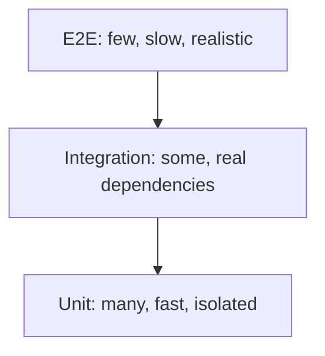

## In one line
Unit tests check one small piece of logic alone, integration tests check that pieces work together with real dependencies, and end-to-end tests check a whole user journey through the real app. You need a mix, weighted toward the fast ones.

## The problem it solves
You change how coupons are calculated. Did checkout just break? Did the order history page break? Did a 10% coupon on a $9.99 mug come out as $8.99 or $8.98?

Without automated tests, you find out by clicking through the app by hand. That takes many minutes, you skip it when busy, and customers find the bug instead.

A few terms:

- An **automated test** is code that runs your code and checks the result, for example "the total for 2 mugs at $12.99 is $25.98".
- A **test runner** is the tool that finds and runs your tests and reports what passed. Node.js has one built in: `node:test`. Jest and Vitest are popular alternatives.
- An **assertion** is the line that checks a result, like `assert.equal(total, 2598)`. If it's false, the test fails.

But tests cost time to write, run, and maintain. The real question is which kind of test catches which bug most cheaply.

## Everyday analogy
Building a car. **Unit tests** check each part on the bench: does this brake pad grip, does this bulb light? **Integration tests** check parts connected together: brake pedal to brake pads, through real hydraulic lines. **End-to-end tests** are a test drive on a real road.

You check thousands of parts, many connections, and take a few test drives. A test drive catches what the bench can't, but it's slow, and a failure doesn't say which part is wrong.

Where it breaks down: in software the line between levels is blurry. Where one level ends and the next begins is a judgement call, not a fixed rule.

## How it works
**The three levels:**

1. **Unit test.** Tests one function or module alone, with no database, network, or files. It runs in microseconds to milliseconds. Best for business logic with many cases: pricing, validation, date rules.
2. **Integration test.** Tests several pieces together with **real** dependencies: your Express route, your SQL, and a real PostgreSQL test database. It runs in tens of milliseconds to seconds. It catches what unit tests can't: wrong SQL, wrong column names, a middleware in the wrong order, a missing constraint.
3. **End-to-end (E2E) test.** Drives the whole running system like a user would, usually by controlling a real browser with a tool like Playwright or Cypress. "Log in, add a mug to the cart, pay, see the confirmation." It takes seconds per test. It proves the critical journeys work, but it's slower and more **flaky**: failing sometimes without any real bug, because of timing, network, or test data.

**The test pyramid** is the classic guideline for the mix: many unit tests at the bottom, fewer integration tests in the middle, a few E2E tests at the top. The higher you go, the more confidence each test gives, and the slower, costlier, and flakier it gets.


*Notice: going down, tests get faster and more numerous; going up, each test covers more of the real system.*

Some teams prefer a "testing trophy" shape with integration tests as the biggest group, because in a typical API many bugs live in the connections. Both agree: few E2E tests, and test each behaviour at the lowest level that can catch its bugs.

**Running them.** Tests run on every push in **CI** (continuous integration: a service that tests every change automatically). Unit tests also run constantly on your laptop, because they are instant. See [CI/CD with GitHub Actions](#/topic/ci-cd).

## Real example
**Setup:** Node.js 20, `npm install express pg` and `npm install --save-dev supertest`, `"type": "module"` in `package.json`. For the integration test, a throwaway PostgreSQL database with `products` and `orders` tables, its URL in `TEST_DATABASE_URL`. For example, run `docker run -d -p 5433:5432 -e POSTGRES_PASSWORD=pw -e POSTGRES_DB=shop_test postgres:16`.

**1. Unit test** for the pricing logic (`pricing.test.js`):

```js
import { test } from 'node:test';
import assert from 'node:assert/strict';
import { calculateOrderTotal } from './pricing.js';

test('adds up price × quantity for every item', () => {
  const items = [{ priceCents: 1299, quantity: 2 }, { priceCents: 500, quantity: 1 }];
  assert.equal(calculateOrderTotal(items), 3098);
});

test('applies a percentage coupon, rounded to whole cents', () => {
  assert.equal(calculateOrderTotal([{ priceCents: 999, quantity: 1 }], 10), 899); // 99.9 rounds to 100
});

test('rejects an impossible coupon', () => {
  assert.throws(() => calculateOrderTotal([], 150), RangeError);
});
```

**2. Integration test** for `POST /orders` (`orders.test.js`). **supertest** sends real HTTP requests to your Express app without opening a network port. `createApp(db)` builds the app around whichever database it's given.

```js
import { test, beforeEach, after } from 'node:test';
import assert from 'node:assert/strict';
import request from 'supertest';
import pg from 'pg';
import { createApp } from './app.js';

const db = new pg.Pool({ connectionString: process.env.TEST_DATABASE_URL }); // throwaway test DB
const app = createApp(db);

beforeEach(async () => { // every test starts from the same known data
  await db.query('TRUNCATE orders, products RESTART IDENTITY');
  await db.query("INSERT INTO products (id, name, price_cents) VALUES (42, 'Ceramic mug', 1299)");
});
after(() => db.end());

test('POST /orders saves the order and returns the total', async () => {
  const res = await request(app).post('/orders').send({ productId: 42, quantity: 2 }).expect(201);
  assert.equal(res.body.total_cents, 2598);

  const { rows } = await db.query('SELECT quantity FROM orders WHERE id = $1', [res.body.id]);
  assert.equal(rows[0].quantity, 2); // it really reached PostgreSQL
});

test('POST /orders rejects a quantity of 0', async () => {
  await request(app).post('/orders').send({ productId: 42, quantity: 0 }).expect(400);
});
```

**Run both:**

```bash
TEST_DATABASE_URL=postgres://postgres:pw@localhost:5433/shop_test node --test --test-reporter=spec
# ✔ POST /orders saves the order and returns the total (61.4ms)
# ✔ POST /orders rejects a quantity of 0 (5.6ms)
# ✔ adds up price × quantity for every item (0.6ms)
# ✔ applies a percentage coupon, rounded to whole cents (0.1ms)
# ✔ rejects an impossible coupon (0.1ms)
```

Look at the times. The unit tests take under a millisecond, so you can have thousands. The integration tests take milliseconds each but prove the SQL and the route really work.

**3. End-to-end**, in words: a Playwright test opens `shop.example.com` in a real browser on a staging copy of the app, logs in as a test user, buys a mug, and checks the confirmation page. Keep a handful of these for the journeys that make money: sign-up, checkout, video upload.

## How to say it in an interview

> [!INTERVIEW]
> **30 seconds:** "Unit tests check one piece of logic in isolation, so they're fast and pinpoint failures. Integration tests check pieces together with real dependencies, like my Express route against a real Postgres test database. End-to-end tests drive the whole app through a browser for critical journeys like checkout. I follow the pyramid idea: lots of unit tests, a solid layer of integration tests, and a few E2E tests, because higher levels give more confidence but are slower and flakier."

> [!INTERVIEW]
> **2 minutes:** Start with the 30-second answer, then add:
>
> "For a Node API, I put business rules like coupon logic in plain functions and unit-test every edge case. For each endpoint, I write integration tests with supertest against a real Postgres in Docker, resetting data before each test. That catches wrong SQL and missing constraints, which a mocked database would hide. Then a few Playwright tests cover sign-up, checkout, and video upload on staging.
>
> The tradeoff is speed and reliability versus realism. If a test suite takes 30 minutes or fails randomly, people stop trusting it and start ignoring failures. So I keep E2E tests few and stable, and I test each behaviour at the lowest level that can actually catch the bug. Everything runs in CI on every pull request."

## Follow-up questions interviewers ask

<details>
<summary>What is code coverage, and is 100% a good goal?</summary>

**Code coverage** is the percentage of your code lines (or branches) that ran during the tests. Low coverage shows untested areas, which is useful. But 100% doesn't mean correct: a test can run a line without checking its result. Chasing a number leads to useless tests. Aim for strong coverage of business logic and risky code, and judge tests by the bugs they would catch.

</details>

<details>
<summary>What makes a test flaky, and what do you do about one?</summary>

Common causes: depending on timing (`sleep(500)` and hoping), tests sharing data and running in a different order, real network calls, the current date, or randomness. Fix the cause: wait for a condition instead of a fixed time, reset data before each test, fake the clock, control the network. Quarantine a flaky test quickly. One unreliable test teaches the whole team to ignore red builds.

</details>

<details>
<summary>Should integration tests use a real database or a mocked one?</summary>

A real one, of the same kind and version as production, where practical. PostgreSQL in Docker starts in seconds. A mocked database can't catch wrong SQL, constraint violations, or transaction bugs, which are exactly what integration tests are for. Mock things you don't control, like a payment provider. See [Mocking and testing APIs](#/topic/mocking-api-tests).

</details>

<details>
<summary>What should you test first in a codebase with no tests?</summary>

Start where bugs would hurt most: money (checkout, refunds), auth, and data that's hard to fix once corrupted. A few integration tests around those endpoints give the most protection fastest. Then, whenever you fix a bug, first write a test that reproduces it. That's a **regression test**: it stops the same bug from coming back.

</details>

## Common mistakes and misconceptions

> [!MISTAKE]
> "Unit tests are enough." Every unit can pass while the system fails: the SQL has a typo, the route forgets the auth middleware, the date format differs between services. Integration tests catch the gaps between units.

> [!MISTAKE]
> Testing everything through E2E. The suite becomes slow and flaky, and a failure says "checkout broke" without saying where. Push each check down to the lowest level that can catch it.

> [!MISTAKE]
> Tests that share state, such as one test creating order 1 and another test expecting it. They pass alone and fail together, or in a different order. Reset data before each test.

> [!MISTAKE]
> Testing implementation details, such as asserting that a private helper was called, instead of checking the result. Then every refactor breaks tests while behaviour stays the same. Test what the code does, not how it does it.

## Tradeoffs: when NOT to use it
- **Don't unit-test glue code.** A route that only passes data from the request to a query has no logic to unit-test. An integration test covers it better.
- **Don't write E2E tests for every edge case.** Test "coupon over 100% is rejected" with a unit test. Keep E2E for whole journeys.
- **Don't test throwaway prototypes heavily.** If the code will be deleted next week, a quick manual check may be the right call. Add tests once it becomes real.

## Check yourself

<details>
<summary>1. A coupon rule has 12 edge cases. At which level do you test them?</summary>

Unit tests. The rule is pure logic, so each case runs in under a millisecond, and a failure points straight at the rule. Add one integration test to prove the endpoint applies coupons at all.

</details>

<details>
<summary>2. All unit tests pass, but POST /orders fails in staging with "column total does not exist". Which level should have caught it?</summary>

An integration test that runs the route against a real database with the real schema. The unit tests never touched the SQL.

</details>

<details>
<summary>3. Why keep end-to-end tests few?</summary>

They're slow, they break for reasons unrelated to bugs (timing, test data, network), and a failure doesn't pinpoint the cause. A few that cover the critical journeys give confidence. Hundreds make the suite slow and untrusted.

</details>

## Go deeper
- [Martin Fowler's site: the practical test pyramid](https://martinfowler.com/articles/practical-test-pyramid.html)
- [Node.js docs: the built-in test runner (node:test)](https://nodejs.org/api/test.html)
- [supertest on GitHub](https://github.com/forwardemail/supertest)
