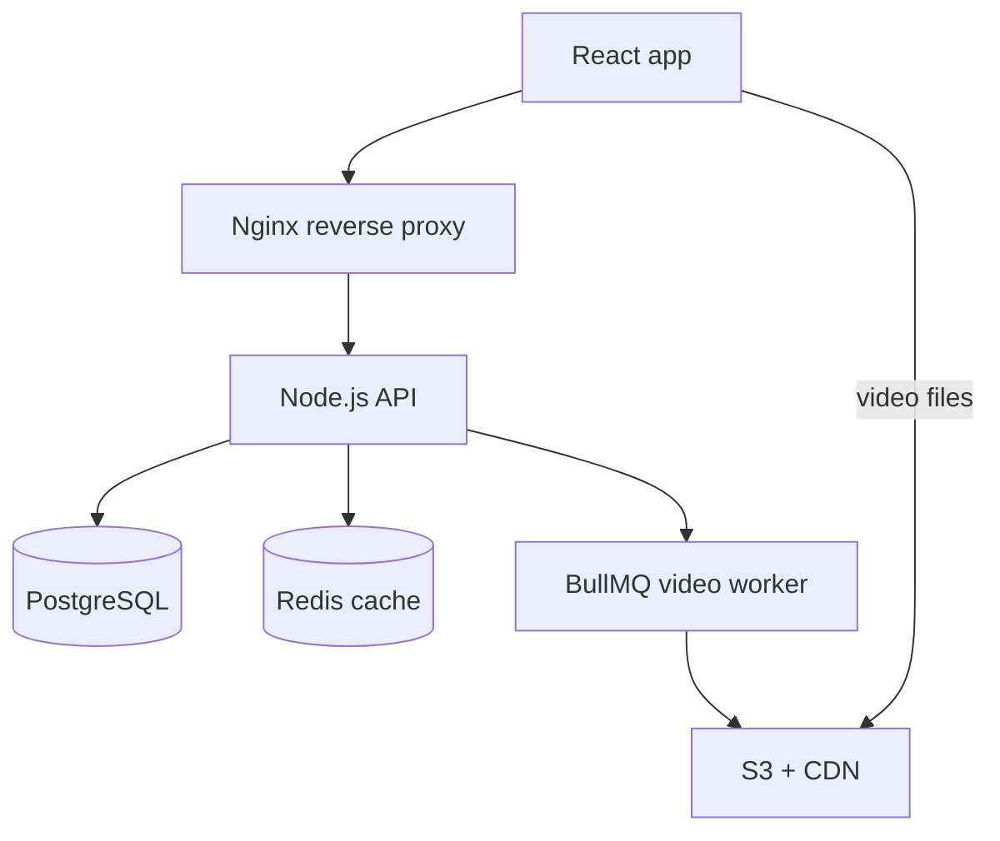

## In one line
Explaining your project means giving a short, layered tour: what it does and for whom, how it's built, what **you** did, two or three decisions and their tradeoffs, and what you'd change now.

## The problem it solves
"Walk me through a project you've worked on" comes up in almost every interview, often in the first ten minutes. It looks like a warm-up. It isn't. The interviewer is checking four things:

- **Real involvement:** did you build this, or just stand near it?
- **Depth:** do you understand why it works, or only that it works?
- **Judgment:** can you name tradeoffs and things you'd do differently?
- **Communication:** can you explain a system clearly to someone who has never seen it?

Two answers fail often: the feature tour ("then the user clicks here, and then...") and the tech list ("React, Node, Postgres, Redis, Docker") with no reasons.

There's also an upside. Your answer decides the next 20 minutes. Every technology you mention is an invitation to a follow-up question. Prepare well, and you steer the interview towards what you know best.

## Everyday analogy
A map with zoom. You start with the whole city, so the listener knows where things are. Then you zoom into the one neighbourhood you know best, and point out interesting streets.

Where it breaks down: in an interview, the listener can grab the zoom. They can point at any box you drew and say "tell me more about that one". So never put a box on the map that you can't explain.

## How it works
### The answer shape
Use the same six parts every time, in this order. Rough timings are for a 2 to 3 minute answer.

1. **Context (15 seconds).** What the product does, who uses it, and roughly how big it is. One or two sentences.
2. **Architecture (30 seconds).** The main pieces and how one request flows through them. Draw it if there's a whiteboard or shared screen.
3. **Your role (15 seconds).** What you owned, in "I" sentences. Say clearly what others did.
4. **Two or three decisions (45 seconds).** For each: what you chose, what you considered instead, and why. This is where judgment shows.
5. **One hard problem (30 seconds).** Something that went wrong or was tricky, and how you solved it. Use numbers only if they are real.
6. **What you'd change (15 seconds).** Honest, specific, and not self-punishing.

Then stop and hand over: "Happy to go deeper on any part. The upload pipeline is probably the most interesting."

### The sketch
If you can draw, draw first and talk over the drawing. Here is a sketch for the example project used on this page: a shop that sells products with short product videos.

*Notice: seven boxes and one request path is enough. Each box is a door you're inviting the interviewer through.*

## Real example
**The prep sheet.** Fill this in for one project before any interview. It takes an hour, and you'll reuse it for every interview.

| Part | Example answers (replace with your real facts) |
|---|---|
| Context | Online shop where sellers upload short product videos; a few thousand orders a month |
| Architecture | React frontend; Node/Express API behind Nginx; Postgres; Redis cache; BullMQ worker for video processing; S3 and a CDN for video; Docker Compose on one Ubuntu VPS |
| My role | Started on the React side; took over the API and deployment when the backend developer left. Built the upload pipeline and the deploy setup. Didn't build payments. |
| Decision 1 | Presigned S3 uploads instead of sending video through the API, so large files never block Node |
| Decision 2 | Postgres, not MongoDB: orders, products, and users are relational and need transactions |
| Decision 3 | One server with Docker Compose, not Kubernetes: our traffic didn't justify the complexity |
| Hard problem | Product pages slowed down after adding related videos; found a missing index with EXPLAIN |
| AI tools | Used an AI assistant to draft code; reviewed it, wrote tests, and caught a missing auth check |
| What I'd change | Add metrics and alerts earlier; we found problems from customer emails at first |

> [!WARNING]
> The example above is made up, to show the shape. Use your own project and your own numbers. If you don't know a real number, describe the scale in words ("a few hundred users a day") rather than inventing one. Interviewers often ask "how did you measure that?"

**"I" versus "we".** Interviewers listen for this closely.

- Too much "we": "We built a video pipeline." The interviewer can't tell what you did.
- Too much "I": claiming the whole system when you built one part. It falls apart at the first deep question.
- Right: "The team was three developers. I owned the upload pipeline and the deployment. Payments was a teammate's area, so I know how it connects, but not its internals."

**Talking about AI tools honestly.** If you wrote much of the code with an AI assistant, say so plainly and show that you stayed in control: you understood the design, reviewed every change, tested it, and can explain any line. "I used Copilot to scaffold the worker, then rewrote the retry logic, because it retried failed payments, which isn't safe" is a strong answer. See [Using AI coding tools well](#/topic/ai-coding-tools).

## How to say it in an interview

> [!INTERVIEW]
> **30 seconds:** "The project I know best is an online shop where sellers upload short product videos. It's a React frontend and a Node and Express API behind Nginx, with Postgres for orders and products, Redis for caching, and a background worker that processes videos and stores them in S3 behind a CDN. It all runs in Docker Compose on one Ubuntu server. I started on the frontend and later took over the backend and deployment, and I built the upload pipeline myself. Happy to go deeper on any part."

> [!INTERVIEW]
> **2 minutes:** Start with the 30-second answer, then add decisions, a problem, and a lesson:
>
> "A couple of decisions I'd point out. Videos are large, so instead of streaming them through Node, the API gives the browser a presigned URL, and the browser uploads straight to S3. Then a BullMQ job picks it up, transcodes it, and marks it ready. That keeps the API fast, though it makes the flow harder to follow, because the upload and the processing happen outside the request.
>
> I also chose one server with Docker Compose rather than Kubernetes. For our traffic, Kubernetes would have been more to learn and operate than the problem justified. The tradeoff is that the server is a single point of failure, so I made sure backups were automated and tested.
>
> One problem: after we added related videos to product pages, they got slow. EXPLAIN ANALYZE showed a sequential scan on the videos table, I added an index, and it went from seconds to milliseconds.
>
> If I did it again, I'd add metrics and alerts from day one. Early on, we found out about problems from customer emails, not from our monitoring."

## Follow-up questions interviewers ask

"Why did you choose PostgreSQL over MongoDB?"

Give the real reason, tied to the data. A good shape: "Orders, products, and users have clear relationships, and placing an order touches several tables that must succeed or fail together, so I wanted transactions and foreign keys. Product attributes vary a bit, and for those I used a JSONB column instead of a separate database." If the honest answer is "it was already there when I joined", say that, then add what you'd choose now and why. See [SQL vs NoSQL](#/topic/sql-vs-nosql).

"What would break first if traffic grew ten times?"

Show you've thought about bottlenecks. For the example: "Probably the database first, because product pages do several queries. I'd check the slowest queries, add caching for product pages, and add a read replica if reads dominate. Video is already served by the CDN, so that part scales. The single server is the other risk, so I'd put the API behind a load balancer with two instances." See [Vertical vs horizontal scaling](#/topic/vertical-horizontal-scaling).

"How did you deploy it?"

Be concrete and honest about the maturity. "GitHub Actions runs the tests and builds a Docker image, pushes it to a registry, then SSHes into the server and runs `docker compose pull` and `up -d`. There's a health check, and rolling back means redeploying the previous image tag." If it was manual, say so, and say how you'd automate it. See [CI/CD with GitHub Actions](#/topic/ci-cd).

"How much of this did you write yourself?"

Answer directly, without being defensive. Separate design from typing. "I designed the upload flow and the data model. I wrote a lot of the code with an AI assistant, and I reviewed and tested all of it. Here's a bug I caught in what it generated..." Interviewers worry about people who can't explain their own code, not about people who use tools.

## Common mistakes and misconceptions

> [!MISTAKE]
> Listing technologies without reasons. "React, Node, Postgres, Redis, Docker" tells the interviewer nothing. One sentence of "why" per choice is worth more than ten names.

> [!MISTAKE]
> Mentioning things you can't explain. If you say "Kafka", expect "why Kafka and not a simple queue?" Only name what you can defend for two follow-up questions.

> [!MISTAKE]
> Talking for ten minutes without checking in. Stop after two or three minutes and offer a choice: "Should I go deeper on the upload pipeline or the deployment?"

> [!MISTAKE]
> Inventing or inflating numbers, such as "it handled a million users". One "how did you measure that?" exposes it, and then the interviewer doubts everything else you said.

## Tradeoffs: the limits of this approach
- **Don't recite a memorised script.** Know the six parts and your key facts, then talk naturally. A recited answer sounds flat and breaks when you're interrupted.
- **Tailor to the role.** For a backend role, spend your time on the API, data, and deployment. For a full-stack role, include one frontend decision too.
- **Respect confidentiality.** For work projects, describe the architecture and your decisions without client names, internal numbers, or secrets. "A retail client" is fine.
- **A side project is fine** if you have no work project to show. Treat it with the same seriousness: real decisions, real tradeoffs, real problems.

## Check yourself

1. Name the six parts of the answer shape, in order.

Context, architecture, your role, two or three decisions with tradeoffs, one hard problem and how you solved it, and what you'd change.

2. Why is "we built a video pipeline" a weak sentence?

It hides your role. The interviewer can't tell whether you designed it, built part of it, or watched someone else build it. Say what you did ("I built the upload flow and the worker") and what others owned.

3. Why should you only draw boxes you can explain?

Every box invites a follow-up question. A box you can't explain becomes the place where the interview finds the limit of your knowledge, on a topic you chose.

## Go deeper
- [The C4 model: explaining architecture at different zoom levels](https://c4model.com/)
- [Tech Interview Handbook: Self introduction](https://www.techinterviewhandbook.org/self-introduction/)
