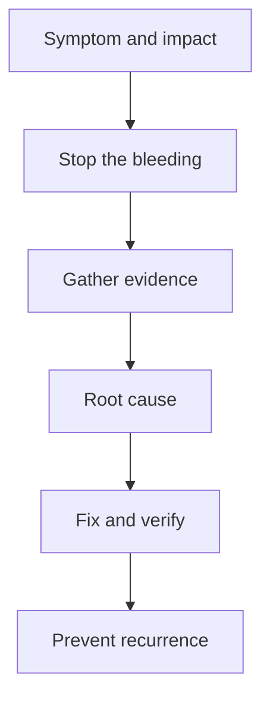

## In one line
A good production bug story shows, in about two minutes, how you noticed the problem, limited the damage, found the real cause with evidence, fixed it, and made sure it can't happen the same way again.

## The problem it solves
"Tell me about a production bug you fixed" (or "the hardest bug you've worked on") is a favourite backend question. A **production bug** is one that real users hit on the live system, as opposed to one caught during development or testing.

The interviewer is checking your **method** (evidence or guessing?), **priorities** (did you protect users first?), **ownership** (including of your own mistakes), and **learning** (did anything change afterwards?).

Weak answers are too small ("a typo in a variable name"), blame others ("the frontend team broke it"), or end at "and then I fixed it", with nothing about prevention.

## Everyday analogy
A detective story. There's a crime (the symptom), clues (logs, metrics, traces), suspects you rule out one by one, the culprit (the root cause), and finally new locks on the doors (prevention).

Where it breaks down: in a detective story, the clever deduction is the whole point. In a bug story, the interviewer cares just as much about the "boring" parts: how quickly you limited the damage, and what you changed so it can't happen again.

## How it works
### The answer shape
This is STAR (see [Behavioral answers with STAR](#/topic/star-method)), adapted for debugging:

1. **Symptom and impact.** What did users see, how many, and how did you find out?
2. **Stop the bleeding.** What did you do first to protect users? (Rollback, disable a feature, a quick workaround.)
3. **Investigation.** What evidence did you gather? What did you suspect first, and how did you rule it out?
4. **Root cause.** One clear sentence. The **root cause** is the underlying reason, not the symptom: "the endpoint wasn't idempotent", not "orders were duplicated".
5. **Fix and verify.** What did you change, and how did you prove it worked?
6. **Prevention.** A test, an alert, a code change that makes the mistake impossible, or a process change.
7. **Lesson.** One sentence on what you do differently now.

*Notice: "stop the bleeding" comes before investigation, and the story doesn't end at the fix.*

### Choosing the story
Pick a **real** bug where you played a central part, **medium-sized** (it needed investigation but fits in two minutes), **backend-flavoured** for a backend role (data, concurrency, performance, deploys), with a **lesson** you can state in one sentence.

Bugs you caused yourself are fine, often better. Owning a mistake and showing what you changed is exactly what interviewers want to see.

## Real example
An example story (build yours from a bug you really worked on): duplicate orders in the shop app.

> **Symptom and impact:** "One Monday, support forwarded emails from customers who'd been charged twice for one order. Looking at the database, about 30 orders over the weekend had a twin: same user, same cart, created a few seconds apart."
>
> **Stop the bleeding:** "The duplicates had started after a release on Friday, where I'd added automatic retries to the checkout request in the React app, so a slow network wouldn't lose an order. I turned that retry off with a quick release within the hour, and we refunded the duplicate charges."
>
> **Investigation:** "I searched the logs by user ID for the affected orders. Every pair had the same pattern: a first `POST /orders` that took over 10 seconds, then a second one 10 seconds after the first started. Ten seconds was the frontend timeout. So the first request hadn't failed. It was slow, because the payment provider was slow that weekend. The frontend gave up waiting and retried, and both requests completed."
>
> **Root cause:** "Our order endpoint wasn't idempotent: the same request sent twice created two orders. My retry made that visible."
>
> **Fix and verify:** "I added an idempotency key. The frontend generates a unique ID when the checkout starts and sends it in a header on every attempt. The API stores it with a unique constraint in Postgres, so a second request with the same key returns the first order instead of creating a new one. I tested it by forcing a slow payment and retrying, and got one order. Then I turned the retry back on."
>
> **Prevention and lesson:** "We added a nightly check that alerts if one user has two orders with the same cart within a minute, and a test for the retry case. My lesson: before adding a retry anywhere, ask whether the operation is safe to repeat."

See [Idempotency](#/topic/idempotency) for how idempotency keys work.

## How to say it in an interview

> [!INTERVIEW]
> **30 seconds:** "Some customers were charged twice for one order. It started after I added an automatic retry to the checkout request in the frontend. I turned the retry off straight away and we refunded the duplicates. The logs showed the first request was slow, not failed, because the payment provider was slow, so the retry created a second order. The real cause was that our order endpoint wasn't idempotent. I added an idempotency key with a unique constraint in Postgres, so a repeated request returns the original order, then turned the retry back on and added an alert for duplicates."

> [!INTERVIEW]
> **2 minutes:** Start with the 30-second answer, then add how you found it and the tradeoffs:
>
> "The key clue came from the logs. Every duplicate pair had the second request starting exactly 10 seconds after the first, which matched our frontend timeout. That told me it was the retry, and that the first request was still running when we gave up on it.
>
> There were a few options. Removing the retry for good would have fixed the duplicates, but brought back lost orders on bad networks. A longer timeout would only make it rarer. An idempotency key fixed the actual problem. The tradeoff is a bit more complexity: the frontend must keep the same key across retries, and the API has to handle a second request arriving while the first is still processing. I handled that with the unique constraint, so the second insert fails and the API returns the existing order.
>
> What I took away is a habit: whenever I add a retry, at any layer, I check whether the operation is safe to repeat. And I own the fact that I introduced the retry. It was a reasonable idea, but I didn't think through what happens when a request is slow rather than failed."

## Follow-up questions interviewers ask

"Why didn't your tests catch it?"

Answer honestly and specifically. "Our tests ran against a fast, mocked payment provider, so no request was ever slow enough to trigger the retry. I added a test that delays the payment call beyond the timeout and checks that only one order is created."

"How did you know it was the retry and not something else?"

Show the evidence and what you ruled out. "Duplicates started right after Friday's release, and none before. The gap between each pair matched the 10-second timeout exactly. Double-clicks would have shown gaps of under a second, and the button was disabled during submission anyway."

"What if you couldn't reproduce it?"

Explain how you'd gather more evidence instead of guessing: add targeted logging with request IDs around the suspected area, look for patterns in when and for whom it happens (time, user type, data size), and try to recreate those conditions, such as slow dependencies or concurrent requests. Meanwhile, keep users protected with a mitigation.

"How did you communicate with the team and customers?"

"I told the team in our channel as soon as I saw the pattern, including that it came from my change. Support got a short explanation and the list of affected orders, so they could refund and reply to customers. We wrote a short blameless post-mortem afterwards." See [Scenario: server down at 2 AM](#/topic/scenario-server-down).

## Common mistakes and misconceptions

> [!MISTAKE]
> Choosing a trivial bug, like a typo or a CSS issue. It shows no method. Pick something that needed investigation.

> [!MISTAKE]
> Blaming others: "the frontend team's code caused it". Even if true, focus on what you did. Interviewers imagine you describing them the same way one day.

> [!MISTAKE]
> Stopping at "and then I fixed it". Prevention and the lesson are what separate a good answer from an average one.

> [!MISTAKE]
> Inventing a dramatic story. A deep follow-up ("what did the logs show exactly?") quickly exposes it. A modest true story told well beats a dramatic made-up one.

## Tradeoffs: the limits of this approach
- **No production experience yet?** Use a real bug from a side project, a staging environment, or a course project, and say so. Don't pretend it was production.
- **Confidential details:** describe the shape of the bug, not client names, internal numbers, or security weaknesses that may still exist.
- **Not every bug has a neat root cause.** Sometimes the answer was "we added a timeout and better logging, and it hasn't recurred". Say that honestly, and say what you'd check if it came back.

## Check yourself

1. Why does "stop the bleeding" come before the investigation?

Users are being hurt while you investigate. A quick mitigation, such as a rollback or disabling a feature, limits the damage and gives you time to find the real cause calmly.

2. In the example, what was the symptom and what was the root cause?

The symptom was duplicate orders and double charges. The root cause was that the order endpoint was not idempotent, so a retried request created a second order.

3. Name two kinds of prevention you could mention at the end of a bug story.

Any two of: a test for the failing case, an alert that detects the problem, a code or database change that makes the mistake impossible (like a unique constraint), or a process change such as a review checklist item.

## Go deeper
- [Google SRE book: Example postmortem](https://sre.google/sre-book/example-postmortem/)
- [Stripe docs: Idempotent requests](https://docs.stripe.com/api/idempotent_requests)
