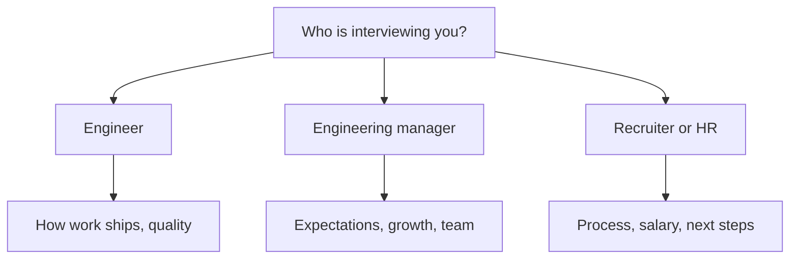

## In one line
At the end of an interview, ask two or three specific, genuine questions that help you decide whether you want the job and show how you think about the work.

## The problem it solves
Almost every interview ends with: "Do you have any questions for us?"

The most common answer, "No, I think you've covered everything", wastes a chance. It can come across as low interest. And you lose your best opportunity to find out what the job is really like.

That second part matters more than it seems. Interviews are two-way. A job ad doesn't tell you whether deploys are a calm button press or a nervous evening of SSH commands, whether you'd be on call every other week, or whether anyone reviews code. The people interviewing you know, and this is your moment to ask.

## Everyday analogy
Viewing a flat before renting it. The agent shows you round, but you still turn on the taps, open the windows, and ask about the neighbours, because you're the one who will live there.

Where it breaks down: in an interview, you're still being assessed while you ask. Your questions are part of the impression you leave, so they should be thoughtful, not a list of complaints.

## How it works
1. **Prepare five to eight questions** before the interview. Some will get answered along the way, so you need spares.
2. **Ask two or three per interviewer.** Leave the rest.
3. **Match the question to the person.** An engineer knows how work ships. A manager knows expectations and growth. A recruiter knows the process and the package.
4. **Ask about how work actually happens**, not about things on the company website.
5. **Listen and follow up** on the answer. One good follow-up beats three new questions.
6. **Close by asking about next steps**, so you know what to expect.

*Notice: each interviewer knows different things, so the same question isn't right for everyone.*

## Real example
**Questions for engineers**, and what the answer tells you:

| Question | What you learn | A warning sign in the answer |
|---|---|---|
| "Walk me through how a change gets from a laptop to production." | Code review, tests, CI/CD, how deploys work | "We SSH in and edit files on the server" |
| "What happens when production breaks at night? How often are people on call?" | On-call load and how incidents are handled | Vague answers, or "it's always the same person" |
| "What did the team learn from the last outage?" | Whether they write post-mortems, and whether they blame people | Blaming a named person |
| "How does the team use AI coding tools? Are there any rules?" | Their attitude to AI-assisted code, review standards | No review at all of generated code |
| "What's the most painful part of the codebase right now?" | Technical debt, and how honest they are | "Nothing, it's all great" |

**Questions for the engineering manager:**

- "What would a great first three months look like for this role?"
- "How do people on the team get feedback, and how often?"
- "What's the biggest challenge the team faces this year?"
- "How are priorities decided when the roadmap and technical work compete?"

**Questions for the recruiter or HR:**

- "What are the next steps, and when should I expect to hear back?"
- "What's the salary range for this role?" (The recruiter stage is the right place for this.)
- "How is the role set up: remote, hybrid, or office?"

**A closing question**, if you feel confident: "Is there anything in my background that makes you unsure about me for this role?" It gives you a chance to answer a concern before they decide. Use it only if you can respond calmly to what you hear.

## How to say it in an interview

> [!INTERVIEW]
> **30 seconds:** "Yes, two questions. First, could you walk me through how a change gets from someone's laptop to production here? I'm curious about reviews, tests, and how deploys work. And second, what does on-call look like for this team: how often, and what happens when something breaks at night?"

> [!INTERVIEW]
> **2 minutes** (an exchange with a follow-up):
>
> **You:** "Could you walk me through how a change gets to production?"
>
> **Interviewer:** "We open a pull request, someone reviews it, GitHub Actions runs the tests, and we deploy by merging to main."
>
> **You:** "That sounds smooth. How do you roll back if a deploy goes wrong? I ask because on my last project we deployed Docker images over SSH, and the first time we needed a rollback we realised we hadn't tagged our images. Rolling back meant rebuilding the old version under pressure. After that I started tagging every image with the commit hash. So I'm always curious how teams handle it."
>
> **Interviewer:** "Good question. We keep the previous image and can redeploy it with one click."
>
> **You:** "Nice. Do you also handle database migrations that way, or are those kept backward-compatible?"
>
> The follow-up shows real experience, and the answers tell you how mature their process is. The tradeoff: each follow-up uses time, so in a short slot one good exchange is better than three shallow questions.

## Situations you should be ready for

"What if they've already answered all my questions?"

Say so, and pick up something they said: "You covered most of what I wanted to ask. You mentioned you're moving to microservices. What's driving that?" This shows you listened. That's why you prepare spares.

"Can I ask about salary with the engineer?"

Usually not. Engineers often don't know the range, and it can make the conversation awkward. Ask the recruiter or hiring manager, typically early in the process or at the offer stage.

"How do I ask about work-life balance without sounding lazy?"

Ask about facts, not feelings. Instead of "Do you work long hours?", ask "What does a typical week look like?" or "How often are people on call, and what's a normal night on call like?" The answers tell you the same thing.

"The interviewer asks 'Why do you ask that?'"

Give your honest reason, ideally tied to experience: "I've worked on a team without code review, and bugs reached production that a second pair of eyes would have caught. So I've learned to value it." That turns your question into another chance to show what you care about.

## Common mistakes and misconceptions

> [!MISTAKE]
> "No questions." It wastes the chance to learn about the job and can look like low interest. Always have at least two ready.

> [!MISTAKE]
> Asking things you could have read on the website, such as "What does the company do?". It suggests you didn't prepare.

> [!MISTAKE]
> Asking ten questions in a row when time is nearly up. Read the room. If there are three minutes left, ask your best one.

> [!MISTAKE]
> Not listening to the answer. Moving straight to your next prepared question, without reacting, makes it feel like a checklist rather than interest.

## Tradeoffs: when NOT to ask
- **Don't ask questions you don't care about** just to seem interested. Interviewers can tell, and you waste time you could use on what matters to you.
- **Don't use questions to show off** or to catch the interviewer out. "Why aren't you using Kubernetes?" sounds like criticism. "What led you to your current setup?" gets the same information.
- **Don't negotiate in the technical round.** Salary and benefits discussions belong with the recruiter or at the offer stage.

## Check yourself

1. Why is "How does a change get to production?" a good question for an engineer?

It reveals how the team really works: code review, tests, CI/CD, and deploy safety. An engineer knows the honest answer, and it tells you what your daily work would be like.

2. Rephrase "Do you work long hours?" as a better question.

"What does a typical week look like for the team?", or "How often is each person on call?" Both ask for facts instead of a judgment.

3. Why prepare more questions than you'll ask?

Some will be answered during the interview. With spares ready, you still have good questions at the end.

## Go deeper
- [Tech Interview Handbook: Questions to ask at the end of an interview](https://www.techinterviewhandbook.org/final-questions/)
- [Julia Evans: Questions I'm asking in interviews](https://jvns.ca/blog/2013/12/30/questions-im-asking-in-interviews/)
