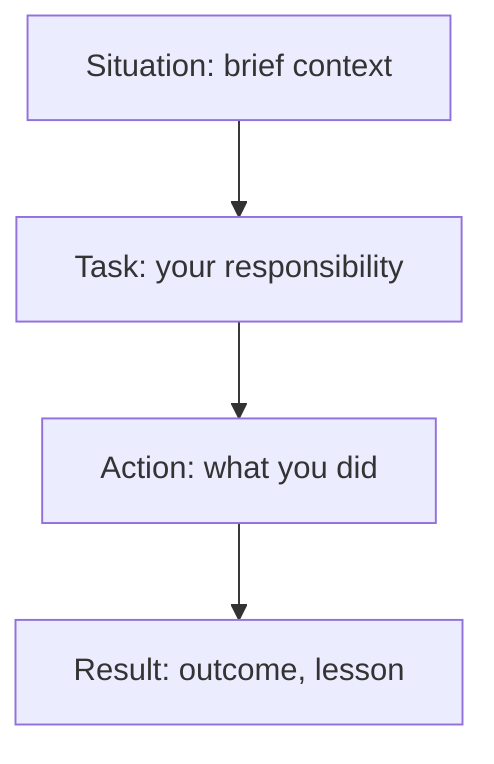

## In one line
STAR is a four-part shape for answering "Tell me about a time when..." questions: the Situation, your Task, the Actions you took, and the Result, with most of your time spent on what you did.

## The problem it solves
**Behavioural questions** ask about your past behaviour, on the idea that how you handled things before predicts how you'll handle them again. They usually start with "Tell me about a time...":

- "...you had to learn something new quickly."
- "...you disagreed with a teammate."
- "...you made a mistake."
- "...you had a tight deadline."

Without a structure, answers go wrong in predictable ways: two minutes of background and ten seconds of action, hypothetical answers ("I would talk to them"), "we" throughout, or a story that just stops with no outcome.

Interviewers often score these answers against a list of qualities, such as ownership or teamwork. A clear shape makes it easy for the interviewer to find what they're scoring.

## Everyday analogy
A good bug report. It gives the context (which page, which browser), what should have happened, the steps taken, and the outcome. Anyone can follow it without asking questions.

Where it breaks down: a bug report is neutral and impersonal. A STAR answer is a spoken story about **you**. It should show your judgment, and even how you felt ("I was worried we'd miss the launch"), because that is what's being assessed.

## How it works
### The four parts
| Part | What it answers | Share of a 2-minute answer |
|---|---|---|
| **S**ituation | Where and when? Just enough context to follow. | About 15% |
| **T**ask | What was your responsibility or goal? What made it hard? | About 10% |
| **A**ction | What did **you** do, step by step, and why? | About 60% |
| **R**esult | What happened? What changed? What did you learn? | About 15% |

The percentages are a rough guide, not a rule. The key point: **Action is the heart of the answer.** It's where your decisions, skills, and judgment show.

In the Action, use "I", give 2 to 4 concrete steps, say **why** you chose each, and include one decision where you weighed options. In the Result, use real numbers if you have them, a clear description if you don't, and one sentence on what you learned.

*Notice: one box, Action, carries most of the answer. The others exist to make it understandable.*

### The story bank
You can't prepare an answer for every possible question, but you don't need to. Prepare **five or six real stories** in STAR shape, and you can adapt them to most questions. One story about learning a new area under pressure fits "learned quickly", "tight deadline", and "stepped outside your comfort zone".

| Theme interviewers ask about | Your story (one line) |
|---|---|
| Learning something new fast | |
| A mistake you made | |
| Disagreement or conflict | |
| Tight deadline or pressure | |
| Ownership: fixed something nobody asked you to | |
| A production problem | (see [Tell me about a production bug](#/topic/production-bug-story)) |

## Real example
**Question:** "Tell me about a time you had to learn something new quickly."

**A weak answer:**

> "We had to move our backend to Docker, so we learned Docker and moved everything over. It was hard, but we got it done and it works well now."

**A STAR answer** (an example: build yours from your own experience):

> **Situation:** "I was a React developer on a small team building an online shop with product videos. Our only backend developer left two weeks before we were due to launch video uploads."
>
> **Task:** "I volunteered to take over the upload feature and the deployment, though I'd never run a production server or used Docker seriously."
>
> **Action:** "First I read through the existing code with an AI assistant, asking it to explain each part, and I wrote down every piece I didn't understand. I spent two evenings on the Docker docs and got the whole app running locally in Docker Compose, so I could break things safely. The original plan sent videos through our Node API. When I tested with a 500 MB file, the API's memory jumped and other requests slowed down. So I switched to presigned S3 uploads, where the browser uploads straight to storage. I asked a backend developer friend to review the design, because I didn't want to trust my own judgment alone on something new."
>
> **Result:** "We launched on the planned date. Uploads went straight to S3 and the API stayed responsive. What I took from it: when I'm learning something new, I build a safe local copy first, and I get an experienced person to review the risky decisions."

Notice the Action: specific steps, a reason for each, a problem found by testing, and a decision with a "why".

## How to say it in an interview

> [!INTERVIEW]
> **30 seconds** (a compact STAR for "Tell me about a mistake you made"): "I built an endpoint that returned all of a user's orders with no pagination. It was fine in testing, but one large business customer had thousands of orders, and their page started timing out. I added pagination with a limit and a cursor, updated the frontend, and checked the other list endpoints for the same issue. Since then, I test with realistic data sizes, and every list endpoint gets pagination from the start."

> [!INTERVIEW]
> **2 minutes:** The same story, fuller:
>
> "**Situation:** On our shop app, I built the 'My orders' endpoint. In development each test user had five or ten orders, so it returned them all at once.
>
> **Task:** A few weeks after launch, support said one business customer couldn't open their orders page. It was my endpoint, so I took it.
>
> **Action:** I checked the logs for that user and saw the request taking over 20 seconds before timing out. They had several thousand orders, and we were loading every one with its items. The quick option was a higher timeout, but that would just make them wait longer. I added cursor-based pagination, 20 orders at a time, ordered by created date, and changed the React page to load more on scroll. I also checked our other list endpoints and found two more with the same problem.
>
> **Result:** Their page loaded in under a second, and the two other endpoints were fixed before anyone hit them. The tradeoff was a slightly more complex frontend. The lesson I took: test with realistic data volumes. I now seed my local database with large accounts, and pagination is part of my checklist for any list endpoint."

## Follow-up questions interviewers ask

"What would you do differently?"

Interviewers ask this after almost every story. Have one honest, specific improvement ready. For the orders story: "I'd have asked support what our largest customers looked like before building it, and tested with that size." Avoid "nothing".

"What exactly was your part, and what did the team do?"

This checks for over-claiming. Separate the two clearly: "I designed and built the pagination, and changed the frontend. A teammate reviewed it, and our QA person tested it with the large account." Being precise here builds trust.

"How did the other person react?" (after a conflict story)

They want to see that you listened and respected the other side. Describe their view fairly, what you learned from it, and how you reached agreement or a decision. A story where you were completely right and they were completely wrong sounds less mature than one where you both changed your minds a little.

"How did you measure the result?"

Give the measurement if you had one: response time from logs, a drop in support tickets, a deadline met. If you didn't measure, say so honestly, describe what you observed, and say what you'd measure next time.

## Common mistakes and misconceptions

> [!MISTAKE]
> Answering hypothetically: "I would talk to my teammate and find a compromise." The question asked about a time you did it. Tell a real story.

> [!MISTAKE]
> "We" throughout. The interviewer is hiring you, not your old team. Use "I" for your actions and name what others did.

> [!MISTAKE]
> Inventing or polishing stories until they're not true. Follow-up questions dig into details, and made-up details don't hold. A small true story beats an impressive false one.

> [!MISTAKE]
> A fake weakness for the mistake question, such as "I care too much". Pick a real, modest mistake, and show what you changed afterwards.

## Tradeoffs: when STAR doesn't fit
- **Technical questions aren't STAR questions.** "How does an index work?" needs an explanation, not a story. Use STAR when the question asks about a time something happened.
- **Don't say the labels out loud.** "The situation was... the task was..." sounds robotic. Use the shape and let it be invisible.
- **Not every story has a happy result.** If it ended badly, say so, and make the Result about what you learned and changed. That's often a stronger answer.

## Check yourself

1. What do the four letters stand for, and which part gets the most time?

Situation, Task, Action, Result. Action gets the most time, roughly 60%, because it shows what you did and why.

2. "I would sit down with them and talk it through." What's wrong with this answer to "Tell me about a disagreement"?

It's hypothetical. The question asked about a real past event. The interviewer can't assess what you might do, only what you did.

3. Why prepare five or six stories instead of one answer per possible question?

There are too many possible questions, but they cluster into a few themes. A handful of real stories, each adaptable to several themes, covers most of them, and you'll tell them more naturally than dozens of memorised answers.

## Go deeper
- [MIT Career Advising: The STAR method for behavioral interviews](https://capd.mit.edu/resources/the-star-method-for-behavioral-interviews/)
- [Tech Interview Handbook: Behavioral interviews](https://www.techinterviewhandbook.org/behavioral-interview/)
