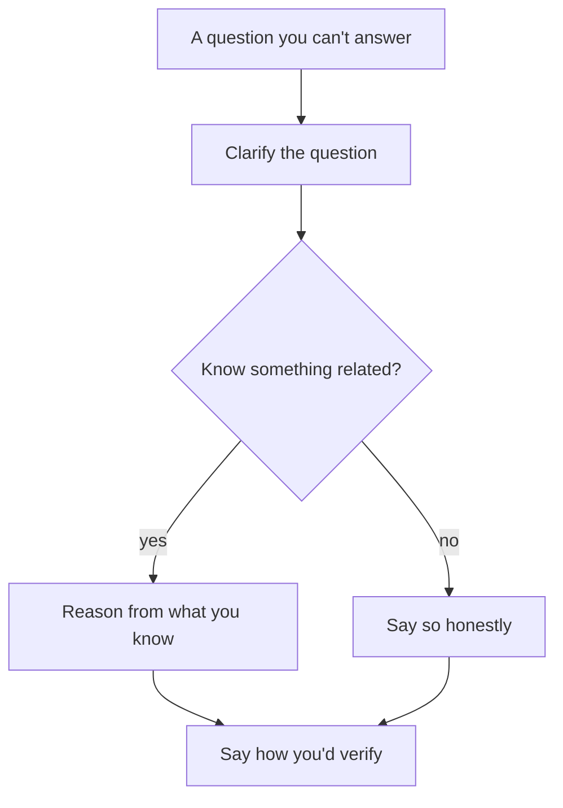

## In one line
When you don't know an answer, say so plainly, then show how you'd reason about it or find out, starting from what you do know.

## The problem it solves
Every interview reaches questions you can't answer. Often that's on purpose: many interviewers keep asking deeper follow-ups until they find the edge of your knowledge, because how you behave at that edge tells them a lot.

At that moment, people tend to do one of two things:

- **Bluff.** They give a confident answer they made up. The interviewer usually knows the answer, so the bluff is spotted, and now they doubt everything else you've said. That's worse than the gap itself.
- **Freeze.** "I don't know", then silence. Honest, but it wastes the chance to show how you think, which is often what's being tested.

On the job, nobody knows everything either. Teams want someone who says "I'm not sure, let me check" rather than someone who guesses confidently and breaks production.

## Everyday analogy
A good doctor faced with an unusual symptom. They don't invent a diagnosis, and they don't shrug. They say: "I'm not sure what's causing this yet. Here's what I can rule out, here's what I suspect, and here's the test that will tell us." Patients trust that more than a confident guess.

Where it breaks down: the doctor can then order the test. In an interview you usually can't look anything up, so reasoning out loud **is** the test.

## How it works
### The answer shape
1. **Pause, and clarify the question.** Sometimes you know the idea under another name. "Do you mean read replicas, or splitting data across servers?"
2. **Be honest about your level.** There's a big difference between "I haven't used Kafka in production" and "I've never heard of it". Say which it is.
3. **Connect to what you know.** "I've used BullMQ, which is also a queue, so I'd expect..."
4. **Reason out loud, and label guesses as guesses.** "My guess is X, because Y."
5. **Say how you'd find out or check it.** Official docs, a quick experiment, `EXPLAIN`, asking the team's expert.
6. **Optionally, invite correction.** "Is that roughly right?" Many interviewers will tell you, and you learn something.

*Notice: both paths end in the same place: showing how you would find the answer.*

### Useful phrases
- "I haven't worked with that directly, but here's how I'd think about it."
- "I'm not sure. My best guess is..., because..."
- "I know the general idea but not the details. Let me say what I know, and you can stop me."

## Real example
Three situations, with weak and strong answers.

**1. You know something related.** "How does Kafka keep messages in order?" You've used BullMQ but never Kafka.

> Weak: "Kafka keeps all messages in order, because it's a log." (A confident guess, and partly wrong.)
>
> Strong: "I haven't used Kafka in production. I've used BullMQ for background jobs. From what I've read, a Kafka topic is split into partitions, and I believe ordering is only guaranteed inside one partition, not across the whole topic. So if order matters per user, I'd expect you to route each user's messages to the same partition, using the user ID as the message key. I'd confirm that in the docs before relying on it."

That strong answer is correct, and even if a detail had been off, it shows understanding, clear labelling of what's uncertain, and a plan to check. See [BullMQ vs RabbitMQ vs Kafka](#/topic/bullmq-rabbitmq-kafka).

**2. You've never heard of it.** "What's a Bloom filter?"

> Weak: (silence), or a made-up description.
>
> Strong: "I haven't come across Bloom filters. From the name, I'd guess it's some kind of filter, but I'd rather not guess at details. Can you tell me where it's used? Then I can at least reason about why someone would pick it."

Asking for context turns a dead end into a conversation. If the interviewer explains, listen and respond to it. That shows you can learn quickly.

**3. You knew it, but your mind went blank.**

> Strong: "I know this one, it's just not coming to me. Can I come back to it in a minute?" Or start from a nearby fact and work towards it: "OK, a 401 is about not being logged in... so a 403 is when you are logged in but not allowed."

Talking around the topic often brings the answer back.

## How to say it in an interview

> [!INTERVIEW]
> **30 seconds** (for "Have you used Kubernetes?" when you haven't): "Not in production. I deploy with Docker Compose on Ubuntu servers, over SSH, so I know containers, images, health checks, and restart behaviour well. From what I understand, Kubernetes does a similar job across many machines: it keeps a set number of containers running, restarts or reschedules them, and routes traffic to healthy ones. I'd expect to pick it up quickly on top of that base, and I'd start with the official tutorials."

> [!INTERVIEW]
> **2 minutes** (for "How would you shard a PostgreSQL database?" when you never have): "I haven't sharded a database myself, so let me reason it through and tell you where I'm unsure.
>
> Sharding means splitting the data across several database servers, so each holds part of it. The first decision would be the shard key: the column that decides which server a row lives on. For our shop, user ID seems natural, because most queries are about one user's orders, so each query would hit one shard.
>
> The tradeoff is that anything across users gets hard. A report of 'all orders yesterday' has to ask every shard and combine the results, and joins across shards aren't simple. Moving data when you add a shard is also painful, I believe, which is why people plan the key carefully.
>
> Before sharding, I'd check if we really need it: better indexes, caching, and read replicas for read-heavy load usually go a long way. I know there are extensions like Citus that handle sharding for Postgres, but I'd need to read up on how they work. Is that the direction you were thinking of?"

## Follow-up questions interviewers ask

"Just take a guess."

Then guess, and label it. "My guess is that it's about ordering within a partition, because that's how I'd design it. I'm not certain." A labelled guess with a reason shows thinking. Refusing to guess looks stubborn. Guessing without labelling it looks like bluffing.

"How would you find out?"

Be specific. Name the source and the check. "I'd read the official docs for that feature, then try it locally: start Postgres in Docker, create the table, and run `EXPLAIN ANALYZE` to see what actually happens." Specific steps show you know how to learn. "I'd Google it" sounds like you don't.

"It's on your CV. Why don't you know it?"

This is why you should only list what you can discuss. If it happens, be honest about your level: "I used it for one feature two years ago, through a library, so I'm rusty on the internals. Here's what I did with it." Then remove it, or prepare it, before the next interview.

"What would you do if this happened in production and you didn't know the answer?"

Show a safe process: protect users first (roll back, or disable the feature), collect evidence (logs, metrics), check documentation, and ask for help early from whoever knows the system. Say you'd note what you learned for next time. Asking for help quickly is a strength, not a weakness. See [Scenario: server down at 2 AM](#/topic/scenario-server-down).

## Common mistakes and misconceptions

> [!MISTAKE]
> Bluffing. A confident wrong answer is worse than "I don't know", because it makes the interviewer doubt your correct answers too.

> [!MISTAKE]
> Saying "I don't know" and stopping. You give up the chance to show reasoning, which is often what the question was for.

> [!MISTAKE]
> Over-apologising. "Sorry, I'm so bad at this, sorry..." makes the gap feel bigger than it is. Say it once, plainly, and move on to what you know.

> [!MISTAKE]
> Inventing experience: "Yes, I've used Kubernetes" when you've only read about it. The next question ("how did you handle config and secrets?") exposes it.

## Tradeoffs: the limits of honesty
- **Honesty doesn't replace preparation.** "I don't know" is fine for advanced or unusual topics. For basics listed as must-know on this site, such as HTTP status codes, indexes, or the event loop, it's a real problem. Study those.
- **Don't overuse it on your own work.** Not knowing details of a system you claim to have built raises doubts. Prepare your projects deeply (see [Explaining your own project](#/topic/explain-your-project)).
- **Long reasoning has a cost.** If you know nothing about a topic, a short honest answer beats three minutes of vague guessing.
- **In live coding, it's normal not to remember exact APIs.** "I don't remember if it's `splice` or `slice` here, I'd check MDN" is fine. Interviewers care about the approach.

## Check yourself

1. What's the difference between a labelled guess and a bluff?

A labelled guess is presented as a guess, with a reason: "My guess is X, because Y, but I'd confirm it." A bluff is presented as fact. If the guess is wrong, the first still shows good thinking; the second damages trust.

2. You've never heard of a term the interviewer uses. What's a good first move?

Say so honestly, and ask for context: "I haven't come across that. Where is it used?" That turns a dead end into a conversation where you can reason and show you learn quickly.

3. Why is "I'd Google it" a weaker answer to "how would you find out?" than naming a source and a test?

It doesn't show how you'd judge what you find. Naming official docs and a quick experiment, like running a query with `EXPLAIN` locally, shows you know where reliable answers are and how to verify them.

## Go deeper
- [Tech Interview Handbook: Coding interview best practices](https://www.techinterviewhandbook.org/coding-interview-cheatsheet/)
